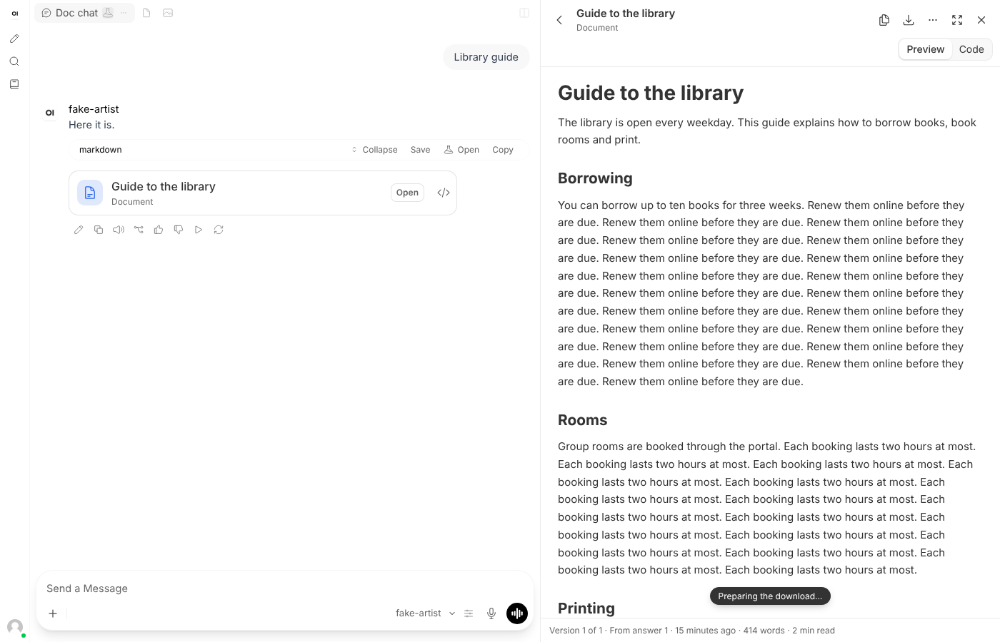
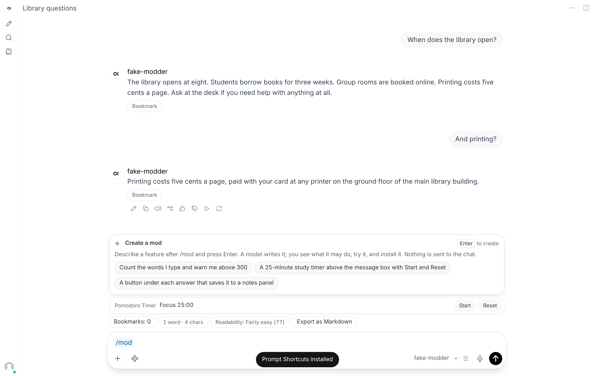
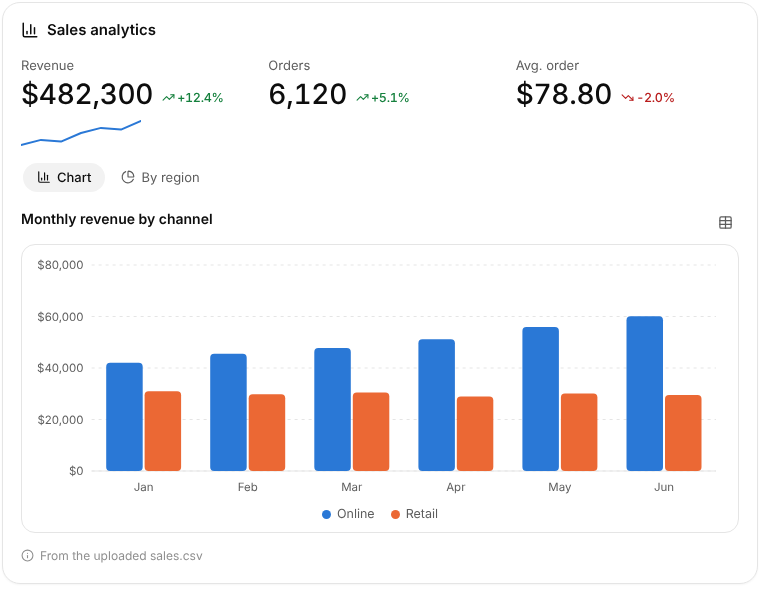
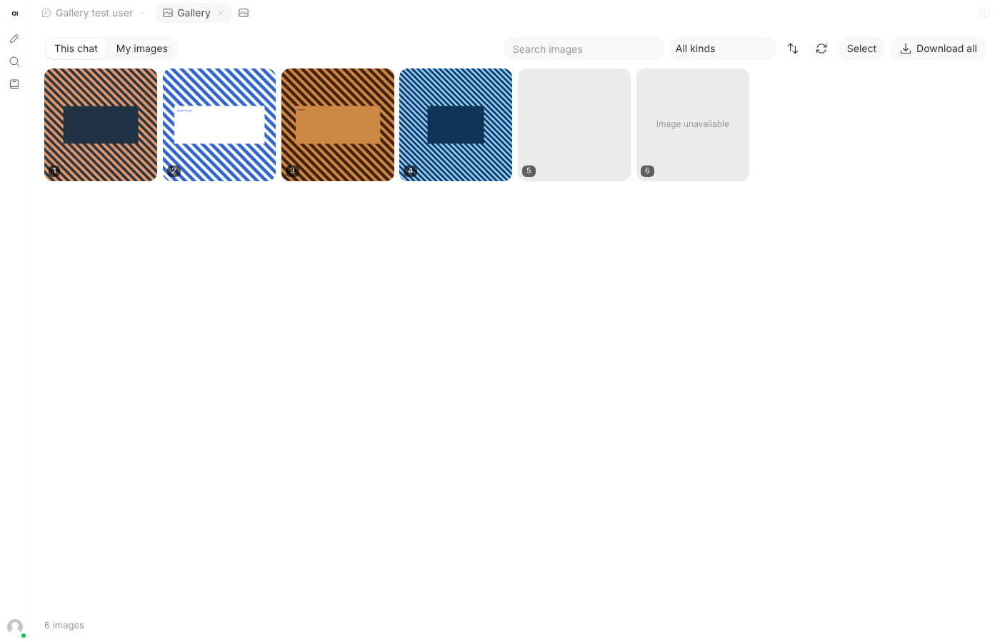
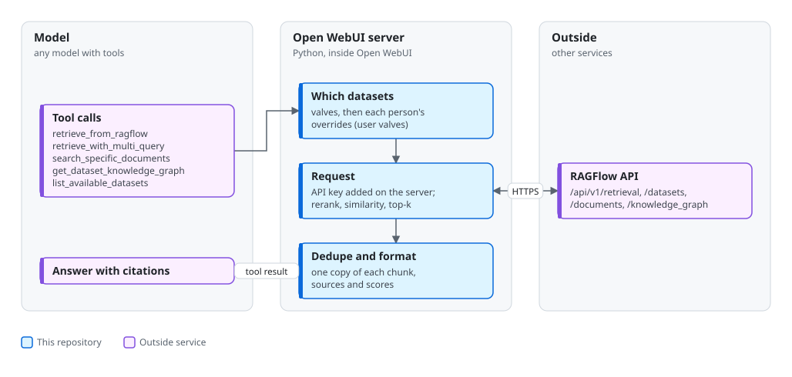
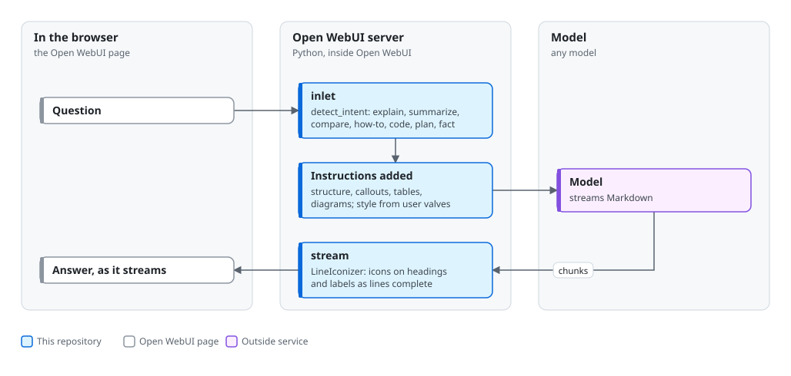
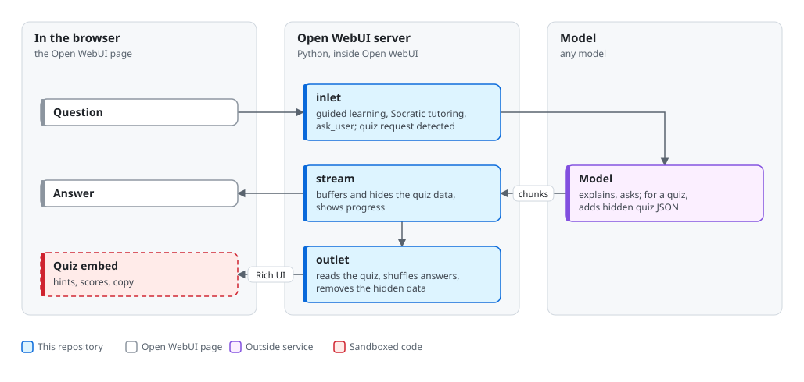
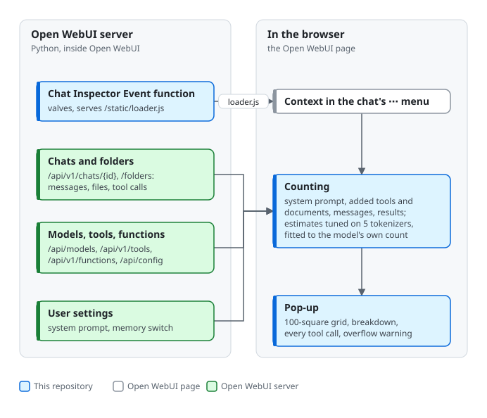
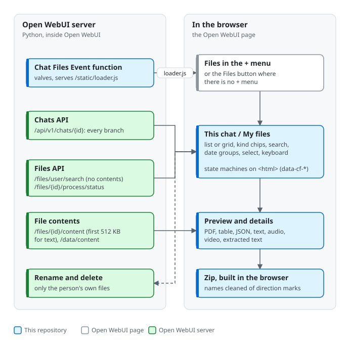
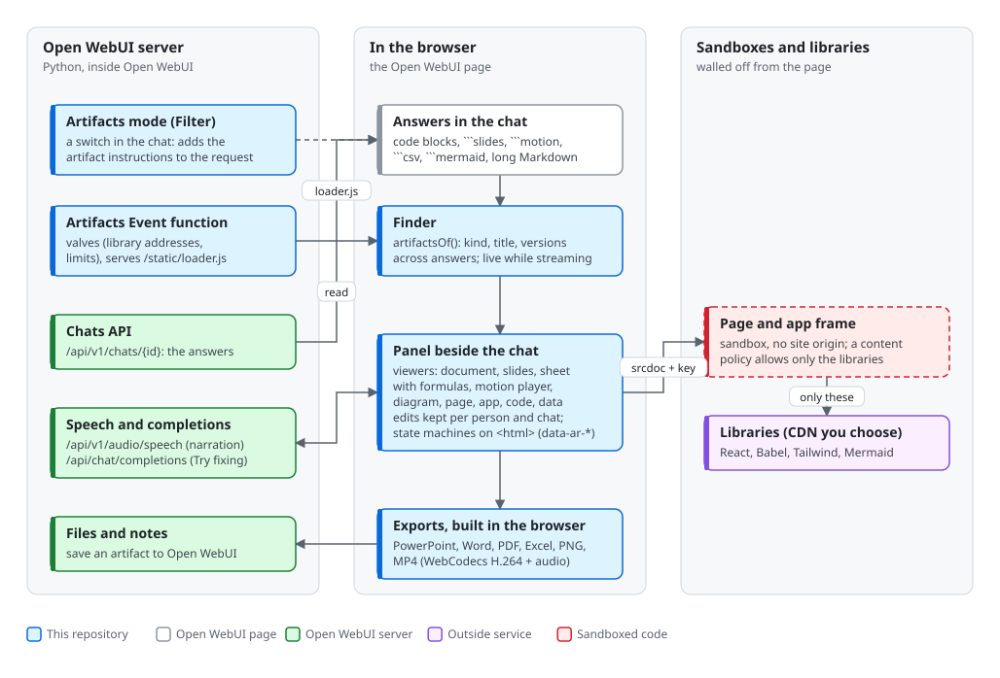

# Open WebUI Extensions

Twelve extensions for [Open WebUI](https://github.com/open-webui/open-webui), built for a university deployment and written so anyone can install them. Some change how answers look, some add whole new tabs and panels, and one lets people build small features for themselves by describing them.

Every extension is a single Python file you paste into Open WebUI. Each folder has its own README, a changelog, tests, and a diagram of how it works. Read the code before you install anything: Open WebUI runs it on your server.

## What they look like

| [Artifacts](functions/events/chat-artifacts/) | [Mods](functions/events/chat-mods/) | [Generative UI](tools/generative-ui/) |
| --- | --- | --- |
|  |  |  |
| [Chat Files](functions/events/chat-files/) | [Chat Gallery](functions/events/chat-gallery/) | [Chat Inspector](functions/events/chat-inspector/) |
|  |  |  |

## How they fit into Open WebUI


Open WebUI gives plugins four places to run, and this repository uses all of them.

Filters sit in the chat pipeline. They see the request on its way to the model (`inlet`), each chunk as it streams back (`stream`), and the finished answer (`outlet`). Rich Responses, Study Mode and Artifacts mode work this way.

Tools are functions the model decides to call. Generative UI, the Email Composer and the RAGFlow connector are Tools. The first two answer with an HTML embed, which Open WebUI shows in a sandboxed iframe inside the answer.

Actions are buttons under an answer. Quick Actions is one.

Event functions react to things that happen on the server: a sign-up, a login, a settings change. Secure Onboarding uses them to build a welcome chat. The browser features (Chat Inspector, Gallery, Files, Artifacts and Mods) use them differently. They publish a script through [Classic298's Shared Assets Protocol](https://github.com/Classic298/open-webui-plugins/tree/main/shared-assets-protocol), which Open WebUI loads on every page from `/static/loader.js`. That script then works in the browser with the signed-in person's own access, through Open WebUI's normal API. These five add no server routes of their own, and they can sit side by side because they share that one loader.

## Extensions

| Extension | Type | Version | What it does |
| --- | --- | --- | --- |
| [Generative UI](tools/generative-ui/) | Tool + Filter | 1.2.0 | Interactive cards in answers: charts, tables, calculators, checklists, comparisons, timelines, diagrams, maps, live weather. The model writes a JSON spec; the Tool validates it and renders it. |
| [Rich Email Composer](tools/email-composer/) | Tool | 1.0.0 | An editable email card in the chat, with formatting, recipient checks, *Ask for changes*, copy, `.eml` export and a hand-off to the person's own mail app. |
| [RAGFlow Advanced Connector](tools/ragflow/) | Tool | 3.0.0 | Retrieval from RAGFlow: datasets, multi-query search, document search and knowledge graphs, with sources. |
| [Rich Responses](functions/filters/rich-responses/) | Filter | 1.0.1 | Works out what kind of answer is wanted (explain, compare, how-to, ...), asks the model for a matching structure, and adds icons to headings as they stream. |
| [Study Mode](functions/filters/study-mode/) | Filter | 1.1.0 | Guided learning and Socratic tutoring, with interactive quizzes built from hidden data in the answer. |
| [Quick Actions](functions/actions/quick-actions/) | Action | 3.0.1 | A menu under each answer: rewrite, humanize, verify and more, plus actions people and teams define themselves. English and French. |
| [Secure Dynamic Onboarding](functions/events/secure-onboarding/) | Event | 9.3.0 | One pinned welcome chat per person, showing only what they are allowed to use, in English, French, Spanish or Catalan, kept up to date as permissions change. |
| [Chat Inspector](functions/events/chat-inspector/) | Event | 1.2.0 | *Context* in the chat menu: how full the model's context window is, what fills it, and every tool call, fitted to the model's own token count. |
| [Chat Gallery](functions/events/chat-gallery/) | Event | 1.1.0 | A Gallery tab with every image in the chat and in the person's files: zoom, generation details, zip, delete. A maintained fork of @G30's Chat Gallery. |
| [Chat Files](functions/events/chat-files/) | Event | 2.0.0 | A Files tab with every document in the chat and in the person's account, as a list or a grid, with previews, rename, delete and zip. |
| [Artifacts](functions/events/chat-artifacts/) | Event + Filter | 1.4.0 | Documents, slides, spreadsheets, motion graphics, diagrams, pages and apps open in a panel beside the chat, with versions, edits and exports (PowerPoint, Word, PDF, Excel, MP4). Generated code runs in a sandbox. |
| [Mods](functions/events/chat-mods/) | Event | 1.0.0 | Type `/mod` and describe a feature; a model writes it, Mods checks and test-runs the code, and it appears. Each mod runs in a sandbox, limited to the permissions it was given. |

## How each one works

Each diagram is drawn from the code. Blue boxes are this repository, green is Open WebUI itself, purple is outside services, and the dashed red boxes are sandboxed code. Click a name for the full README.

### [Generative UI](tools/generative-ui/)


The model never writes HTML. It writes one JSON spec, and the Tool does the rest: it repairs common JSON mistakes, keeps only the fields each component allows, fetches live weather or images when the spec asks, and builds a self-contained card with its own renderer. No CDN is involved, so the cards still work on servers with no internet access. More in [ARCHITECTURE.md](tools/generative-ui/ARCHITECTURE.md).

### [Rich Email Composer](tools/email-composer/)


The server never sends mail. *Send* opens the draft in the person's own mail app, which keeps credentials out of Open WebUI and stops a draft card from quietly turning into a mailer. Editing, formatting and the `.eml` export all happen in the card.

### [RAGFlow Advanced Connector](tools/ragflow/)



The RAGFlow API key stays on the server. Each person can narrow the datasets through their own settings, and the connector removes duplicate chunks before the model sees them.

### [Rich Responses](functions/filters/rich-responses/)



Two small jobs. On the way in, it guesses the kind of answer from the question and adds instructions for that shape. On the way out, it adds an icon to each heading as soon as the line is complete, so the answer looks right while it is still streaming.

### [Study Mode](functions/filters/study-mode/)



Quizzes travel inside the answer as hidden data. The Filter keeps that data out of sight while the answer streams, then turns it into an interactive quiz with shuffled answers and removes the raw data from the saved message.

### [Quick Actions](functions/actions/quick-actions/)


It looks at the answer before offering anything, so a code block gets different actions from a paragraph. The finished prompt lands in the message box for review, or is sent straight away, depending on the person's setting.

### [Secure Dynamic Onboarding](functions/events/secure-onboarding/)


The guide is rebuilt from a snapshot of what the person can actually use: their permissions, models, tools, prompts and knowledge. It only rewrites the welcome chat when that snapshot changes, and by default it doesn't bring back a chat someone deleted. A Redis lock stops two workers from creating the same chat twice.

### [Chat Inspector](functions/events/chat-inspector/)



It only reads. It never polls and adds nothing to the request. Token counts are estimates tuned against five real tokenizers, then fitted to the prompt size the model itself reported, when it reported one.

### [Chat Gallery](functions/events/chat-gallery/) and [Chat Files](functions/events/chat-files/)




Two tabs built the same way, and designed to sit together: Gallery takes the images, Files takes everything else. Both read through Open WebUI's API as the signed-in person, so nobody sees a file they couldn't open anyway. Zips are built in the browser.

### [Artifacts](functions/events/chat-artifacts/)



Artifacts are found in ordinary answers, so any model works. Pages and apps run in a frame with no site origin, behind a content policy that allows only the libraries the administrator configured. Every export, MP4 video included, is built in the browser. More in [ARCHITECTURE.md](functions/events/chat-artifacts/ARCHITECTURE.md).

### [Mods](functions/events/chat-mods/)


The interesting part is Create. A model's first answer is often wrong in small ways, so Mods reads it leniently, checks it, and test-runs it in a throwaway sandbox before anyone sees it. Anything that fails goes back to the model, up to three times. Installed mods run one per sandboxed frame, with no network, and every request they make is checked against what the person allowed. More in [ARCHITECTURE.md](functions/events/chat-mods/ARCHITECTURE.md).

The diagrams are generated by [`docs/diagrams/build.py`](docs/diagrams/build.py) from [`docs/diagrams/specs.py`](docs/diagrams/specs.py). Change a spec and run `python docs/diagrams/build.py` to redraw them.

## Repository structure

```text
.
├── README.md
├── LICENSE
├── SECURITY.md
├── CONTRIBUTING.md
├── CHANGELOG.md
├── RELEASING.md
├── docs/
│   ├── architecture.svg
│   └── diagrams/
│       ├── build.py          draws every architecture diagram
│       └── specs.py          what each diagram shows
│
├── tools/
│   ├── README.md
│   ├── generative-ui/
│   │   ├── README.md
│   │   ├── ARCHITECTURE.md
│   │   ├── CHANGELOG.md
│   │   ├── generative_ui.py
│   │   ├── screenshots/
│   │   └── tests/
│   │       ├── browser_test.js
│   │       ├── build_demos.py
│   │       ├── demos.py
│   │       └── test_generative_ui.py
│   ├── email-composer/
│   │   ├── README.md
│   │   ├── CHANGELOG.md
│   │   ├── SOURCE_SHA256
│   │   ├── email_composer.py
│   │   ├── test_email_composer.py
│   │   └── unpack_source.py
│   └── ragflow/
│       ├── README.md
│       ├── CHANGELOG.md
│       └── ragflow.py
│
└── functions/
    ├── README.md
    ├── filters/
    │   ├── README.md
    │   ├── rich-responses/
    │   │   ├── README.md
    │   │   ├── CHANGELOG.md
    │   │   ├── rich_responses.py
    │   │   └── test_rich_responses.py
    │   └── study-mode/
    │       ├── README.md
    │       ├── CHANGELOG.md
    │       ├── test_study_mode.py
    │       └── study_mode.py
    ├── pipes/
    │   └── README.md
    ├── actions/
    │   ├── README.md
    │   └── quick-actions/
    │       ├── README.md
    │       ├── CHANGELOG.md
    │       ├── quick-actions-icon.svg
    │       └── quick_actions.py
    └── events/
        ├── README.md
        ├── chat-artifacts/
        │   ├── README.md
        │   ├── ARCHITECTURE.md
        │   ├── CHANGELOG.md
        │   ├── artifacts_mode.py
        │   ├── chat_artifacts.py
        │   ├── screenshots/
        │   └── tests/
        │       ├── e2e.mjs
        │       ├── fake_model.py
        │       ├── seed.py
        │       └── test_chat_artifacts.py
        ├── chat-mods/
        │   ├── README.md
        │   ├── ARCHITECTURE.md
        │   ├── CHANGELOG.md
        │   ├── chat_mods.py
        │   ├── screenshots/
        │   └── tests/
        │       ├── e2e.mjs
        │       ├── fake_model.py
        │       ├── seed.py
        │       └── test_chat_mods.py
        ├── chat-files/
        │   ├── README.md
        │   ├── ARCHITECTURE.md
        │   ├── CHANGELOG.md
        │   ├── chat_files.py
        │   ├── screenshots/
        │   └── tests/
        │       ├── e2e.mjs
        │       ├── seed.py
        │       └── test_chat_files.py
        ├── chat-inspector/
        │   ├── README.md
        │   ├── ARCHITECTURE.md
        │   ├── CHANGELOG.md
        │   ├── chat_inspector.py
        │   ├── screenshots/
        │   └── tests/
        │       ├── e2e.mjs
        │       ├── fake_model.py
        │       ├── fit_tokens.py
        │       ├── seed.py
        │       ├── test_chat_inspector.py
        │       └── token_samples.json
        ├── chat-gallery/
        │   ├── README.md
        │   ├── ARCHITECTURE.md
        │   ├── CHANGELOG.md
        │   ├── chat_gallery.py
        │   ├── screenshots/
        │   └── tests/
        │       ├── e2e.mjs
        │       ├── seed.py
        │       └── test_chat_gallery.py
        └── secure-onboarding/
            ├── README.md
            ├── CHANGELOG.md
            ├── locales/
            │   ├── README.md
            │   ├── ca.json
            │   ├── en.json
            │   ├── es.json
            │   └── fr.json
            ├── secure_onboarding.py
            ├── smoke_secure_onboarding.mjs
            ├── sync_locales.py
            └── test_secure_onboarding.py
```

Each extension folder also has a `diagrams/architecture.svg`.

## Extension types

| Type | What it is | Where it runs |
| --- | --- | --- |
| Tool | A function the model can call, such as an API or data source | Server, when the model asks |
| Filter | Changes the request, the stream, or the finished answer | Server, on every message |
| Pipe | A custom model, provider, router or workflow | Server |
| Action | A button under an answer | Server, when pressed |
| Event | Reacts to Open WebUI events (sign-ups, logins, saves) | Server; can publish a browser script |

Each category has its own README with the directory convention.

## Installation

Each extension has a dedicated README with its setup steps. In general:

- Tools are imported from **Workspace > Tools**.
- Functions are imported from **Admin Panel > Functions**.
- Review source code before enabling an extension.
- Put credentials and deployment-specific settings in Valves or environment-backed configuration, never directly in source files.

## Compatibility

The repository follows current Open WebUI plugin APIs. Individual extensions declare their own compatibility requirements when a hard minimum is necessary.

Rich Email Composer intentionally does not hard-code an Open WebUI `0.11.x` version requirement in its public Tool metadata. It relies on Rich UI embed/event capabilities described in its own README.

Study Mode and Quick Actions currently declare **Open WebUI 0.11.1 or newer** because they use current Function event APIs and interactive browser-side UI capabilities.

Generative UI declares **Open WebUI 0.12.0 or newer** because it relies on Tool embeds returned as `(HTMLResponse, context)` and the embed prompt messages checked against the 0.12.5 source.

Chat Inspector, Chat Gallery, Chat Files, Artifacts and Mods declare **Open WebUI 0.13.0 or newer**, the release that added the Tabs panel. Each was tested in a real browser on 0.13.0 and 0.13.3: Artifacts alone and with Inspector, Files and Gallery; Files with and without Gallery; Mods alone and with Files and Artifacts.

Secure Dynamic Onboarding declares **Open WebUI 0.11.3 or newer** because it uses current Event Function hooks, Rich UI embeds, effective permission catalogs, Notes, Channels, Calendar, Automations, and current chat storage APIs.

## Security

Open WebUI Tools and Functions execute Python on the Open WebUI server. Treat extensions as trusted server-side code.

This repository should not contain:

- API keys or passwords;
- private endpoints or internal IP addresses;
- personal or institutional email addresses;
- user data or private documents;
- deployment-specific secrets.

See [SECURITY.md](SECURITY.md) for the repository policy.

## Versioning and releases

Extensions are versioned independently using semantic versioning.

Recommended Git tag format:

```text
<plugin-name>-v<version>
```

Examples:

```text
generative-ui-v1.2.0
email-composer-v1.0.0
study-mode-v1.1.0
quick-actions-v3.0.1
ragflow-v3.0.0
secure-onboarding-v9.3.0
chat-gallery-v1.1.0
chat-inspector-v1.2.0
chat-files-v2.0.0
chat-artifacts-v1.4.0
chat-mods-v1.0.0
```

See [RELEASING.md](RELEASING.md) for the release checklist, tag convention, and suggested GitHub repository topics.

## Contributing

See [CONTRIBUTING.md](CONTRIBUTING.md) for the extension structure, documentation checklist, security expectations, and versioning rules.

## Changelog

Repository-level changes are tracked in [CHANGELOG.md](CHANGELOG.md).

Every extension also keeps its own changelog beside the implementation:

| Extension | Changelog | Latest |
| --- | --- | --- |
| Generative UI | [tools/generative-ui/CHANGELOG.md](tools/generative-ui/CHANGELOG.md) | `generative-ui-v1.2.0` |
| Rich Email Composer | [tools/email-composer/CHANGELOG.md](tools/email-composer/CHANGELOG.md) | `email-composer-v1.0.0` |
| RAGFlow Advanced Connector | [tools/ragflow/CHANGELOG.md](tools/ragflow/CHANGELOG.md) | `ragflow-v3.0.0` |
| Rich Responses | [functions/filters/rich-responses/CHANGELOG.md](functions/filters/rich-responses/CHANGELOG.md) | `rich-responses-v1.0.1` |
| Study Mode | [functions/filters/study-mode/CHANGELOG.md](functions/filters/study-mode/CHANGELOG.md) | `study-mode-v1.1.0` |
| Quick Actions | [functions/actions/quick-actions/CHANGELOG.md](functions/actions/quick-actions/CHANGELOG.md) | `quick-actions-v3.0.1` |
| Secure Dynamic Onboarding | [functions/events/secure-onboarding/CHANGELOG.md](functions/events/secure-onboarding/CHANGELOG.md) | `secure-onboarding-v9.3.0` |
| Chat Inspector | [functions/events/chat-inspector/CHANGELOG.md](functions/events/chat-inspector/CHANGELOG.md) | `chat-inspector-v1.2.0` |
| Chat Gallery | [functions/events/chat-gallery/CHANGELOG.md](functions/events/chat-gallery/CHANGELOG.md) | `chat-gallery-v1.1.0` |
| Chat Files | [functions/events/chat-files/CHANGELOG.md](functions/events/chat-files/CHANGELOG.md) | `chat-files-v2.0.0` |
| Artifacts | [functions/events/chat-artifacts/CHANGELOG.md](functions/events/chat-artifacts/CHANGELOG.md) | `chat-artifacts-v1.4.0` |
| Mods | [functions/events/chat-mods/CHANGELOG.md](functions/events/chat-mods/CHANGELOG.md) | `chat-mods-v1.0.0` |

## License

Released under the [MIT License](LICENSE).
