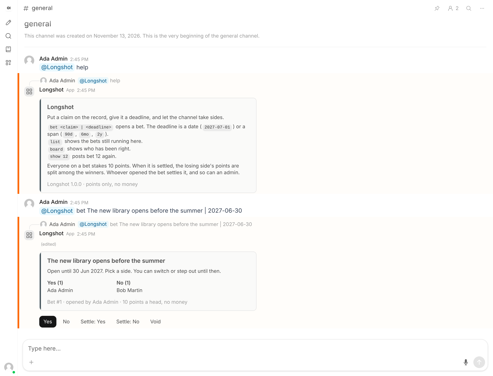
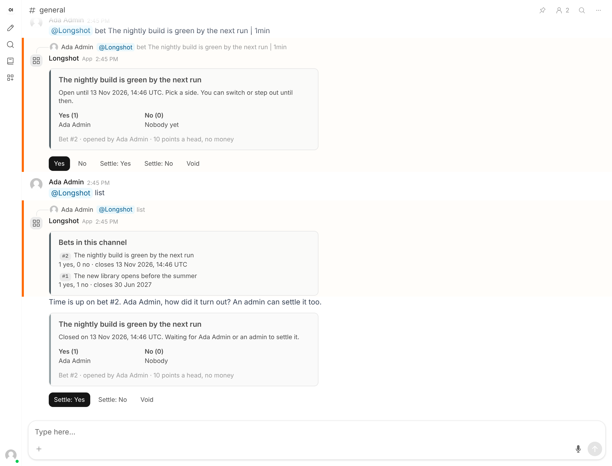
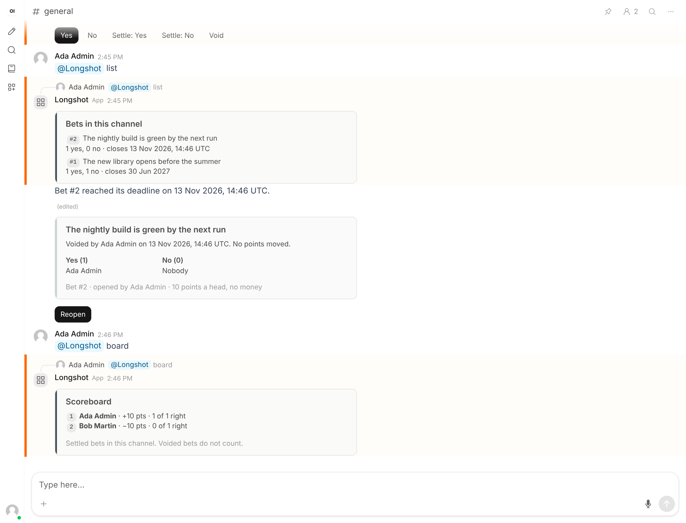

# Longshot

Long bets for Open WebUI channels. Someone puts a claim on the record with a deadline, the channel takes sides, and when the date arrives Longshot comes back and asks how it turned out. A scoreboard keeps track of who called it.

It grew out of [Pulse](../pulse/), the starter app in this repository, and keeps its shape: one Python file, run beside Open WebUI.



| | |
| --- | --- |
| Type | Channel app (external service, built with [oix](https://github.com/open-webui/oix)) |
| Version | 1.0.0 |
| Open WebUI | 0.13.3 or newer, with Apps and Channels enabled |
| Python | 3.11 or newer, `oix[fastapi]>=0.8.0`, `uvicorn[standard]` |

## Commands

Mention the app in a channel it was added to.

| Message | Result |
| --- | --- |
| `@Longshot bet The new library opens before the summer \| 2027-06-30` | Opens a bet that closes at the end of that day, UTC |
| `@Longshot bet Our launch slips past March \| 90d` | Opens a bet that closes in 90 days |
| `@Longshot list` | Bets in this channel that are still open or waiting to be settled |
| `@Longshot board` | The scoreboard for this channel |
| `@Longshot show 12` | Posts bet 12 again, with working buttons |
| `@Longshot help` | The help card |

A deadline is a date written `YYYY-MM-DD`, or a span: `30min`, `12h`, `90d`, `6w`, `6mo`, `2y`. A month counts as 30 days and a year as 365. The longest a bet can run is twenty years. The text before the last `|` is the claim, so a claim may itself contain a `|`.

## How a bet runs

1. Whoever opens the bet is making the claim, so they start on Yes. They can switch.
2. Until the deadline, anyone who can use the app in that channel clicks Yes or No. Clicking the other side switches; clicking the same side again steps out. The card updates for everyone.
3. At the deadline, picks stop. Within about 15 seconds Longshot posts the bet again, in the same thread, and asks the opener how it turned out.
4. The opener or an admin clicks Settle: Yes, Settle: No or Void. They can also do this before the deadline, if the answer is already known.
5. The card then shows who was right and what each person won or lost. Reopen undoes a wrong call.



## Points

Nobody pays anything. Each person on a bet stakes 10 points, and when it is settled the losing side's points are split evenly among the winners. Three people wrong and one right gives the one +30; three right and one wrong gives each of the three +3.3. Being right against the crowd pays more than agreeing with it, which is the point of the game.

If everyone picked the same side there is nobody to collect from, so no points move, though the call still counts toward each person's record. A voided bet counts for nothing.

The scoreboard is worked out from the settled bets each time it is asked for. Reopening a bet takes its points back off the board.



## Run it

```bash
python -m pip install "oix[fastapi]>=0.8.0" "uvicorn[standard]"
```

```bash
python longshot.py
```

On first start Longshot creates an API key and an Ed25519 signing key in `data/` beside the script, then prints the App URL and the key. The same key is printed on every start.

In Open WebUI, signed in as an admin:

1. Settings > Admin > General: turn on Apps and Channels, save.
2. Settings > Admin > Apps: click the plus button, enter the App URL and API Key, Continue, keep both scopes, Continue, Connect.
3. In a channel: click the member count, Add Member, pick Longshot under Apps, Add.
4. Type `@Long`, choose Longshot from the list, then `help`.

Where Open WebUI can reach the app decides the App URL:

- Same machine: `http://127.0.0.1:8000/events`, with `APP_ALLOWED_PRIVATE_ORIGINS=http://127.0.0.1:8000` set on the Open WebUI process.
- Open WebUI in Docker, app on the host: `http://host.docker.internal:8000/events`, with the same variable set to `http://host.docker.internal:8000`.
- Different machines: a public HTTPS address that forwards WebSockets to port 8000, plus `/events`. HTTPS needs no `APP_ALLOWED_PRIVATE_ORIGINS`.

## Keeping it running

Longshot is one process with one SQLite file, which is enough for a team. On a Linux server, a systemd unit keeps it up across reboots:

```ini
[Unit]
Description=Longshot channel app
After=network-online.target

[Service]
User=longshot
WorkingDirectory=/opt/longshot
Environment=LONGSHOT_DATA_DIR=/var/lib/longshot
Environment=HOST=127.0.0.1
ExecStart=/opt/longshot/venv/bin/python longshot.py
Restart=on-failure

[Install]
WantedBy=multi-user.target
```

Put a reverse proxy with TLS in front of it and make sure the proxy passes WebSocket upgrades on `/events/socket.io/`. `GET /healthz` answers without a key and returns the version, for uptime checks. Back up the whole data directory: it holds the bets and the signing key.

| Variable | Default | Meaning |
| --- | --- | --- |
| `PORT` | `8000` | Port to listen on |
| `HOST` | `0.0.0.0` | Address to listen on. Use `127.0.0.1` behind a proxy on the same machine |
| `LONGSHOT_DATA_DIR` | `data/` beside the script | Where the keys and `longshot.db` are kept |
| `API_KEY` and `APP_PRIVATE_KEY_FILE` | unset | Supply your own credentials. Both must be set |

## Permissions and data

- Longshot asks for two scopes, `channels:mentions:read` and `channels:messages:write`. It receives only the messages that mention it and never reads other messages or history.
- It stores each claim, its deadline, and the Open WebUI user ID and display name of the opener and of everyone who picked a side, in `data/longshot.db`, unencrypted. Picks are public by design: the card names who is on which side.
- Only the opener or an Open WebUI admin can settle, void or reopen a bet. Open WebUI confirms who clicked before the app acts, and everyone else gets a private refusal.
- A bet belongs to the channel it was opened in. Its buttons do nothing from another channel, and `list`, `board` and `show` see only the current channel.
- Anyone who has the API key can install the app on their own Open WebUI. Keep the data directory private. It is ignored by Git here.

## Tests

`test_longshot.py` starts the app and connects a stand-in Open WebUI that speaks the same protocol: 18 tests covering deadlines, payouts, permissions, the deadline notice and restarts.

```bash
python -m pip install "oix[fastapi]>=0.8.0" "uvicorn[standard]" pytest pytest-asyncio
```

```bash
python -m pytest -q test_longshot.py
```

The same flows were run in a browser against Open WebUI 0.13.3 with an admin and a second, ordinary account.

## Known limitations

- The opener settles their own bet, and usually has a side in it. Longshot does not referee; it shows who settled, and an admin can reopen. For a bet where that is not enough, agree on a judge first and have an admin settle.
- An old copy of a card keeps the buttons it was posted with. It corrects itself the next time someone clicks it, and the notice at the deadline is always current.
- If the app is down at a deadline, the notice goes out when it is back and Open WebUI has reconnected. If Open WebUI refuses the notice, for example because the app was removed from the channel, it is not sent again; `list` still shows the bet as waiting.
- Display names are stored as they were when a person last picked a side.
- One process only. Several replicas would each run the deadline check.
- Times are UTC. Apps are marked experimental in Open WebUI and the protocol may change. Apps cannot join direct messages.
