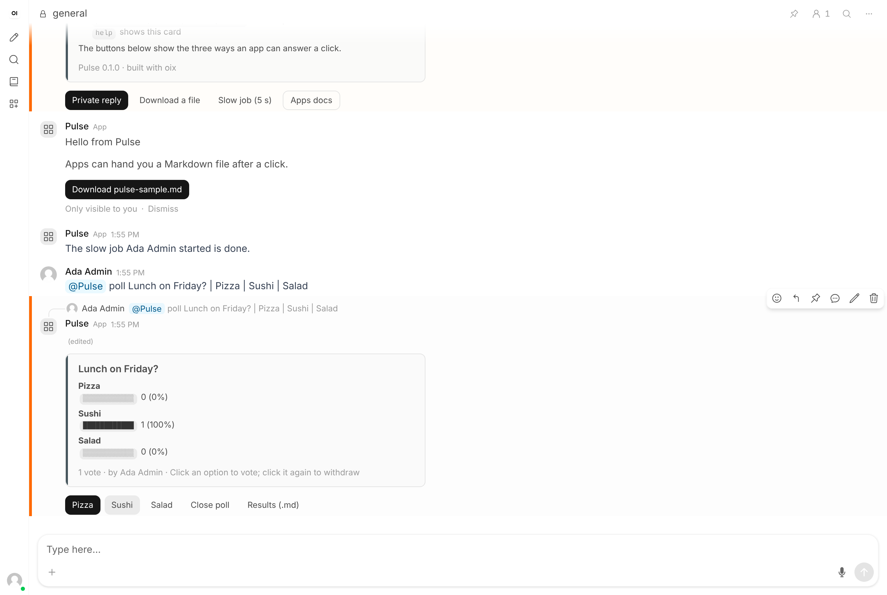

# Pulse

A small Open WebUI **channel app**: polls with live vote buttons, plus a help card whose buttons show each way an app can answer a click. It is meant as a first app to install, read and change.

| | |
| --- | --- |
| Type | Channel app (external service, built with [oix](https://github.com/open-webui/oix)) |
| Version | 0.1.1 |
| Open WebUI | 0.13.3 or newer, with **Apps** and **Channels** enabled |
| Python | 3.11 or newer, `oix>=0.8.0` |

Unlike the Tools and Functions in this repository, an app is not pasted into Open WebUI. It is a separate program that you run; Open WebUI connects to it.



## What it does

Mention the app in a channel it was added to:

| Message | Result |
| --- | --- |
| `@Pulse poll Lunch? \| Pizza \| Sushi \| Salad` | A poll card with one button per option |
| `@Pulse help` (or anything else) | A help card with demo buttons |

On a poll:

- An option button records your vote, moves it, or withdraws it on a second click. The card updates in place for everyone.
- **Results (.md)** gives you a Markdown table of votes and voters as a download, visible only to you.
- **Close poll** works for the poll's creator and for admins; other people get a private error.

On the help card:

- **Private reply** answers only you, under the card.
- **Download a file** hands you a Markdown file.
- **Slow job (5 s)** acknowledges the click at once, then posts in the channel five seconds later. This is the pattern for work that takes longer than the three seconds a click allows.
- **Apps docs** is a link button; it opens a page and never reaches the app.

## Run it

```bash
python -m pip install "oix>=0.8.0"
```

```bash
python pulse.py
```

On first start Pulse creates an API key and an Ed25519 signing key in `data/` next to the script, then prints what to enter in Open WebUI:

```text
Pulse is starting.
  App URL  http://127.0.0.1:8000/events
  API key  3f9c...
```

Keep it running. The same key is printed on every start.

## Connect it to Open WebUI

Open WebUI refuses plain HTTP and private addresses unless you list the app's origin. Set this **on the Open WebUI process** and restart it:

```bash
APP_ALLOWED_PRIVATE_ORIGINS=http://127.0.0.1:8000
```

If Open WebUI runs in Docker and Pulse on the host, `127.0.0.1` is the container itself. Use `http://host.docker.internal:8000` for both the variable and the App URL, and on Linux start the container with `--add-host=host.docker.internal:host-gateway`.

Then, signed in as an admin:

1. **Settings > Admin > General**: turn on **Apps** and **Channels**, save.
2. **Settings > Admin > Apps**: click the plus button. Enter the **App URL** and **API Key**, click **Continue**, keep both scopes, **Continue**, then **Connect**. The app should show **Connected**.
3. Open a channel, click the member count in its header, **Add Member**, pick **Pulse** under **Apps**, **Add**.
4. Send `@Pulse help`, choosing Pulse from the suggestion list.

## Configuration

| Variable | Default | Meaning |
| --- | --- | --- |
| `PORT` | `8000` | Port Pulse listens on |
| `PULSE_DATA_DIR` | `data/` beside the script | Where the keys and `polls.json` are kept |
| `API_KEY` and `APP_PRIVATE_KEY_FILE` | unset | Supply your own credentials, as in the oix README. Both must be set |

## Permissions and data

- Pulse requests two scopes: `channels:mentions:read` and `channels:messages:write`. It receives only messages that mention it, and never reads other messages or history.
- It stores each poll's question, options, and the ID and display name of the creator and of each voter in `data/polls.json`, unencrypted. Votes are not anonymous: the results file lists voters.
- Anyone who has the API key can install the app on their own Open WebUI. Keep `data/` private; it is ignored by Git here.
- Do not delete `data/app-private-key.pem`. Open WebUI pins its public key at install, and a new key means reinstalling the app.

## How it works

Open WebUI dials out to the app, so the app needs no address for Open WebUI.

1. Open WebUI sends `GET /events` with the API key and reads the manifest: ID, name, public key, requested scopes.
2. It opens a Socket.IO connection on `/events/socket.io`, namespace `/apps`. The app proves its identity by signing Open WebUI's challenge with its private key.
3. A mention arrives as a `channel.mention` event. oix checks it back with Open WebUI, confirms receipt, then runs the handler, which posts with `event.reply(...)`.
4. A button click arrives as `channel.action` and must be answered within three seconds. The handler's return value is the answer: a private reply, an `update` of the clicked message, a `download`, an `error` or an `ack`.

Two details that are easy to miss:

- Open WebUI finds the clicked button by its `action_id`, so IDs must be unique within one message. Pulse uses `vote:0`, `vote:1`, and so on, and carries the poll ID in each button's `context`.
- An `update` replaces content, cards and buttons together. Anything left out is removed, so Pulse rebuilds the whole card each time.

## Tests

`test_pulse.py` starts Pulse and connects a stand-in Open WebUI that speaks the same protocol.

```bash
python -m pip install "oix>=0.8.0" pytest pytest-asyncio
```

```bash
python -m pytest -q test_pulse.py
```

## Troubleshooting

- **`App connection failed. Check the API key, pinned public key and Socket.IO endpoint.`** when the app's details loaded fine: the clocks of the app's computer and the Open WebUI server differ by more than 30 seconds. Synchronise the computer's clock and click **Connect** again.
- **Open WebUI runs on another machine**: it cannot reach `127.0.0.1` on yours. Run Pulse on the server, or give it a public HTTPS address with a tunnel and use that address plus `/events` as the App URL. A public HTTPS address needs no `APP_ALLOWED_PRIVATE_ORIGINS`.

## Known limitations

- One process only. Polls live in a local JSON file, so several replicas would disagree.
- A slow job that is running when Pulse stops is lost.
- Apps are marked experimental in Open WebUI and the protocol may change.
- Apps cannot join direct messages.
