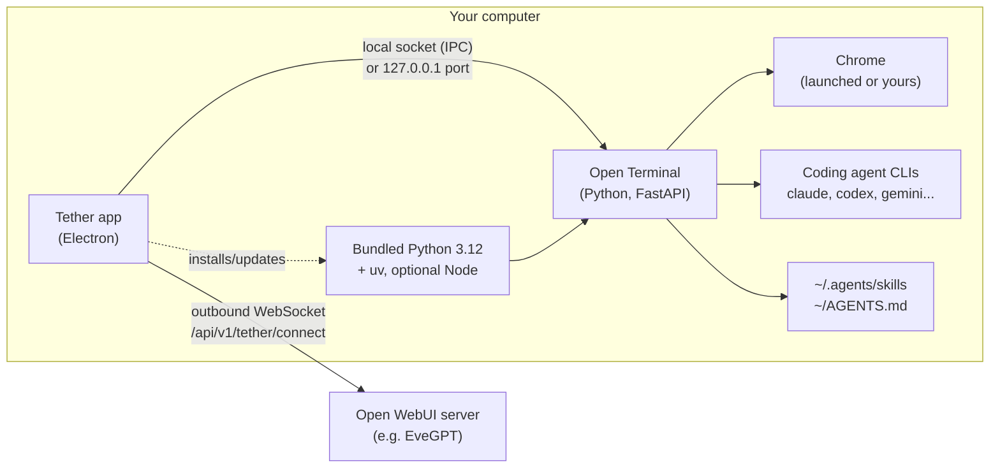

# How Tether and Open Terminal work

Notes from reading the public source of [open-webui/tether](https://github.com/open-webui/tether) (v0.1.12, commit `6bd265e`) and [open-webui/open-terminal](https://github.com/open-webui/open-terminal) (commit `198043b`) on 9 November 2026. This is a description in our own words to explain how the skills in this folder fit in. No Tether code is reproduced here: Tether's licence reserves all rights, so read the source upstream.

## The pieces

1. Tether is an Electron desktop app. It shows your Open WebUI in a window, keeps a list of saved WebUI connections, and manages a local Open Terminal for each.
2. Open Terminal is the Python service that actually runs commands, reads and writes files, drives the browser and desktop, and talks to coding agents. It is MIT-licensed.
3. The relay connects them to the server. Tether opens one outbound WebSocket from your PC to the WebUI at `/api/v1/tether/connect`, authenticated with your WebUI sign-in token. The server sends HTTP and WebSocket requests down that pipe; Tether checks each request path stays on the local terminal and forwards it. Your PC needs no public address and no open inbound port, which is why it works behind campus NAT and proxies.

## Runtime bootstrap

On first use Tether downloads a standalone CPython 3.12 build (python-build-standalone) with checksum verification, installs `uv` into it, then installs or updates the `open-terminal` package with uv. Node is downloaded only for features that need it. Everything lives in Tether's own data folder, separate from any Python you installed. That is why Tether avoids the Python 3.15 wheel problems you hit with a plain `pip install`.

## How Open Terminal is started

- With recent Open Terminal versions, Tether starts it on a private local socket (`--ipc`) and gives it no HTTP port at all. Only Tether can reach it.
- "Allow HTTP access" adds a port bound to `127.0.0.1` (this computer only) or `0.0.0.0` (your network), still protected by an API key. "Copy URL and API key" exposes those for other apps. Both are off by default; leave them off unless another tool needs the terminal.
- Tether settings become `OPEN_TERMINAL_*` environment variables for that process: browser mode and Chrome DevTools URL, desktop on/off, file browser root, session limit, and any extra variables you add under Advanced.

## The sandbox (optional, worth knowing)

Tether has a sandbox mode that confines Open Terminal to one workspace folder:
- Backends: Seatbelt on macOS, bubblewrap on Linux, and Microsoft's process-container SDK on Windows.
- The workspace must be a real local folder, not the home root, not a drive root, with no symlinks pointing out, no hard links and no mounted drives inside. Tether checks this before starting and probes that writes outside the folder and network access really fail.
- Inside, HOME, TEMP and the app-data folders point to a throwaway session folder, PATH is reduced to Tether's Python and the system folder, pip has no package index, network is denied, and browser, desktop and notebook tools are switched off.
- Open Terminal sees `OPEN_TERMINAL_ISOLATED=true`. The `safe-computer-use` and `system-diagnostics` skills check for it and adjust.

Use the sandbox for staff who only need document and data work in one folder. Turn it off only for people who need the browser, desktop control, coding agents or network.

## What the model sees

- Default system prompt from Open Terminal: the OS, host, user, shell and Python version, plus "verify before changing" and "use display_file for deliverables". `OPEN_TERMINAL_SYSTEM_PROMPT` and `OPEN_TERMINAL_INFO` can replace or extend it.
- `AGENTS.md` from the terminal user's home folder is added to every message by Open WebUI (skipped above 32 KiB).
- Skills: Open Terminal lists every folder under these home-relative paths that has a `SKILL.md` with a non-empty `description` in its frontmatter:
  `~/.agents/skills`, `~/.cptr/skills`, `~/.claude/skills`, `~/.codex/skills`.
  Names are de-duplicated (first wins), descriptions are cut at 1024 characters, and up to 50 resource files four folders deep are offered to the model. Open WebUI then shows them in the `$` and `/` menus marked Terminal, and with automatic discovery the model loads one when its description matches the task. That is why every description in this pack says when to use it.

## Coding agents

Open Terminal ships adapters for Claude Code, Codex, Cursor, Gemini CLI, OpenCode, Cline, Grok and Pi. If the CLI is installed and signed in on the PC, its models appear in the Open WebUI picker for that terminal. Sessions survive short disconnects; ones left disconnected for over an hour are closed.

## Security notes for an institution

- Without the sandbox, the terminal runs with the full rights of the Windows account. The file browser start folder is a convenience, not a boundary.
- The relay is authenticated with the user's WebUI token, so whoever can sign in as that user on the WebUI can drive their PC while Tether is running. Enforce MFA or SSO on the WebUI and restrict the terminal connection to the right groups.
- Tether follows the system proxy and can trust a specific self-signed certificate per connection, and supports Cloudflare Access sign-in.
- Licence: Tether is free for personal, non-commercial use; organisational production use needs an Open WebUI Enterprise licence. Check this before rolling it out to staff. Open Terminal itself is MIT.
