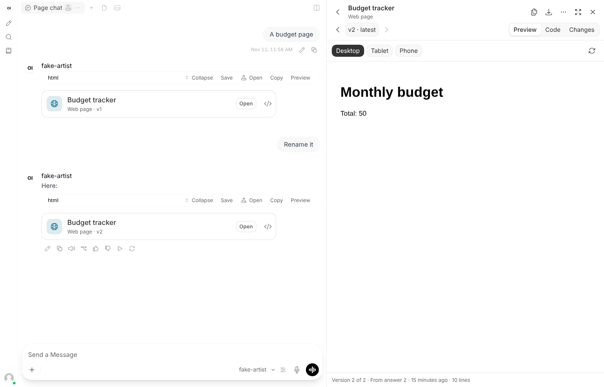
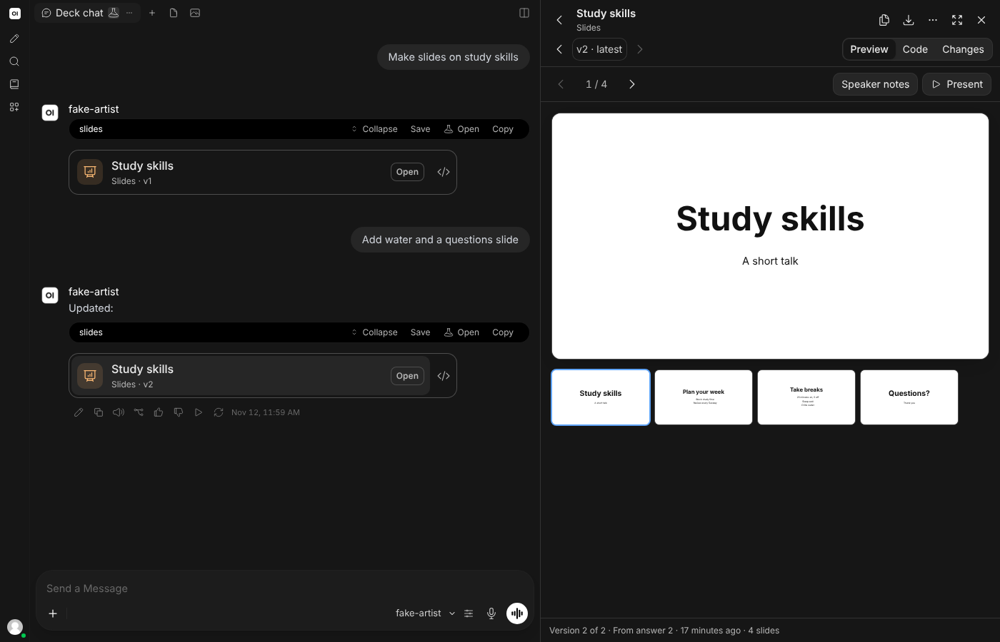
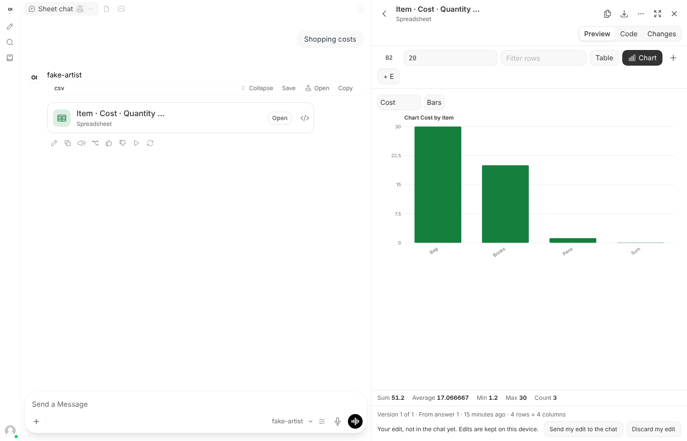
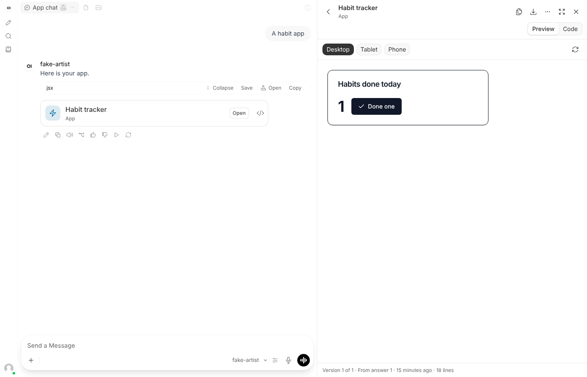
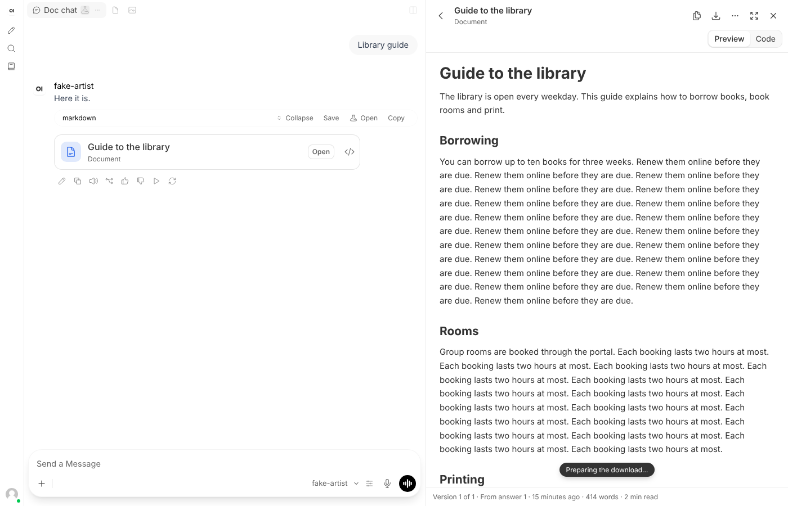
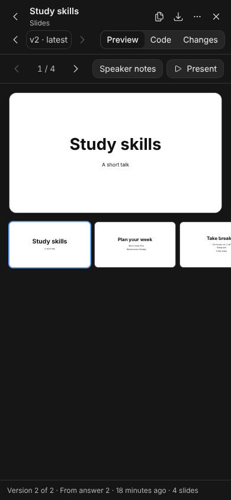
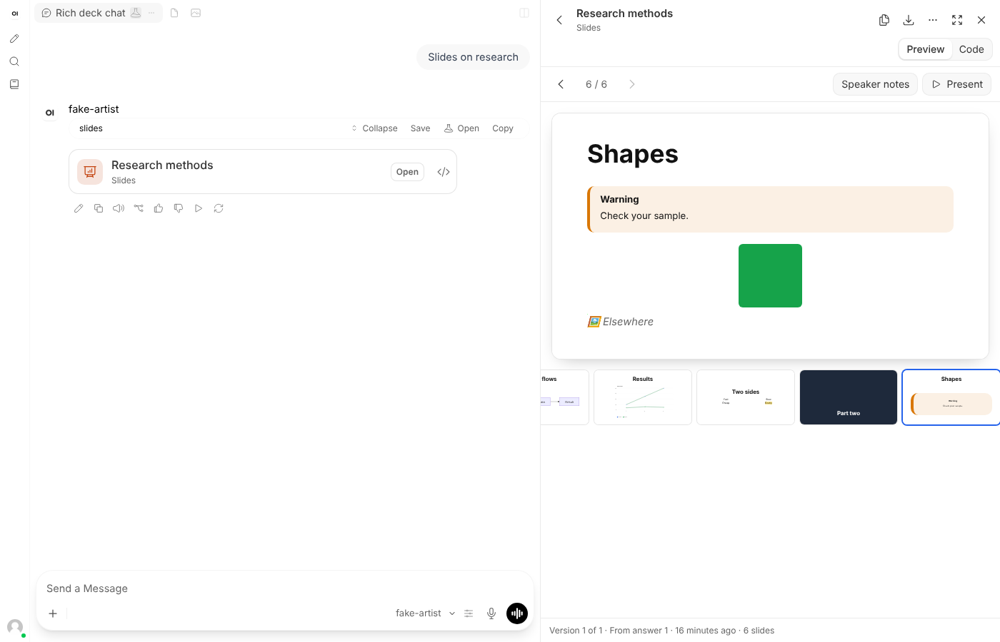
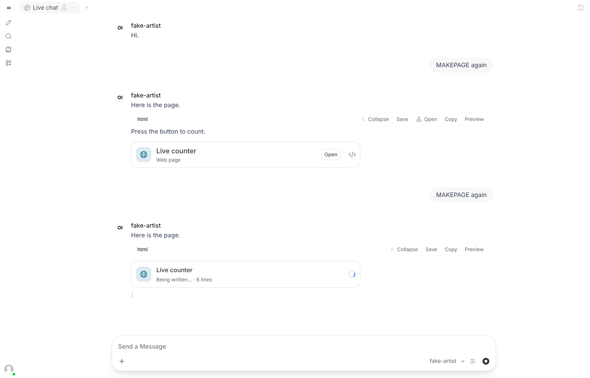

# Artifacts for Open WebUI

When a model writes something you'd keep (a document, a slide deck, a spreadsheet, a diagram, a web page, an app), it shouldn't stay buried in the chat as code. **Artifacts** opens it in a panel beside the chat, the way Claude does: running, readable and editable, with every version the model has made of it, ready to download or ask the model to change. Ordinary answers stay ordinary: only what you ask to create becomes an artifact.

Version v1.1.0. Event Function, with an optional companion Filter, **Artifacts mode**. Requires Open WebUI v0.13.0 or later; tested in a browser on v0.13.0 and v0.13.3. It replaces Chat Canvas.

| A web page, beside the chat | Slides, in dark mode | A spreadsheet with formulas |
| --- | --- | --- |
|  |  |  |

| An app built with React | A document | Phone |
| --- | --- | --- |
|  |  |  |

| A slide with a chart | While it is written |
| --- | --- |
|  |  |

## When something becomes an artifact

Only when it is worth one. Greetings, questions, explanations and ordinary answers stay in the chat, even long ones with a table or a short script.

- **Artifacts mode** ([`artifacts_mode.py`](artifacts_mode.py)) is a switch by the message box, Open WebUI's own filter toggle. When it is on, the model is told how and when to make artifacts: only when you ask for something to create, change or keep, never for small talk; one block per artifact, named on its first line; the whole new version when it changes something. People turn it on per chat; an administrator can turn it on by default for a model (*Workspace > Models > Filters*, then *Default*).
- **Detection** (the `detect` valve) decides which blocks are artifacts:
  - `rich` (default): blocks the model marked as artifacts (a first line `<!-- artifact: Title -->`, `// artifact: Title`, `%% artifact: Title` or `# artifact: Title`, or `artifact` in the fence's info, as in ```` ```slides artifact ````), and kinds that need a viewer at all: whole web pages, React components with a default export, SVG drawings, Mermaid diagrams, slides, CSV data and charts.
  - `marked`: only marked blocks.
  - `all`: also long answers (as documents), Markdown tables (as sheets), JSON and any code of 12 lines or more.

## What it can be

| Kind | What the model writes | What you get |
| --- | --- | --- |
| **Document** | A Markdown block | A formatted page with an outline, callouts, highlights, diagrams, charts, drawings and pictures; download as Markdown, HTML or Word, or print to PDF |
| **Slides** | A ```` ```slides ```` block (or Markdown with `---` between slides) | One slide at a time with thumbnails, speaker notes, arrow keys and Present; diagrams, charts, drawings, pictures, tables, highlights, callouts, columns and title or section layouts on slides; download as a presentation that runs on its own, or print to PDF |
| **Spreadsheet** | A ```` ```csv ```` block | A grid with formulas (`=SUM(B2:B9)`, `=AVERAGE(C:C)`, `=IF(B2>10,"high","low")`, `=ROUND(…)` and more), sorting, filtering, column statistics, bar, line, area and pie charts of one column or all of them, and editing; download as CSV or Excel (formulas kept), the chart as SVG or PNG, or print |
| **Chart** | A ```` ```chart ```` block: optional `type:` (bar, line, area, pie) and `title:` lines, then CSV | The chart, with its data as a spreadsheet one click away |
| **Diagram** | A ```` ```mermaid ```` block | A flowchart, sequence, timeline, mind map or Gantt chart; download as Mermaid, SVG or PNG |
| **Web page / design** | An ```` ```html ```` block | The page running in a sandbox, at desktop, tablet or phone width; download as HTML or print |
| **App** | A ```` ```jsx ```` or ```` ```tsx ```` component with a default export | The app running with React 18, Tailwind, npm packages (lucide-react, recharts, d3…) and the shadcn/ui pieces Claude's apps use (`@/components/ui/card`, `button`, `input`, `tabs`…); download as JSX or as a page that runs on its own |
| **Drawing** | An ```` ```svg ```` block | The picture; download as SVG or PNG |
| **Data** | A ```` ```json ```` block | A tree to fold and unfold, or a table for a list of records; download as JSON or CSV |
| **Code** | A marked code block | An editor with line numbers; download with its file name |

### Inside documents and slides

| Write | To get |
| --- | --- |
| ```` ```mermaid ```` … ```` ``` ```` | A diagram |
| ```` ```chart ```` with `type: line` / `title: Sales`, then `Month,Online,Paper` rows | A chart, one series per column |
| ```` ```svg ```` … ```` ``` ```` | A drawing |
| `` | A picture from this site (generated or uploaded images) or a `data:` image; from elsewhere only when `network` is `open`, otherwise it is named, not loaded |
| `==words==` | Highlighted words |
| `> [!NOTE]`, `> [!TIP]`, `> [!IMPORTANT]`, `> [!WARNING]` | A callout |
| A line of `|||` (slides) | Two (or up to four) columns |
| `<!-- layout: title -->`, `<!-- layout: section -->`, `<!-- layout: center -->` (slides) | A title, section or centred slide |
| `Note:` (slides) | Speaker notes |

## Versions

Like Claude's, each artifact carries its versions. When a later answer has a block with the same name, or, when nothing is named, the one block of its kind right after the previous answer's one block of that kind, that block is the next version.

- A switcher (‹ v2 · latest ›) moves between versions; **Changes** shows what each changed, line by line.
- While you look at the latest version, a new one replaces it as soon as the model finishes.
- Each answer gets a card for the versions it made, and each code block that is an artifact gets an **Open** button.
- A regenerated answer or another branch shows that branch's versions.

## Working with it

- **Nothing half-made.** While a model writes an artifact, its code is folded away in the chat behind a card saying it is being written. When the answer is done, the panel opens on it (not on phones), complete. The card can show the code in the chat again.
- **Try fixing.** An error inside a page or an app is shown under it, with *Try fixing*, which sends the error to the model; the fix arrives as the next version.
- **Ask about a part.** Select text in an artifact, choose *Ask about this*, say what should change, and it is sent with the part it is about.
- **Edit it yourself.** Code is editable, and so are spreadsheet cells. An edit is a draft only you see, kept in your browser; *Send my edit to the chat* puts it in the message box for the model to continue from, and *Discard my edit* drops it.
- **Start one.** *New* offers ready requests for each kind; one goes into the message box for you to complete and send. *Write it yourself* makes a blank artifact on this device.
- **Keep it.** Copy, download, *Save to my files*, *Save as a note*, or *Show in chat*.
- **Full screen** widens the panel over the chat; on a phone the panel always covers the screen.

## For people writing artifacts: AI and storage

Like Claude's artifacts, pages and apps can use:

- `await window.claude.complete(prompt)` (also `window.ai.complete`): asks the chat's model and returns its answer as text. The first time, the person is asked whether to allow it; the artifact never sees the chat, and requests are limited per minute. Nothing it asks is saved to a chat.
- `window.storage.get(key)`, `.set(key, value)`, `.delete(key)`, `.list(prefix)`: keeps text values in the person's browser for that artifact, up to 512 KB.

## Opening it

- The **Artifacts** button beside the chat's **⋯** button.
- **Artifacts** in the chat's ⋯ menu.
- A card under an answer, or the **Open** button on a code block.
- A link with `?artifact=`.

Escape closes it; drag its left edge, or use the arrow keys on it, to change its width.

## Open WebUI's own Artifacts

Open WebUI has a small Artifacts view of its own, for HTML and SVG only. With `replace_builtin` on (the default), this one stands in for it: its ⋯ entry is hidden, its **Preview** button on a code block opens this panel, and its tab is closed when it opens by itself. Turn the valve off to keep both.

## Install

1. If Chat Canvas is installed, disable or delete it in **Admin Panel > Functions**: Artifacts does everything it did. Canvas edits kept in browsers aren't carried over.
2. Create a function and paste [`chat_artifacts.py`](chat_artifacts.py). Review the code first, as with any function.
3. Enable it, then hard-refresh open Open WebUI tabs (`Ctrl+Shift+R`).
4. Recommended: create another function from [`artifacts_mode.py`](artifacts_mode.py) and enable it. Make it global (⋯ > *Global*) so its switch is offered with every model, or add it to chosen models under *Filters*, ticking *Default* to have it on from the start.
5. If your network can't reach the public CDNs, point the library valves at your own copies (see below).

## Settings

| Valve | Default | What it does |
| --- | --- | --- |
| `detect` | `rich` | Which blocks are artifacts: `rich`, `marked` or `all` (see *When something becomes an artifact*). |
| `auto_open` | on | Opens the panel on a new artifact or version once the answer is done. Never on phones, never before it is complete. |
| `cards_in_chat` | on | Cards under answers and **Open** buttons on code blocks. |
| `collapse_code` | on | Folds an artifact's code away in the chat behind its card, as Claude does; the card can show it again. While it is written, the card says so. |
| `min_code_lines`, `min_document_chars`, `tables_as_sheets` | 12, 1500, on | With `detect = all`: the shortest code artifact, the shortest answer offered as a document, and Markdown tables as sheets. |
| `network` | `libraries` | What artifacts may load: `libraries` (only the addresses below), `open` (anything on the web) or `off` (nothing; apps and diagrams can't run). |
| `esm_cdn` | `https://esm.sh` | Where apps load React and the npm packages they import. |
| `babel_url`, `tailwind_url`, `mermaid_url` | jsDelivr, pinned versions | Babel standalone 7.29.10, Tailwind browser 4.3.3 and Mermaid 11.17.2. |
| `extra_hosts` | jsDelivr, cdnjs, unpkg, Google Fonts | Other addresses pages may load scripts, styles, fonts and images from. |
| `allow_ai` | on | `window.claude.complete()`, after asking. |
| `ai_calls_per_minute` | 10 | The limit for all artifacts in a tab. |
| `allow_storage` | on | `window.storage`. |
| `keep_drafts` | on | Keeps edits and blank artifacts in the browser. Turn off on shared computers. |
| `allow_save` | on | *Save to my files* and *Save as a note*. |
| `replace_builtin` | on | Stands in for Open WebUI's own Artifacts (see above). |
| `templates` | on | *New* and its ready requests. |
| `header_button` | on | The button beside ⋯. |
| `show_in_chat_menu` | on | The ⋯ menu entry. |
| `platform_name` | empty | The platform's name in the wording; empty uses `WEBUI_NAME`. |
| `language` | `auto` | English or French, following each person's Open WebUI language. |

A valve change reaches a browser tab when it is next reloaded.

### Your own copies of the libraries

Apps need an ESM CDN that serves npm packages with React shared between them; [esm.sh](https://github.com/esm-dev/esm.sh) can be self-hosted. Babel, Tailwind and Mermaid are single files that can be served from anywhere your users reach. Only `http(s)` addresses are accepted, and only their sites are allowed by the frames' content policy.

## Security

Artifacts come from models and, in shared chats, from other people. They are treated as untrusted:

- **A sandbox without this site.** Pages, apps and diagrams run in frames given `allow-scripts` (and modals, downloads, forms, popups) but never `allow-same-origin` or top navigation. They can't read the page, Open WebUI's storage, the sign-in token or cookies, and can't move the tab. In the browser tests, a page that tried all of these was blocked every time.
- **A content policy.** With `network = libraries`, a frame may only load from the library addresses; anything else, including a `fetch` or an image pointing elsewhere, is blocked, so a generated page can't send the chat's contents anywhere. Open WebUI's own `iframe_csp` setting is added on top when an administrator set one.
- **No prompts from frames.** Open WebUI ignores prompts that a sandboxed page posts to it; the tests check that nothing is typed or sent.
- **Messages from frames** are accepted only from that frame's own window with its own random key, and only of a few kinds; AI requests ask first and are rate-limited.
- **SVG** is shown as an image, where scripts don't run. **Documents, slides, sheets and data** are built from text and a fixed set of elements; links are limited to `http`, `https` and `mailto` and open without a referrer, and pictures in Markdown are named, not loaded.
- **Printing** goes through a frame that may not run scripts, holding the panel's own safe rendering.
- **The sign-in token** is only ever sent to this site; every request goes through one function that refuses other addresses.

## What it reads and writes

- Reads the open chat (`GET /api/v1/chats/{id}`), or a shared one (`GET /api/v1/chats/share/{id}`), the person's account (`GET /api/v1/auths/`), and the platform's name and frame policy (`GET /api/config`).
- *Save to my files* calls `POST /api/v1/files/`; *Save as a note* calls `POST /api/v1/notes/create`; AI requests call `POST /api/chat/completions` with the prompt alone.
- Sending to the chat fills or submits the message box through Open WebUI's own `input:prompt` page messages; long text or text with `{{ }}` is attached as a file instead.
- Keeps drafts, blank artifacts, the panel width and `window.storage` values in the browser's local storage, under keys starting `owui-chat-artifacts:`, up to about 3 MB of drafts, oldest chats first to go.
- It never changes a chat by itself and adds no server routes; the server half only serves the script.

## Limits

- **Libraries come from the network.** Apps need `esm_cdn` and Babel; diagrams need Mermaid. Where they can't be reached, the panel says so and the code is still there.
- **Grouping into versions is a guess** when nothing is named; *Changes* shows what really differs.
- **Spreadsheets** have one sheet, up to 2,000 rows and 60 columns, and the functions listed in the formula hint (SUM, AVERAGE, MIN, MAX, MEDIAN, COUNT, COUNTA, PRODUCT, ROUND, ABS, SQRT, POWER, INT, MOD, IF, AND, OR, NOT, CONCAT, LEN, UPPER, LOWER). Excel export keeps values and formulas, not styling.
- **Documents** export to Word as a Word-readable HTML file (`.doc`); slides export to HTML and PDF, not PowerPoint.
- **Pages with external pictures or APIs** need those addresses in `extra_hosts`, or `network = open`.
- **Sharing** is not offered. A chat shared with Open WebUI's own Share still shows its artifacts, read-only.
- **Drafts live in one browser.**
- **Interface markers.** It finds Open WebUI's interface by markers stable from v0.13.0 to v0.13.3 (`chat-container`, `messages-container`, `chat-context-menu-button`, `code-textarea-…`, `copy-code-button`, `response-content-container`, `data-panel-tab`). A later release may need an update.
- English and French.

## Tests

Server half, logic (parsing, detection, versions, formulas, charts) and Artifacts mode, without Open WebUI:

```bash
python -m pip install "pydantic>=2,<3" starlette httpx pytest
python -m pytest -q tests/test_chat_artifacts.py
```

In a browser, against a **throwaway** Open WebUI with no users yet, wired to the fake model, with copies of the libraries served locally (any static server answering `/react@18.3.1`, `/react-dom@18.3.1/client`, `/lucide-react`, `/babel.min.js`, `/tailwind.js` and `/mermaid.min.js` with ESM builds):

```bash
python tests/fake_model.py 9999 &
OPENAI_API_BASE_URL=http://127.0.0.1:9999/v1 OPENAI_API_KEY=test ENABLE_OPENAI_API=true open-webui serve
python tests/seed.py http://127.0.0.1:8080 http://127.0.0.1:9997 chat_artifacts.py > seed.json
node tests/e2e.mjs seed.json
```

`fake_model.py` streams a page when asked `MAKEPAGE`, a fix when asked to fix an artifact, and says whether Artifacts mode's instructions reached it when asked `WHATMODE`. Results on 2026-11-12:

| Open WebUI | With Chat Inspector, Files and Gallery | Checks |
| --- | --- | --- |
| v0.13.3 | yes | 125 of 125 passed |
| v0.13.3 | no | 125 of 125 passed |
| v0.13.0 | yes | 125 of 125 passed |

They cover every kind of artifact and its downloads (the Excel file is opened and its formulas read back), versions and Changes, the panel docking beside the chat, the address reopening an artifact, drafts that survive a reload and go to the message box, the ⋯ menu, Escape, Open WebUI's Preview button and its own Artifacts tab, **the attack page** (parent page, token, cookies, top navigation, network and pictures blocked, its posted prompt ignored), `window.storage`, `window.claude.complete` with its consent dialog, **Try fixing** with the fake model's fix becoming version 2, **ordinary answers making nothing** (a long answer with a table, a script and JSON, and a live "hello"), **a page streamed live** shown as a writing card with its code folded and the panel closed, then opening complete and running, the code shown again from its card, **Artifacts mode** reaching the model when on by default and not otherwise, documents and **slides holding diagrams, multi-series charts, columns, section layouts, callouts, drawings and pictures** (a picture from another site not loaded) and their downloads, a chart block on its own, asking about a selected part, a chat shared through Open WebUI opening read-only, the small copy note, *New* and blank artifacts, contrast of 4.5:1 or better in light, dark, OLED black and *Her*, a phone, French, and the valves, including `detect` in its three settings. The Chat Inspector suite also passes with Artifacts installed.

Not tested in a browser: the public CDNs themselves (unreachable from the test machine; the same files were served locally), a real model, Ollama, and printing to paper.
