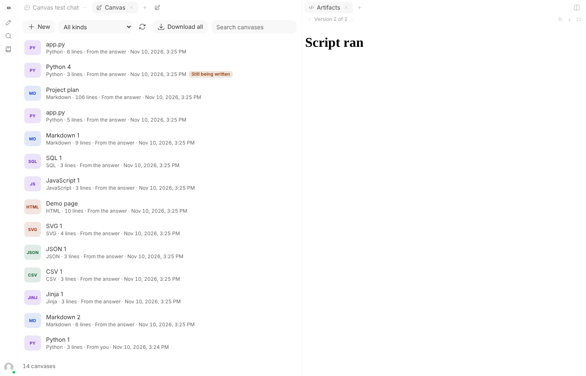
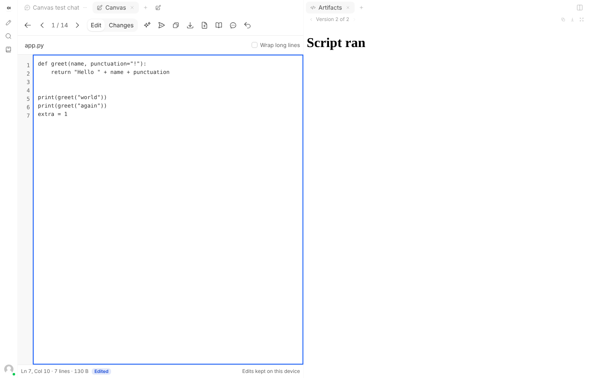
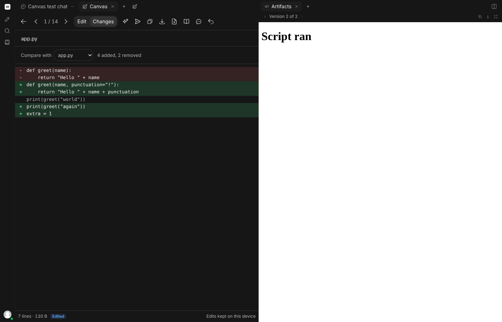
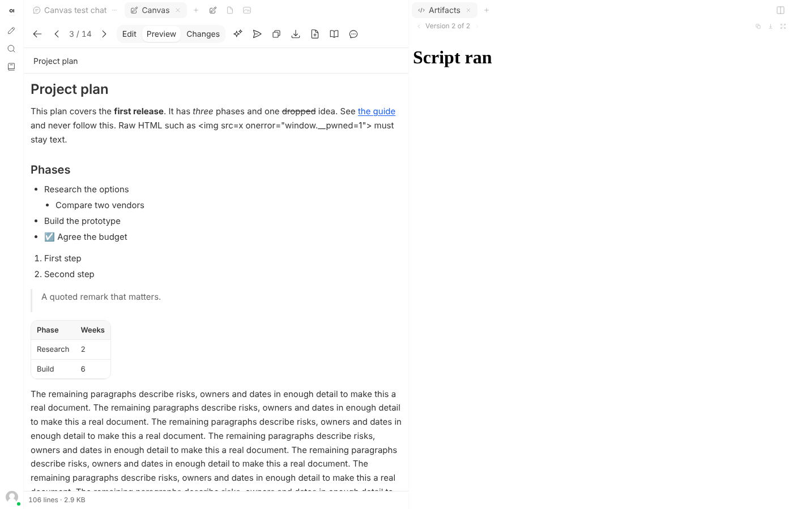
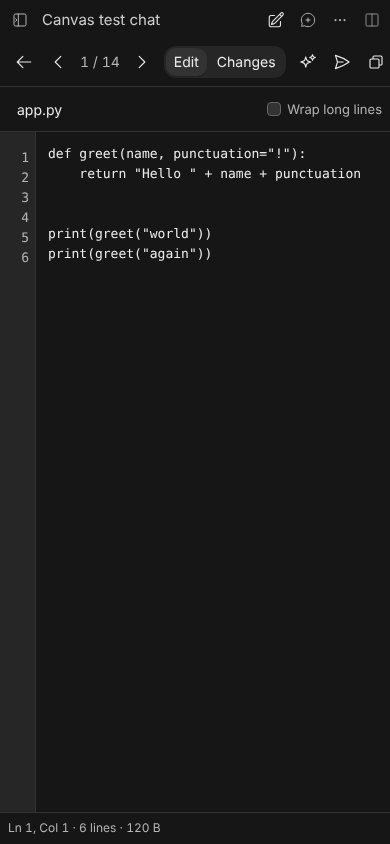

# Chat Canvas for Open WebUI

When a model writes code or a long document, it lands in the chat as text you can only copy. Chat Canvas adds a **Canvas** tab beside the chat where each code block and document becomes a page you can edit, preview, compare with the original, send back to the model with a request, and save.

Version v1.0.0. Event Function. Requires Open WebUI v0.13.0 or later, the release that added the Tabs panel; tested in a browser on v0.13.0 and v0.13.3.

It is a companion to [Chat Gallery](../chat-gallery/) and [Chat Files](../chat-files/), built the same way. Install any of them, alone or together.

| The canvases of a chat | Editing | What changed, dark mode |
| --- | --- | --- |
|  |  |  |

| A document, previewed | Phone |
| --- | --- |
|  |  |

## How it differs from Open WebUI's Artifacts

Open WebUI's built-in Artifacts tab *shows* the HTML and SVG a model writes. Canvas is for *working on* what a model writes, of any kind. The two run side by side.

| | Built-in Artifacts | Chat Canvas |
| --- | --- | --- |
| HTML and SVG, rendered | yes | yes |
| Other code, documents, data | no | yes |
| Edit | no | yes |
| Compare versions | no | yes |
| Ask the model for a change to a part | no | yes |
| Save to files or notes | no | yes |

## What you can do

- **Find the work in a chat.** Canvas lists every code block of three lines or more, from you or the model, and every long answer as a document, newest first. Titles come from a file name the model gave, an HTML page's title, or a document's first heading. Search looks inside the text too.
- **Edit.** Line numbers, Tab and Shift+Tab to indent, undo, a line and column readout, and line wrapping for prose. Arabic and Hebrew are edited right to left.
- **Preview.** HTML pages run in a sandbox; SVG drawings, Markdown documents, JSON (pretty-printed, or told it is broken) and CSV tables are rendered.
- **See what changed.** *Changes* compares your edit with the original line by line, with plus and minus signs as well as colour. It can also compare with another canvas, such as the model's earlier version of the same file.
- **Ask for a change.** Select a part, or nothing for the whole canvas, choose *Ask for a change* and say what you want. Your request, the part and your current version are put in the message box. You check it and send it; Canvas sends nothing itself.
- **Hand it back.** *Put in the message box* does the same with your edited version alone.
- **Keep it.** Copy, download with a sensible file name, download every canvas as a zip, *Save to my files* (it then appears in Chat Files), or *Save as a note*.
- **Start from nothing.** *New* opens a blank canvas with a title and a language of your choice.
- **Go back.** *Go back to the original* discards your edits after asking. *Show in chat* jumps to the message.

Your edits are kept in your browser, for your account and that chat, and are still there after a reload. The line under the editor always says whether they are kept. They never change the chat itself.

## Opening it

- **The Canvas button**, a pencil on a page, at the end of the tab row above the chat, or in the top bar on a small screen.
- **The + menu** of the Tabs panel, for accounts that have that menu.

Where a tab row or the side panel is on screen, Canvas is a tab: choose another tab and it steps aside with the editor as you left it. Otherwise, as on a phone, it opens over the chat with its own close button.

Keyboard: Up, Down, Home and End move through the list and Enter opens a canvas. In the editor Tab indents; press Escape once to free Tab for moving between controls, and again to go back to the list. `Ctrl+S` (or `Cmd+S`) keeps your edit at once.

## Light, dark and themes

Canvas takes its colours from Open WebUI's palette and follows light, dark, OLED black and *Her*. Every text was measured at 4.5:1 contrast or better in all four: the list, the editor, line numbers, added and removed lines, the document preview and the ask box. An HTML preview keeps a white page, as a browser would show it, unless the page sets its own colours.

## Install

1. Open **Admin Panel > Functions** as an administrator.
2. Create a function and paste [`chat_canvas.py`](chat_canvas.py). Review the code first, as with any function: it runs on your server.
3. Enable the function, then hard-refresh any open Open WebUI tab (`Ctrl+Shift+R`, or `Cmd+Shift+R` on a Mac).
4. Open a chat that has code or a long answer, and select the Canvas button.

## Settings

| Valve | Default | What it does |
| --- | --- | --- |
| `min_code_lines` | 3 | The shortest code block that becomes a canvas. 1 lists every block, one-line commands included. |
| `min_document_chars` | 1200 | An answer with at least this much text outside code blocks is also offered as a document. 0 turns document canvases off. |
| `run_scripts` | on | Lets scripts run in the preview of an HTML canvas. The preview is sandboxed either way. |
| `keep_drafts` | on | Keeps each person's edits in their browser. Turn it off on shared computers: edits then last only until the page is closed, and the editor says so. |
| `allow_save` | on | Offers *Save to my files* and *Save as a note*. |
| `header_button` | on | Adds the Canvas button. Off leaves only the + menu, which many accounts don't have. |
| `language` | `auto` | `auto` follows each person's Open WebUI language: French where it is French, English elsewhere. |

A valve change reaches a browser tab the next time that tab is reloaded.

## What it reads and writes

Canvas runs in the browser with the signed-in person's own access.

- It reads the open chat, from `GET /api/v1/chats/{id}`, and the person's account, from `GET /api/v1/auths/`, to keep each person's edits apart.
- *Save to my files* calls `POST /api/v1/files/`, and *Save as a note* calls `POST /api/v1/notes/create`, Open WebUI's own routes.
- *Ask for a change* and *Put in the message box* fill Open WebUI's message box through the page's own message hook. A long canvas, or one containing `{{ }}`, is attached as a file through the message box's own upload.
- Edits and blank canvases are stored in the browser's local storage under keys starting `owui-chat-canvas:`, up to about 3 MB in all; the oldest chats' edits make room for new ones. An edit over 400,000 characters is not stored, and the editor says so.

It never changes a chat, adds no server routes of its own, and sends nothing anywhere else. The server half of the function only serves the script, through `/static/loader.js`.

## Permissions and security

- **HTML preview.** The page runs in a sandboxed frame that is never given same-origin access. In testing, a page that tried to reach the parent window, its storage and the top window was blocked on all three. Like any web page it can still load things from the internet; turn `run_scripts` off to stop its scripts.
- **SVG** is shown as an image, where scripts don't run.
- **Markdown preview** builds text and a fixed set of elements. Raw HTML in a document stays visible as text. Only `http`, `https` and `mailto` links become links, and they open without a referrer. Pictures are named, not loaded.
- **Titles and text** from the model are written to the page as text, never as HTML.
- **Nothing is sent for you.** Canvas only fills the message box.
- **Shared computers.** Edits kept in the browser stay there after sign-out, under that account's id. Turn `keep_drafts` off where that matters.

## Limits

- No syntax colouring in the editor; it is a plain text editor with line numbers.
- The Markdown preview is a simplified reader: no maths, footnotes or diagrams, and pictures are not loaded.
- No preview for CSS or JavaScript on their own, or for other languages.
- Edits live in one browser. They don't follow you to another device, and clearing the browser's site data removes them. Save to files or notes to keep something for good.
- Each code block is its own canvas. Canvas doesn't decide that two blocks are versions of one file; *Changes* lets you compare any two of the same language.
- *Ask for a change* depends on the model replying with a full code block, which the request asks for but can't guarantee.
- A regenerated answer is a new message, so its blocks are new canvases; edits to the earlier answer's blocks stay with those.
- Line-by-line comparison stops when the two differing parts are too large (their line counts multiplied above four million).
- The tab lasts until you close it or reload the page; your edits outlast both.
- Like its companions, it finds Open WebUI's interface by markers that have stayed stable from v0.13.0 to v0.13.3 (`panel-tab-strip`, `data-panel-group`, `app-dropdown-menu`, and the ids `controls-container`, `chat-container`, `chat-pane`, `chat-input`, `messages-container`), and fills the message box through the `input:prompt` page message. If a later release changes those, Canvas may need an update.
- Interface languages are English and French.

## Tests

Server half, without Open WebUI:

```bash
python -m pip install "pydantic>=2,<3" starlette httpx pytest
python -m pytest -q tests/test_chat_canvas.py
```

In a browser, against a **throwaway** Open WebUI with no users yet (the tests create accounts, files and notes, and change valves):

```bash
python tests/seed.py http://127.0.0.1:8080 chat_canvas.py ../chat-files/chat_files.py ../chat-gallery/chat_gallery.py > seed.json
node tests/e2e.mjs seed.json
```

Leave out the other two paths to test Canvas on its own. `e2e.mjs` needs Playwright with Chromium.

Results on 2026-11-10:

| Open WebUI | With Gallery and Files | Checks |
| --- | --- | --- |
| v0.13.3 | yes | 113 of 113 passed |
| v0.13.3 | no | 105 of 105 passed (the checks that need the other two are skipped) |
| v0.13.0 | yes | 113 of 113 passed |

They cover: reading nested, `~~~`, list-indented and unclosed blocks; reasoning and one-liners left out; editing, indenting, undo and the Escape key; edits surviving a reload; Changes against the original and against another canvas; Ask for a change with a selection, with nothing sent; `{{ }}` code travelling as a file; the HTML sandbox against a page that tries to break out; SVG, Markdown, JSON and CSV previews; right-to-left text; copy, download, save to files, save as a note; a blank canvas and its title shown as text; the zip; separate edits per chat; a browser that refuses to store edits; a 25,000-line block opening in under three seconds with line numbers level to the last line; opening before the chat has loaded; taking turns with Gallery and Files, and a crowded tab row; contrast in four themes; a phone; the + menu; and each valve.

Open WebUI's own Artifacts logs one error in the browser console on any chat that holds an HTML block, with or without Canvas; the tests ignore that one message.

Not tested in a browser: a real model answering an *Ask for a change* request, an answer streaming live, split screen, and use with Chat Tabs.
