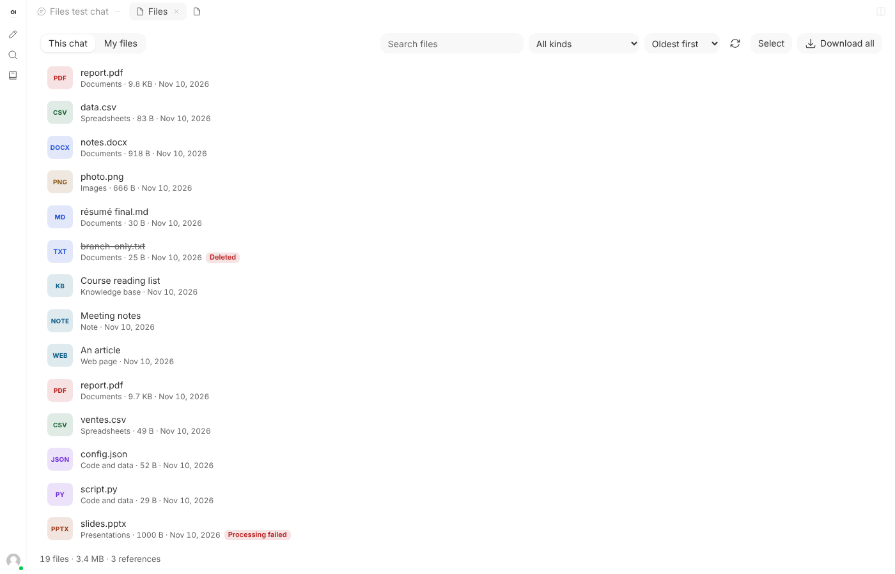
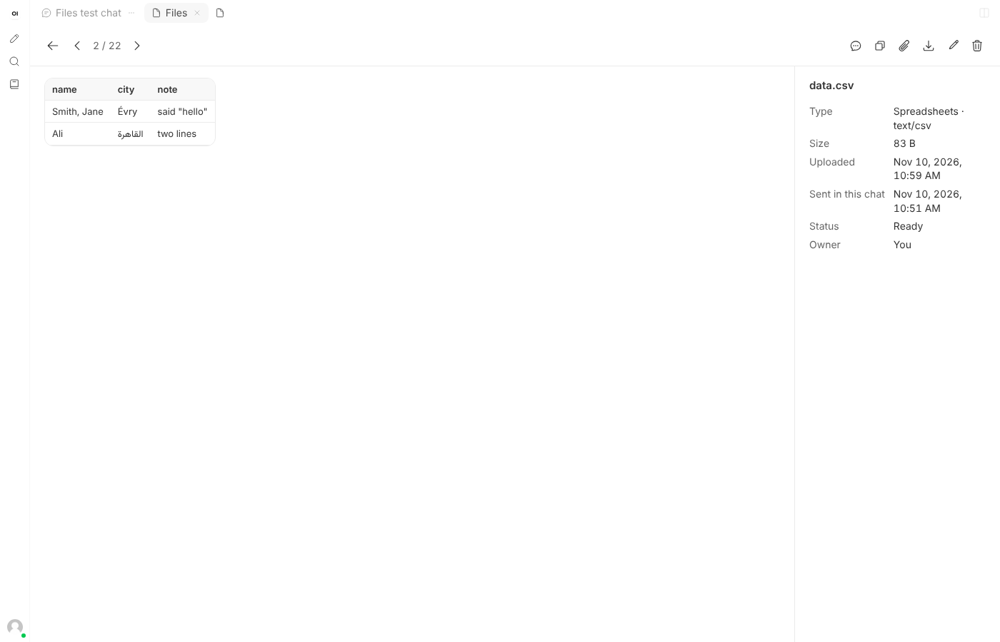
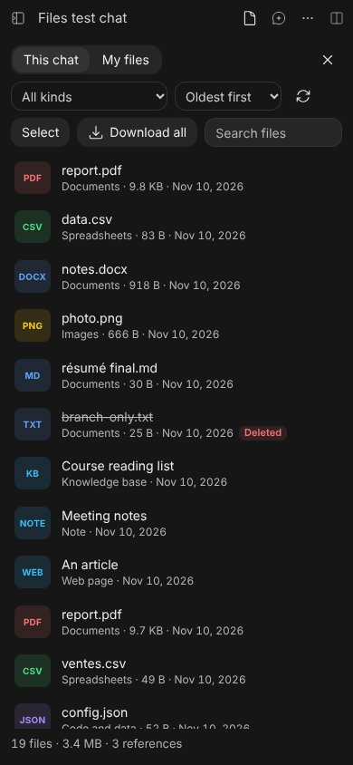
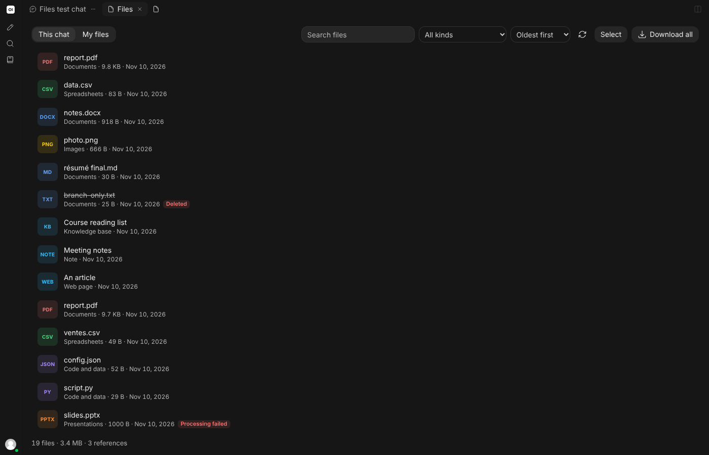

# Chat Files for Open WebUI

Documents, spreadsheets and other files end up scattered through long chats, and Open WebUI has no single place to find them again. Chat Files adds a **Files** tab beside the chat: every file in the current chat, every file in your account, with previews, search, rename, delete and zip.

Version v1.0.0. Event Function. Requires Open WebUI v0.13.0 or later, the release that added the Tabs panel; tested in a browser on v0.13.0 and v0.13.3.

It is a companion to [Chat Gallery](../chat-gallery/), built the same way. Gallery shows images; Files shows everything else. Install either or both.

| This chat | Preview | Dark mode, phone |
| --- | --- | --- |
|  |  |  |



## What you can do

- **See a chat's files at once.** *This chat* lists every file attached in the chat, on every branch, in the order they were sent, and the files the model's answers link to, such as a report a tool wrote. It also lists the knowledge bases, notes, chats and web pages the chat refers to.
- **Browse all your files.** *My files* lists every file you own, newest first, 200 at a time as you scroll. You only see your own, administrators included.
- **Find one.** Search by name, type or extension, including names in any script. Narrow to documents, spreadsheets, presentations, code and data, audio, video, archives or other. Order by newest, oldest, name or size.
- **Preview it.**

  | File | Preview |
  | --- | --- |
  | PDF | The browser's own PDF viewer, and *Open in a new tab* |
  | CSV, TSV | A table, with quoted commas, doubled quotes, line breaks inside quotes and semicolon-separated files read correctly; the first 500 rows and 50 columns |
  | JSON | Pretty-printed |
  | Text, Markdown, code, logs, HTML, SVG | As text; files over 512 KB show their first 512 KB and say so |
  | Audio, video | Played in the page |
  | Word, PowerPoint, Excel and others | The text Open WebUI extracted when the file was uploaded |
  | Archives, binary files | A download button |

- **Read its details.** Type, size, upload date, when it was sent in this chat, status and owner. Files Open WebUI is still processing, failed to read, or no longer has are flagged in the list; a failed file shows why.
- **Rename** your own files. The name is selected without its extension; empty names and names with `/` or `\` are refused.
- **Delete** your own files, one at a time or a selection, after a confirmation. A deleted file is removed from Open WebUI, from every chat that showed it, and from any knowledge base it was added to. It can't be brought back.
- **Download** a file with its original name, or a selection or the whole view as a zip. Two files with the same name become `name.ext` and `name (2).ext`.
- **Copy** a file's text, **attach** a file to your next message through Open WebUI's own upload, or **show in chat** to go back to the message it came from.

## Opening it

- **The Files button.** On a wide screen it sits at the end of the tab row above the chat. On a small screen, where Open WebUI shows its classic top bar, it sits in that bar. With Chat Gallery installed, the two buttons sit side by side and Gallery's stays nearest the edge.
- **The + menu** of the Tabs panel also lists *Files*, for accounts that have that menu.

Where a tab row is on screen, Files opens as a tab: choose another tab and it steps aside, keeping its place, preview included; its × closes it. With Chat Gallery, the two take turns in front. Where there is no tab row, as on a phone, Files opens over the chat with its own close button. Escape closes a preview first, then leaves Select mode, then sets Files aside.

Keyboard: Up and Down, Home and End move through the list; Enter opens the preview; Left and Right move between previews.

## Light, dark and themes

Files takes its colours from Open WebUI's palette, so it follows light mode, dark mode, the OLED black theme, the *Her* theme, and changes of theme made while it is open. Every text was measured at 4.5:1 contrast or better against what is painted under it, in all four themes, in the list, the preview and the delete box. File-type badges and warning flags use deeper tones in light mode and lighter ones in dark mode for that reason. High-contrast (forced colours) mode gets outlined controls.

## Install

1. Open **Admin Panel > Functions** as an administrator.
2. Create a function and paste [`chat_files.py`](chat_files.py). Review the code first, as with any function: it runs on your server.
3. Enable the function, then hard-refresh any open Open WebUI tab (`Ctrl+Shift+R`, or `Cmd+Shift+R` on a Mac).
4. Open a chat and select the Files button.

## Settings

| Valve | Default | What it does |
| --- | --- | --- |
| `max_zip_mb` | 300 | The largest zip, in MB, that Download builds. The browser holds the whole zip in memory until it is saved, so keep this low if people download from phones. |
| `include_images` | `auto` | Whether images are listed. `auto` leaves them out when Chat Gallery is enabled on this server and lists them otherwise. `yes` or `no` forces it. |
| `show_references` | on | In *This chat*, also lists the knowledge bases, notes, chats and web pages the chat refers to. |
| `allow_rename` | on | Lets people rename their own files. |
| `allow_delete` | on | Lets people delete their own files. |
| `header_button` | on | Adds the Files button. Off leaves only the + menu, which many accounts don't have. |
| `language` | `auto` | `auto` follows each person's Open WebUI language: French where it is French, English elsewhere. `en` or `fr` forces one. |

A valve change reaches a browser tab the next time that tab is reloaded.

## What it reads

Chat Files runs in the browser with the signed-in person's own access. It reads:

- the open chat, from `GET /api/v1/chats/{id}`;
- whether each of the chat's files still exists and whether Open WebUI failed to process it, from `GET /api/v1/files/{id}/process/status`;
- the person's files without their contents, from `GET /api/v1/files/user/search`;
- a file's record, from `GET /api/v1/files/{id}`, only when its owner or the reason it failed isn't already known;
- a file's extracted text, from `GET /api/v1/files/{id}/data/content`, only when you preview a file the browser can't show itself;
- the file itself, from `GET /api/v1/files/{id}/content`, when you preview, copy, download, attach or zip it. Text previews ask for the first 512 KB only;
- the person's own account, from `GET /api/v1/auths/`, to know which files are theirs.

To rename it calls `POST /api/v1/files/{id}/rename`, and to delete `DELETE /api/v1/files/{id}`, Open WebUI's own routes. It adds no server routes of its own, stores nothing on the server or in the browser, and sends nothing anywhere else. The server half of the function only serves the script, through `/static/loader.js`.

## Permissions and security

- Everything goes through Open WebUI's API, so its access checks apply. Rename and delete are offered only for files the person owns, even to an administrator, who could otherwise change other people's files.
- The sign-in token is attached only to requests the browser resolves to the Open WebUI address.
- File names, contents, CSV cells and extracted text are written to the page as text, never as HTML. HTML and SVG files are shown as source and never run.
- Only a file that starts like a PDF goes to the browser's PDF viewer. A file named `.pdf` that is something else is treated as unknown.
- Web pages a chat refers to open in a new tab without a referrer and without a link back to Open WebUI.

## Limits

- Previews of PDFs, audio and video depend on the browser: mobile browsers may show a PDF's first page only, or offer to open it; *Open in a new tab* opens it in the browser's own viewer.
- Word, PowerPoint, Excel and similar files show the text Open WebUI extracted at upload, not the formatted document. A file uploaded without processing, such as through the API, may have no extracted text.
- A renamed file keeps its old name in chats that already show it; Open WebUI stores the name in the chat.
- Search, the kind filter and the order in *My files* cover the files loaded so far; scroll to load more.
- *Show in chat* from *My files* needs the chat link Open WebUI saves with a file, which it does for some files only. In *This chat* it always works.
- A temporary chat isn't saved, so it has no *This chat* view.
- The tab lasts until you close it or reload the page.
- With G30's Chat Tabs pinned pane, Files opens over the chat rather than inside that pane. This was not tested.
- Like Chat Gallery, it finds Open WebUI's interface by markers that have stayed stable from v0.13.0 to v0.13.3: `panel-tab-strip`, `data-panel-group`, `data-panel-tab-bar`, `app-dropdown-menu`, and the ids `controls-container`, `chat-container`, `chat-pane` and `chat-input`. If a later release changes those, Files may not appear until it is updated.
- Interface languages are English and French.

## Tests

Server half, without Open WebUI:

```bash
python -m pip install "pydantic>=2,<3" starlette httpx pytest
python -m pytest -q tests/test_chat_files.py
```

It loads the function the way Open WebUI does and checks the served script, the 304 answer, valve changes, withdrawal when disabled, valve limits, the French translation, that nothing is written as HTML, that only real PDFs reach the viewer, the shared protocol with Chat Gallery, and that the two protocol blocks are unchanged.

In a browser, against a **throwaway** Open WebUI with no users yet (the tests create accounts, rename and delete files, and change valves):

```bash
python tests/seed.py http://127.0.0.1:8080 chat_files.py ../chat-gallery/chat_gallery.py > seed.json
node tests/e2e.mjs seed.json
```

Leave out the Chat Gallery path to test Files on its own. `seed.py` needs Pillow; `e2e.mjs` needs Playwright with Chromium. The seed holds a PDF, two files both named `report.pdf`, a CSV with quoted commas and line breaks, a semicolon CSV, JSON, Python, a 3 MB log, a binary file, an HTML page named `.pdf`, a Word file, a PowerPoint file Open WebUI fails to read, a WAV, a zip, an Arabic file name, a 200-character name, a file deleted after it was sent, a file on another branch, a file linked from an answer, a shared knowledge base, a note, a web page, and 230 more files so *My files* needs two pages.

Results on 2026-11-10:

| Open WebUI | With Chat Gallery | Checks |
| --- | --- | --- |
| v0.13.3 | yes | 105 of 105 passed |
| v0.13.3 | no | 98 of 98 passed (the checks that need Chat Gallery are skipped; images are listed) |
| v0.13.0 | yes | 101 of 101 passed (its classic top bar has no tab row, so the tab-row checks don't apply) |

They cover every preview type above, filters, sorting and search, keyboard use, the clipboard, download, attach, rename with bad names refused, delete with cancel and confirm, the zip's contents, show in chat, paging, a server error and its retry, an empty chat, the home page, the + menu as an administrator, an administrator seeing only their own files, a phone screen, each valve, contrast in light, dark, OLED and *Her* including a live theme switch, taking turns with Chat Gallery, and that no request to another site carried the token or cookies.

The headless Chromium used for the tests saves any download whose name isn't plain ASCII as `download`, even with Open WebUI's own correctly encoded header, so the download check reads the name Files hands to the browser and the saved bytes instead. The zip itself is always given a plain ASCII name for that reason.

Not tested in a browser: video files, split screen, and use with Chat Tabs.
