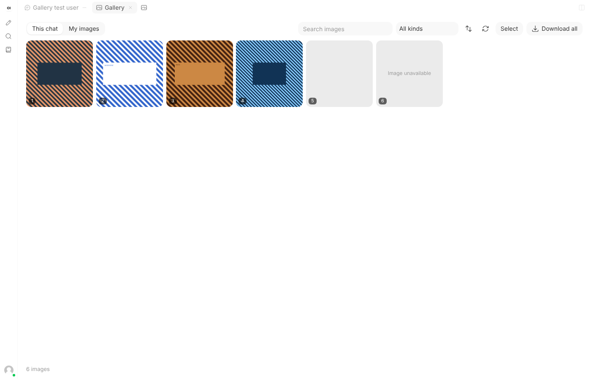
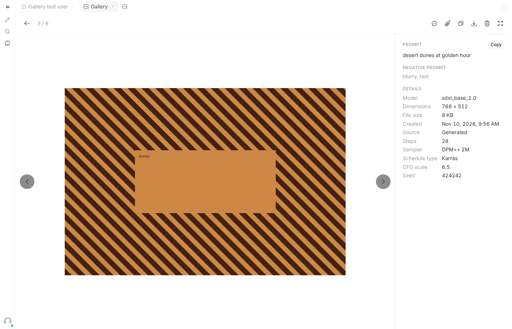
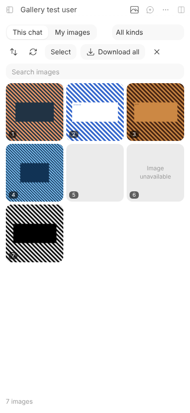

# Chat Gallery for Open WebUI

Images in Open WebUI end up scattered through long chats. Chat Gallery puts them in one place: a **Gallery** tab that shows every image in the current chat as a grid, and a second view, **My images**, with every image you have uploaded or generated in any chat. Open an image to zoom in, read how it was made, copy it, download it, attach it to your next message, or jump back to the message it came from.

Version v1.1.0. Event Function. Requires Open WebUI v0.13.0 or later, the release that added the Tabs panel; tested in a browser on v0.13.0 and v0.13.3.

This is a maintained fork of Chat Gallery 1.0.0 by [@G30](https://openwebui.com/u/g30). The [changelog](CHANGELOG.md) lists what changed. The main differences: it is useful on a server with no image generation, people without a + menu can open it, the grid uses small pictures, it speaks French, and a flaw that could send the sign-in token to another site is fixed.

| Wide screen | Viewer | Phone |
| --- | --- | --- |
|  |  |  |

The pictures in these screenshots are striped test images.

## What you can do

- **See a chat's images at once.** *This chat* collects images you uploaded, images the model generated or edited, images inside tool results, and images linked from other sites, in the order they were sent, from every branch of the chat.
- **Browse all your images.** *My images* lists the image files you own, newest first, and loads more as you scroll. You only ever see your own, administrators included.
- **Filter and sort.** Search by prompt, model, file name or any generation setting. Narrow to generated, uploaded, or linked images. Switch between newest and oldest first.
- **Read how an image was made.** The viewer shows the prompt (with a Copy button), the negative prompt, the model, dimensions, file size, date, source and file name. It also reads the settings saved inside PNG files: seed, steps, CFG, sampler, scheduler, checkpoint and LoRAs from ComfyUI, and the settings line that AUTOMATIC1111, Forge and Fooocus write.
- **Zoom and move around.** Scroll or pinch to zoom toward the pointer, double-click or double-tap to zoom, drag to pan. Swipe or use the arrow keys to move between images. `+`, `-` and `0` zoom from the keyboard, and `F` switches to full screen.
- **Use an image again.** *Attach to message* puts the image in your message draft through Open WebUI's own upload. Nothing is sent until you send it.
- **Go back to the source.** *Show in chat* scrolls to the message the image came from. From *My images*, *Open in chat* opens that chat at that message when Open WebUI saved the link.
- **Copy or download.** Copy an image to the clipboard as a PNG, or download it with a file name taken from its prompt or original name.
- **Download many at once.** *Download all* saves what the current view shows as a zip with a `prompts.txt`. *Select* (or a long press on a phone) picks some instead. A download in progress can be cancelled.
- **Delete your own images.** The trash button deletes the image you are looking at; in Select mode, *Delete* removes the ones you picked. The gallery asks first. A deleted image is gone from Open WebUI and from every chat that showed it, and it can't be brought back. Other people's images and linked images have no delete button.
- **Refresh.** The refresh button reads the chat again. Coming back to the Gallery tab does the same.

## Opening it

- **The Gallery button.** On a wide screen it sits at the end of the tab row above the chat. On a small screen, where Open WebUI shows its classic top bar, it sits in that bar.
- **The + menu** of the Tabs panel also lists *Gallery*, for accounts that have that menu.

Where a tab row is on screen, the gallery opens as a tab: choose another tab and it steps aside, keeping its place; its × closes it. In a split screen it opens in the pane whose button or + you used. Where there is no tab row, as on a phone with the panel closed, it opens over the chat and has its own close button. Escape closes the viewer first, then leaves Select mode, then sets the gallery aside.

As a tab, the gallery has no background of its own: what the panel would show under it is hidden, so a page background image shows through. It uses Open WebUI's colors, so it follows light and dark mode and themes that recolor Open WebUI. It never writes anything into your chats.

## Install

1. Open **Admin Panel > Functions** as an administrator.
2. Create a function and paste [`chat_gallery.py`](chat_gallery.py). Review the code first, as with any function: it runs on your server.
3. Enable the function, then hard-refresh any open Open WebUI tab (`Ctrl+Shift+R`, or `Cmd+Shift+R` on a Mac).
4. Open a chat and select the Gallery button.

Upgrading from 1.0.0: paste the new file over the old function. See the [upgrade notes](CHANGELOG.md).

## Settings

| Valve | Default | What it does |
| --- | --- | --- |
| `max_zip_mb` | 300 | The largest zip, in MB, that Download builds. The browser holds the whole zip in memory until it is saved, so keep this low if people download from phones. |
| `library` | `all` | What the second view lists. `all` shows *My images*: every image the person uploaded or generated. `generated` shows only images generated in Open WebUI, as 1.0.0 did. |
| `allow_delete` | on | Lets people delete their own image files from the gallery. |
| `load_linked_images` | on | Shows images that chats link from other websites. Off keeps the gallery from contacting other sites; those images are left out and counted in the footer. The chat itself still shows them. |
| `header_button` | on | Adds the Gallery button. Off leaves only the + menu, which many accounts don't have. |
| `thumbnail_px` | 320 | Size of the small pictures made in the browser for the grid. 0 shows the full files instead, which uses far more memory with large photos. |
| `language` | `auto` | `auto` follows each person's Open WebUI language: French where it is French, English elsewhere. `en` or `fr` forces one. |

A valve change reaches a browser tab the next time that tab is reloaded.

## What it reads

Chat Gallery runs in the browser with the signed-in person's own access. It reads:

- the open chat, from `GET /api/v1/chats/{id}`;
- each image file's record, for its prompt, model and settings, from `GET /api/v1/files/{id}`;
- the person's files, from `GET /api/v1/files/user/search`. With `library` set to `all` it lists all of them and keeps the images; file contents are not requested;
- the image files themselves, to make the grid's small pictures and when you open, copy, download, attach or zip them;
- the person's own account, from `GET /api/v1/auths/`, to know which files are theirs.

When you delete an image it calls `DELETE /api/v1/files/{id}`, Open WebUI's own route. It adds no server routes of its own, stores nothing on the server or in the browser, and sends nothing anywhere else. The server half of the function only serves the script, through `/static/loader.js`.

## Permissions and security

- Everything goes through Open WebUI's own API, so its access checks apply. An administrator sees only their own files in *My images*.
- The sign-in token is attached only to requests the browser resolves to the Open WebUI address. Images on other sites are loaded without it, without cookies and without a referrer.
- Text from chats and files (prompts, names, settings) is written to the page as text, never as HTML.
- Images linked from other sites load from those sites, which then see the visitor's IP address, as they do when the chat shows them. Set `load_linked_images` off to keep the gallery from adding to that. Some sites don't allow copying, attaching or zipping their images; the gallery says so when that happens.
- The function finds Open WebUI's panel through markers in the page, described under Limits. It changes no Open WebUI file.

## Limits

- *My images* lists image files the person owns. An image pasted into a temporary chat, or stored inline in an old chat, has no file and appears only in that chat's *This chat* view.
- A person with thousands of non-image files: the gallery lists files 200 at a time and pauses after 1,000 files without an image, with a *Keep looking* button.
- Search, the kind filter and the sort order in *My images* cover the images loaded so far; scroll to load more.
- *Open in chat* from *My images* needs the chat link Open WebUI saves with a generated image. It saves one for images made with the Image button, not for uploads or for images the model makes with its built-in image tool. *Show in chat* in *This chat* works for all of them.
- A temporary chat isn't saved, so it has no *This chat* view.
- Settings read from the image file come from PNG files only.
- The small pictures are made again each time the page is loaded; nothing is kept in the browser between visits.
- The Gallery tab lasts until you close it or reload the page.
- The gallery finds Open WebUI's interface by markers that have stayed stable from v0.13.0 to v0.13.3: the class of the tab rows (`panel-tab-strip`), the attributes of the split panes (`data-panel-group`, `data-panel-tab-bar`), the + menu (`app-dropdown-menu`), and the ids `controls-container`, `chat-container`, `chat-pane` and `chat-input`. If a later release changes those, the gallery may not appear until it is updated.
- Interface languages are English and French.

## Tests

Server half, without Open WebUI:

```bash
python -m pip install "pydantic>=2,<3" starlette httpx pytest
python -m pytest -q tests/test_chat_gallery.py
```

It loads the function the way Open WebUI does and checks the served script, the 304 answer, valve changes, withdrawal when disabled, valve limits, that every word has a French translation, and that the two protocol blocks are unchanged.

In a browser, against a **throwaway** Open WebUI with no users yet (the tests create accounts, delete files and change the function's valves):

```bash
python tests/seed.py http://127.0.0.1:8080 chat_gallery.py > seed.json
node tests/e2e.mjs seed.json
```

`seed.py` needs Pillow; `e2e.mjs` needs Playwright with Chromium. On 2026-11-10 all 52 checks passed on Open WebUI v0.13.3 and v0.13.0, with no page errors. They cover: opening as a plain user with no + menu; the six images of a chat with an upload, generated images, a repeat, a document and linked images; small pictures for a 4000 px photo; the kind filter, sort and search; AUTOMATIC1111 and ComfyUI settings read from PNG files; the zip; *My images*; delete with cancel and confirm; Select mode; Refresh; tabs taking turns; closing; an empty chat; the + menu as an administrator; a phone screen; each valve; and that no request to another site carried the token or cookies.

Not tested in a browser: pinch, swipe and double-tap gestures, copying to the clipboard, *Attach to message*, split screen, and use together with G30's Chat Tabs.

## Credit

Chat Gallery is by [@G30](https://openwebui.com/u/g30), released under the MIT license. It is built on Classic298's [Shared Assets Protocol](https://github.com/Classic298/open-webui-plugins/tree/main/shared-assets-protocol) and its live reload add-on (BSD 3-Clause), copied into the function byte for byte, so it shares `/static/loader.js` with other interface functions that use the protocol.
