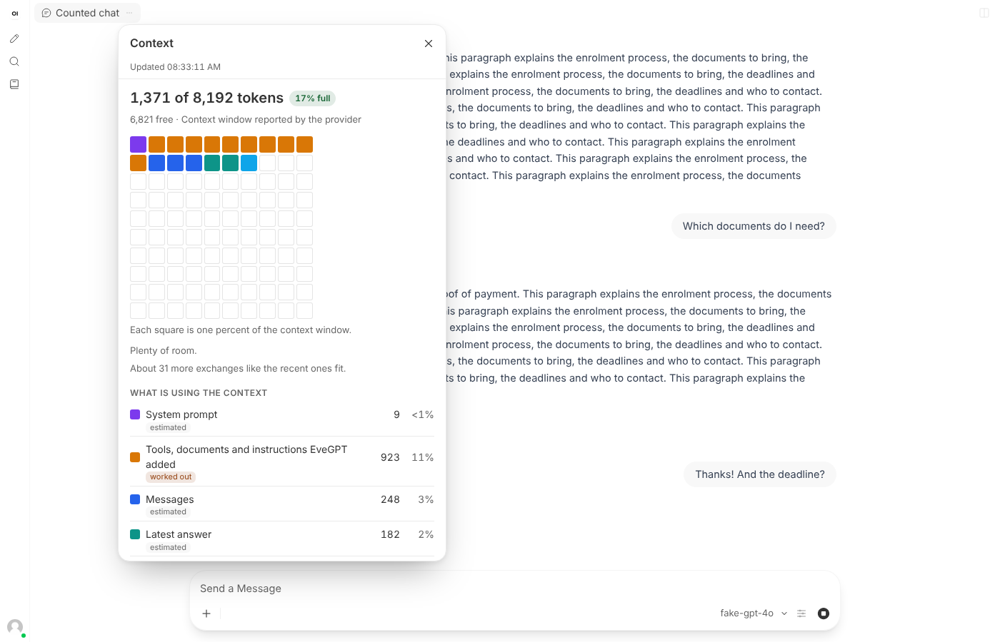
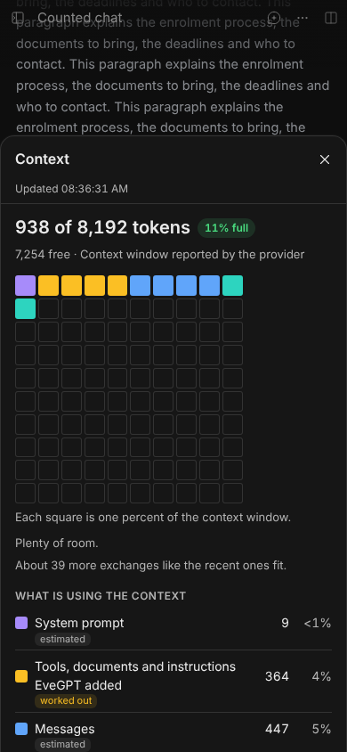
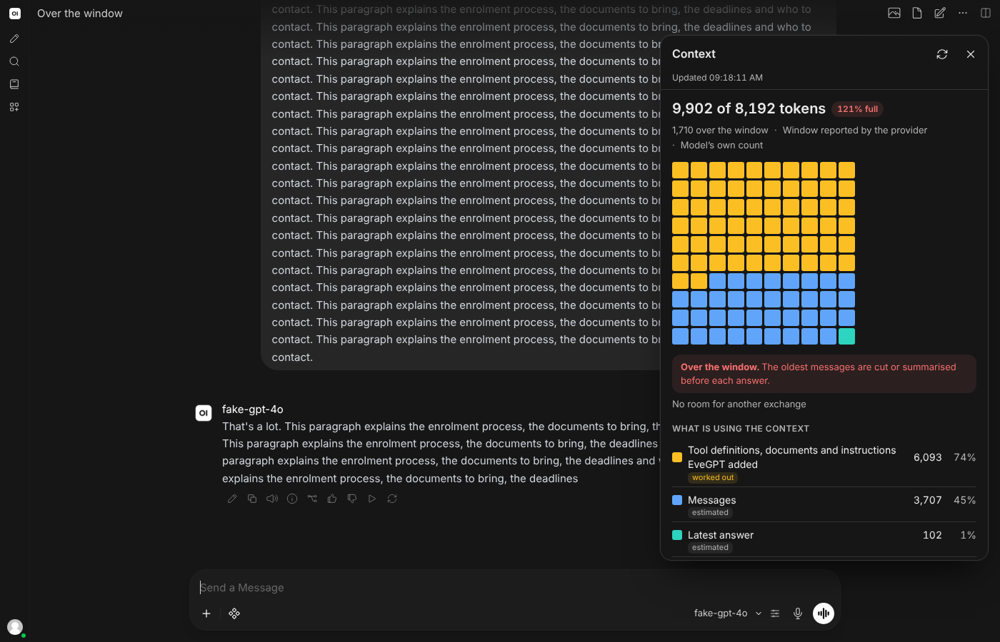

# Chat Inspector for Open WebUI

How full is this chat? Chat Inspector adds **Context** to the chat's **⋯** menu. It opens a pop-up that shows how much of the model's context window the chat uses, the way Claude does: a grid of squares, one per percent, coloured by what fills them, and a breakdown of each part.

Version v1.1.0. Event Function. Requires Open WebUI v0.13.0 or later, the release that added the Tabs panel; tested in a browser on v0.13.0 and v0.13.3.

It is a companion to [Chat Gallery](../chat-gallery/), [Chat Files](../chat-files/) and [Chat Canvas](../chat-canvas/), built the same way.

| The pop-up, from the ⋯ menu | Phone: a sheet from the bottom | Full view, over the window |
| --- | --- | --- |
|  |  |  |

The wording uses your platform's own name. These screenshots come from a server named EveGPT.

## What it shows

- **How full the chat is.** Tokens in use, out of the model's context window, as a number, a percentage and a grid. It warns as the chat fills up (80 % by default) and once it is past the window, and says roughly how many more exchanges like the recent ones fit.
- **What is using the space.**

  | Part | Where it comes from |
  | --- | --- |
  | System prompt | The model's, the chat's or your own, and the folder's |
  | Tools, documents and instructions Open WebUI added | Worked out: the model's own count minus everything that could be estimated. Tool definitions, retrieved documents, memories and Open WebUI's own instructions live here |
  | Summary of earlier messages | Once Open WebUI has compacted the chat |
  | Messages | The conversation on the branch you are looking at |
  | Latest answer | The newest answer's visible text |
  | Since the last count | Messages after the model last counted |
  | Free space, and reserved before summarising | What is left, and the part beyond Open WebUI's summary threshold when compaction is on |

  Each part is labelled *counted* by the model, *estimated* from the text, or *worked out*.
- **The last answer.** Tokens the model read and wrote, reasoning and cached tokens, speed and time, as the provider reported them.
- **The conversation.** Messages, answers, how many the model counted, and the tokens read and written in all.
- **The model.** What it is set up to do, and how many tools and knowledge bases are attached to it.

In a chat that asks several models at once, a picker chooses whose context to show.

## Where the numbers come from

**The model's own count wins.** Most providers report how many tokens they read for each answer. When they do, Context fits everything to that number: the parts it can estimate are scaled to it, and the rest is shown as the *worked-out* share. Totals then match what the model saw.

**Otherwise it estimates**, with tuning made against the real tokenizers of GPT-4o, GPT-4, Llama 3.1, Qwen 2.5 and Mistral. On 1,109 passages it was not tuned on, in 20 languages plus code, the average error is:

| Model family | Context's estimate | Characters ÷ 4 |
| --- | --- | --- |
| GPT-4o, GPT-4.1, GPT-5, o-series | 8 % | 19 % |
| GPT-4, GPT-3.5 | 9 % | 36 % |
| Llama | 12 % | 26 % |
| Qwen | 12 % | 30 % |
| Mistral | 7 % | 42 % |

The family is recognised from the model's id. Other models get Llama's tuning, which had the smallest worst-case error across all five. [`tests/fit_tokens.py`](tests/fit_tokens.py) reproduces the tuning.

**The context window** comes from, in this order:

1. an administrator's rule in the `context_windows` valve;
2. the model's `num_ctx` setting, or the chat's;
3. your own `num_ctx` setting, for models served by Ollama;
4. what the provider reports (`context_length`), as OpenRouter and many others do.

When none of these is known, Context shows the tokens in use without a percentage, and says so.

## Opening it

In any saved chat, open the chat's **⋯** menu (beside the chat's name, in the tab row or the top bar) and choose **Context**, just under **Overview**. Every account has that menu, plain users included.

Context opens as a **pop-up** under the ⋯ button. The conversation stays visible and usable beside it: you can keep typing and sending, and the pop-up updates when each answer finishes. It stops above the message box rather than covering it. Close it with its **×** or **Escape**, and focus goes back to the ⋯ button. If you move to another chat while it is open, it shows that chat.

On a **phone** it opens as a sheet from the bottom of the screen; tap outside it to close it.

Context reads the chat when it opens and once an answer has finished. It watches the page, not the server, and doesn't poll. While an answer is being written, it says so.

Prefer the full view? Set `open_as` to `tab` and Context fills the chat's pane like the Tabs panel's own tabs. Two more ways in are optional: the Tabs panel's **+** menu (`show_in_plus_menu`) and a button beside the tabs (`header_button`).

## Its name for the platform

Wherever Context names the platform ("tools and instructions EveGPT added", "summarised by EveGPT"), it uses the name your administrator gave Open WebUI with `WEBUI_NAME`, read from the server. Without a custom name it says "Open WebUI". The `platform_name` valve sets it explicitly.

## Light, dark and themes

Context takes its colours from Open WebUI's palette and follows light, dark, OLED black and *Her*. Every text was measured at 4.5:1 contrast or better in all four, warnings included.

## Install or upgrade

1. Open **Admin Panel > Functions** as an administrator.
2. Create a function with the id `chat_inspector`, or open the existing Chat Inspector, and paste [`chat_inspector.py`](chat_inspector.py). Review the code first, as with any function: it runs on your server.
3. Enable it, then hard-refresh open Open WebUI tabs (`Ctrl+Shift+R`, or `Cmd+Shift+R` on a Mac).

Upgrading from 0.2.0 or 1.0.0 keeps the same function id. In 1.1.0 Context moved to the chat's ⋯ menu and opens as a pop-up; the + menu entry is off unless you turn on `show_in_plus_menu`.

## Settings

| Valve | Default | What it does |
| --- | --- | --- |
| `context_windows` | empty | Context windows for models whose provider doesn't report one, or to correct one. One rule per line or comma, pattern `=` size: `gpt-4o* = 128000, llama3.1* = 128k, campus-model = 32768`. `k` and `m` mean thousand and million. The first matching rule wins, and a rule beats what the provider says. |
| `warn_percent` | 80 | How full the window is before Context says it is getting full. |
| `show_capabilities` | on | Show what the model is set up to do. |
| `platform_name` | empty | The name Context uses for the platform, such as `EveGPT`. Empty uses the server's `WEBUI_NAME`. |
| `open_as` | `popup` | `popup`: a pop-up under the ⋯ button, with the chat still in view. `tab`: the full view, like the Tabs panel's tabs. |
| `show_in_chat_menu` | on | Add Context to the chat's ⋯ menu, under Overview. |
| `show_in_plus_menu` | off | Also add it to the Tabs panel's + menu, where it opens as a tab. |
| `header_button` | off | Also add a Context button beside the tabs. It opens the way `open_as` says. |
| `language` | `auto` | `auto` follows each person's Open WebUI language: French where it is French, English elsewhere. |

## What it reads

Chat Inspector runs in the browser with the signed-in person's own access and only reads:

- the open chat, from `GET /api/v1/chats/{id}`, including Open WebUI's compaction threshold when compaction is on;
- the models the person can use, from `GET /api/models`, at most every five minutes;
- the person's settings, from `GET /api/v1/users/user/settings`, for their system prompt and context size;
- the chat's folder, from `GET /api/v1/folders/{id}`, for its system prompt;
- the platform's name, from `GET /api/config`.

It changes nothing, stores nothing, adds no server routes and sends nothing anywhere else. The server half only serves the script through `/static/loader.js`.

## Limits

- **Estimates are estimates.** Without the model's own count, Context can't see tool definitions, retrieved documents or memories Open WebUI adds. It says so, and the numbers will be low.
- **Images** cost tokens that depend on the model; they aren't estimated, and are counted only within the model's own count.
- **The count is from the last answer.** Anything added since, such as a newly attached file, shows up only as estimated text until the next answer.
- **Reasoning tokens** are shown for the last answer but not counted as context, since most providers don't send reasoning back.
- **A temporary or unsaved chat** has nothing stored to read.
- **The summary threshold** is when Open WebUI compacts the chat, not the model's window; both are shown.
- **Interface markers.** Like its companions, Context finds Open WebUI's interface by markers that stayed stable from v0.13.0 to v0.13.3 (`panel-tab-strip`, `data-panel-group`, `app-dropdown-menu`, `controls-container`, `chat-container`, `chat-pane`, `messages-container`). A later release may need an update.
- **Languages:** English and French.

## Tests

Server half, without Open WebUI:

```bash
python -m pip install "pydantic>=2,<3" starlette httpx pytest
python -m pytest -q tests/test_chat_inspector.py
```

Besides the served script and valves, it runs the shipped token counter on fixed passages and checks it against real tokenizer counts stored in `tests/token_samples.json`.

In a browser, against a **throwaway** Open WebUI with no users yet, wired to the fake model:

```bash
python tests/fake_model.py 9999 &
OPENAI_API_BASE_URL=http://127.0.0.1:9999/v1 OPENAI_API_KEY=test ENABLE_OPENAI_API=true open-webui serve
python tests/seed.py http://127.0.0.1:8080 chat_inspector.py ../chat-canvas/chat_canvas.py ../chat-files/chat_files.py ../chat-gallery/chat_gallery.py > seed.json
node tests/e2e.mjs seed.json
```

`fake_model.py` is an OpenAI-compatible server that streams answers and reports usage, adding 300 tokens of its own to every prompt the way a server's tools and instructions would. Results on 2026-11-10:

| Open WebUI | With Canvas, Files and Gallery | Checks |
| --- | --- | --- |
| v0.13.3 | yes | 76 of 76 passed |
| v0.13.3 | no | 71 of 71 passed |
| v0.13.0 | yes | 76 of 76 passed |

They cover: Context in the chat's ⋯ menu right after Overview, styled like its items, for a plain user with no + menu; the pop-up opening on screen, clear of the message box and without covering the chat; typing and sending with it open, and it following the answer; Escape and × closing it with focus back on the ⋯ button; it following a change of chat; the platform's name, EveGPT, in its wording and the `platform_name` override; the phone sheet and closing it by tapping outside; `open_as = tab`; turning the menu entry off; opening from the + menu when it is turned on; the breakdown summing to the model's count; the grid; the last answer and totals; no polling; an estimated chat with French, Arabic, Chinese and an image; the administrator's window; nearly full and over the window; two models and the picker; a summarised chat; a model that no longer exists; an empty chat; **a real answer streamed through Open WebUI**, with Context saying it is being written and then updating by itself, and the fake model's 300 extra tokens showing up as the worked-out share; taking turns with the other three tabs; a plain user with no + menu and the optional button; contrast in four themes; a phone; and every valve.

Not tested in a browser: a real provider other than the fake model, Ollama's own usage fields, split screen, and Chat Tabs.
