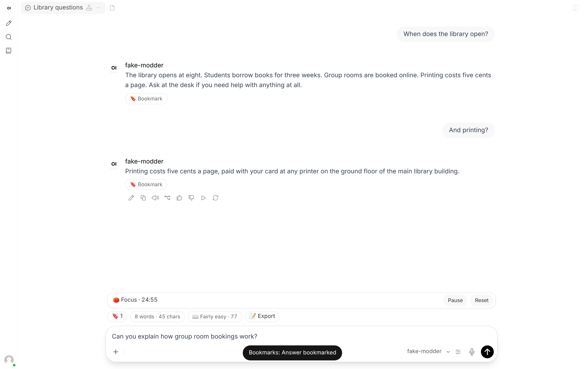
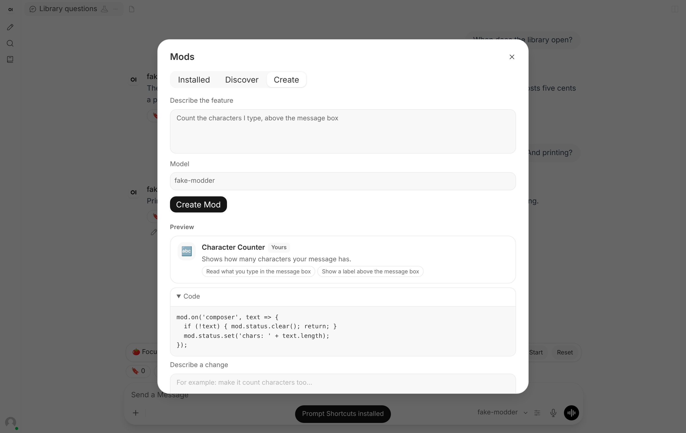
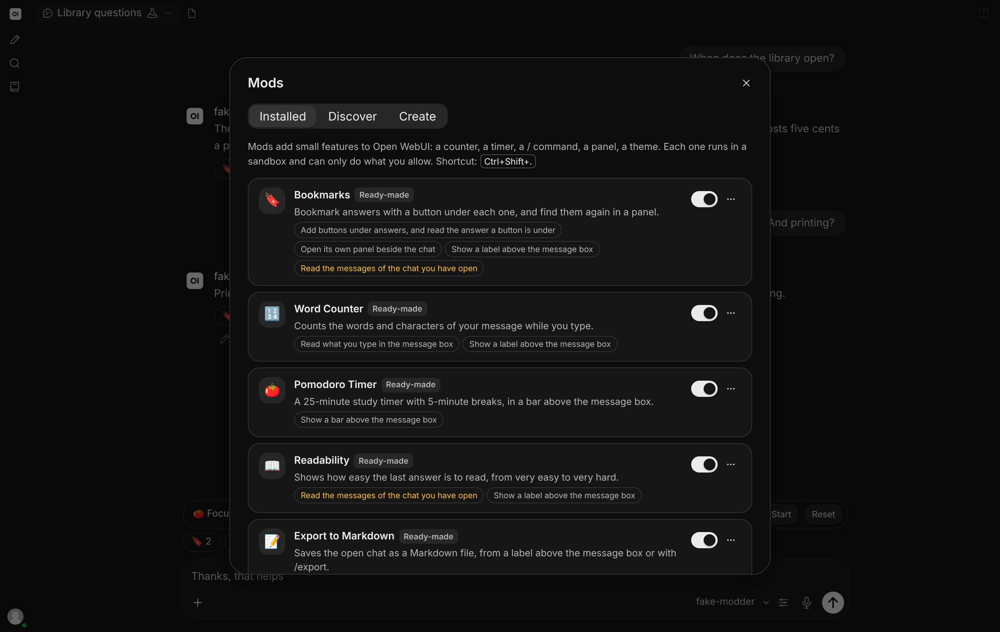

# Mods for Open WebUI

Mods let people add small features to Open WebUI without asking an administrator for a new plugin: a word counter, a study timer, `/` commands, bookmarks, a reading theme. You describe what you want in plain words, a model writes it, you try it, and it appears. Each mod runs in its own sandbox and can only do what you allowed when you installed it.

Version v1.0.0. Event Function. Requires Open WebUI v0.13.0 or later; tested in a browser on v0.13.0 and v0.13.3.

| In a chat | Create a mod | Before it installs |
| --- | --- | --- |
|  |  |  |

| A mod's panel, dark mode | Installed, dark mode | Phone |
| --- | --- | --- |
|  |  |  |

## What you can do

- **Install a ready-made mod** from *Discover*. Eight come with it:

  | Mod | What it does | Permissions |
  | --- | --- | --- |
  | Word Counter | Words and characters of your message, as you type | read the message box, label |
  | Prompt Shortcuts | `/summarize`, `/translate`, `/simplify`, `/quiz`, `/proofread` fill in a ready-written prompt | `/` commands, write the message box |
  | Focus Mode | Hides the sidebar and widens the chat; a label turns it on and off | change the look, label |
  | Pomodoro Timer | 25 minutes of work, 5 of rest, in a bar above the message box | bar |
  | Bookmarks | A button under each answer, and a panel listing what you saved | buttons, panel, label, read the chat |
  | Readability | How easy the last answer is to read (Flesch score, French formula in French) | read the chat, label |
  | Export to Markdown | Saves the chat as a `.md` file, from a label or `/export` | read the chat, save files, label, `/` commands |
  | Warm Reading Theme | Warmer greys in light and dark mode | change the look |

- **Create your own.** In *Create*, describe the feature and choose a model. The model writes the mod; you see what it asks for and its code, *Try It* runs it without saving anything, *Describe a change* rewrites it, and *Install* keeps it.
- **Paste or import** a mod someone shared, as text or a `.mod` file. *Export* in a mod's ⋯ menu saves one.
- **Turn mods on and off**, edit them in Create, or remove them (after a confirmation). A mod that fails shows its last errors on its card.
- **Administrators publish** a mod to everyone from its ⋯ menu, and can turn a published mod on for everyone. It is installed once for each person; someone who removes it doesn't get it back.

Your mods are kept on the server, so they follow you to another browser. What a mod saves for itself (bookmarks, a setting) stays in the browser you used.

## Opening it

- The chat's **⋯ menu** has *Mods*.
- The **+ menu** of the tab row above the chat has *Mods*, where Open WebUI shows that menu.
- **Ctrl+Shift+.** (**⌘⇧.** on a Mac) from anywhere. Open WebUI already uses Ctrl+Shift+M for its model selector, so Mods doesn't.

If a mod makes the page unusable, open Open WebUI with `?mods=off` at the end of the address (for example `https://chat.example.edu/?mods=off`). Nothing runs in that tab, and the Mods window offers to turn them back on.

## What a mod can do

A mod is plain JavaScript that runs in a hidden frame of its own. It sees nothing of the page: it talks to Open WebUI through a `mod` object, and every call is checked against what it was granted.

| Permission | What it unlocks | Risk |
| --- | --- | --- |
| `composer.read` | Hear what you type, read the message box | low |
| `composer.write` | Set or add to the message box | low |
| `chat.read` | Read the open chat; hear when an answer finishes; scroll to a message | high |
| `chat.send` | Send a message in your name (3 a minute at most, never while an answer is being written) | high |
| `ui.status` | A small label above the message box, optionally clickable | low |
| `ui.band` | A bar above the message box with up to 3 buttons | low |
| `ui.pane` | Its own panel beside the chat | low |
| `ui.style` | Change Open WebUI's look with CSS | medium |
| `commands` | Up to 8 `/` commands | low |
| `message.buttons` | Up to 3 buttons under each answer; a button gets the answer it is under | medium |
| `ai` | Ask a model a question (6 a minute by default) | medium |
| `download` | Save text, Markdown, CSV, JSON or HTML files, up to 5 MB | low |

Without any permission a mod can still show a short message, keep up to 64 KB of its own data, and read whether Open WebUI is in dark mode and which language it is in.

Example:

```text
name: Shout
description: Adds /shout, which writes your message in capitals.
icon: 📣
version: 1
permissions: commands, composer.write
---
mod.commands.add('shout', 'Write it in capitals', text => text.toUpperCase());
```

The full API is the guide the model is given in Create; it is in `GUIDE` in [`chat_mods.py`](chat_mods.py).

## Light, dark and languages

Mods takes its colours from Open WebUI's own grey palette, so the window, bars, labels and buttons follow light mode, dark mode and their changes while the page is open. A mod's panel gets the same colours as CSS variables (`--mod-bg`, `--mod-text`, `--mod-accent` and others), sent again when the theme changes, so mods written for one mode work in the other. High-contrast (forced colours) mode gets outlined controls; reduced motion turns animations off.

The interface is in English and French and follows Open WebUI's language. The ready-made mods speak French too.

## Install

1. Open **Admin Panel > Functions** as an administrator.
2. Create a function and paste [`chat_mods.py`](chat_mods.py). Review the code first, as with any function: it runs on your server.
3. Enable the function, then hard-refresh any open Open WebUI tab (`Ctrl+Shift+R`, or `Cmd+Shift+R` on a Mac).
4. Press Ctrl+Shift+. or choose *Mods* in a chat's ⋯ menu.

## Settings

| Valve | Default | What it does |
| --- | --- | --- |
| `enabled` | on | Switches every mod off for everyone at once, without uninstalling anything. |
| `allow_user_mods` | on | Lets people create and import their own mods. Off, they can only install ready-made and published mods (administrators still can). |
| `allowed_permissions` | all 12 | The permissions mods may use on this server, comma separated. Remove `chat.send` or `ai`, for example, and no mod asking for it can be installed or run. |
| `max_mods_per_user` | 12 | How many mods one person can have (up to 24). Each mod that is on runs in its own frame. |
| `ai_calls_per_minute` | 6 | How often one mod may ask a model, per minute. 0 stops it. |
| `studio_model` | empty | The model that writes mods in Create and answers mods' questions. Empty uses the first model each person can use; people can pick another in Create. |
| `show_starters` | on | Offers the 8 ready-made mods. |
| `show_in_chat_menu` | on | Adds *Mods* to a chat's ⋯ menu. |
| `show_in_tab_menu` | on | Adds *Mods* to the tab row's + menu. |
| `language` | `auto` | `auto` follows Open WebUI's language; `en` or `fr` forces one. |
| `catalog` | `[]` | Mods published to everyone, as JSON. Managed from the Mods window. |

A valve change reaches a browser tab the next time it is reloaded.

## Permissions and security

- **The sandbox.** Each mod runs in an `<iframe sandbox="allow-scripts">` written by Mods, without the site's origin. It can't read the page, Open WebUI's storage or cookies, or the sign-in token. It can't open windows, submit forms or navigate the page. Its content policy (`default-src 'none'`, `connect-src 'none'`) blocks every network request: `fetch`, images, fonts, styles and frames from anywhere.
- **The bridge.** Mods accepts a message only from a frame it made, from that frame's own window, carrying a random key given to that frame alone, and only for a request its permissions cover. Text, sizes and rates are capped on the way in.
- **Navigation.** A browser lets a sandboxed frame load another address in itself, and nothing can stop that from outside. Mods stops and switches off a mod the moment its frame loads anything else. Because the address it loaded can carry what the mod was given, **a mod that can read your chat could pass it on**; the permission dialog says so for those mods. Install mods only from people you trust, and read what they ask for.
- **Styles** (`ui.style`) can't load anything: `@import`, `image-set()`, `src()` and every `url()` that isn't a `data:` image are refused or removed, after comments are stripped and with CSS escapes refused, so `u\72l(` can't spell its way through. A style can't select Mods' own interface, so it can't hide itself or the off switch. A style can still make the page hard to use; safe mode (`?mods=off`) undoes that.
- **Mods that misbehave are stopped.** A mod that throws five errors in ten seconds is switched off and marked *Stopped*, with its errors shown.
- **When `allow_user_mods` is off**, the Create tab is gone and the browser runs only code identical to a ready-made or published mod, whatever a person stores through the API (administrators excepted).
- **The server checks what it stores.** Each person's mods are kept in the function's user settings, and the server refuses anything malformed: unknown permissions, grants a mod didn't ask for, ids that aren't simple names, code over 60,000 characters, more than 24 mods. Only administrators can change the catalog, which is checked the same way.
- **Published mods are public to signed-in people.** The catalog is part of the script every page loads, so anyone who can open Open WebUI can read the code of published mods. Don't publish anything secret.
- **The page itself** writes everything as text, never as HTML. The sign-in token is attached only to requests that resolve to Open WebUI's own address.

## Limits

- What a mod keeps for itself is per browser. Mods themselves follow the account.
- Mods places its bar, labels and buttons by markers that have stayed stable from Open WebUI 0.13.0 to 0.13.3 (`chat-input`, `message-input-container`, `messages-container`, `response-content-container`, `chat-context-menu-button`, `panel-tab-strip`). A later release that changes them may hide some of Mods until it is updated.
- Open WebUI's own `/` menu also opens when you type `/`. Mods' commands are listed as chips above the message box and run when you press Enter on one.
- A mod's panel covers the right side of the chat while it is open.
- A mod in its sandbox can't use the microphone, camera, clipboard, notifications or other sites; that is the point.
- Writing mods is as good as the model you choose. The guide keeps models to the API; small local models may need a second try.

## Tests

Server half, without Open WebUI:

```bash
python -m pip install "pydantic>=2,<3" starlette httpx pytest
python -m pytest -q tests/test_chat_mods.py
```

It checks the served script and settings, that a valve change or disabling the function reaches the next request, that published code can't end the script early, every validation rule for settings and stored mods, that the ready-made mods are valid and parse, the French translation, the sandbox and content policy, that nothing is written as HTML, the mod format and the CSS cleaner (run in Node), the state machine, that the Create guide covers every permission, the shortcut, and that the two protocol blocks are unchanged.

In a browser, against a **throwaway** Open WebUI with no users yet:

```bash
python tests/fake_model.py 9996 &
OPENAI_API_BASE_URL=http://127.0.0.1:9996/v1 OPENAI_API_KEY=test open-webui serve &
python tests/seed.py http://127.0.0.1:8080 chat_mods.py > seed.json
node tests/e2e.mjs seed.json
```

`e2e.mjs` needs Playwright with Chromium. It installs the ready-made mods and uses each one, creates, tries, changes, installs and exports a mod with the fake model, opens Mods from the ⋯ and + menus, runs a mod that tries every way out of its sandbox, tries styles that would load from elsewhere or hide Mods, a mod that navigates away and one that keeps failing, checks the server's validation, safe mode, dark mode, French, a phone screen, an administrator publishing a mod for everyone, a person removing it, and the off switch.

Results on 2026-11-17:

| Open WebUI | With Chat Files and Artifacts | Checks |
| --- | --- | --- |
| 0.13.3 | yes | 69 of 69 |
| 0.13.0 | no | 68 of 68 (its + menu button only appears on hover, so that check is skipped) |

Server tests: 42 of 42.

## Licence

MIT. By Muhammad Sohail.
