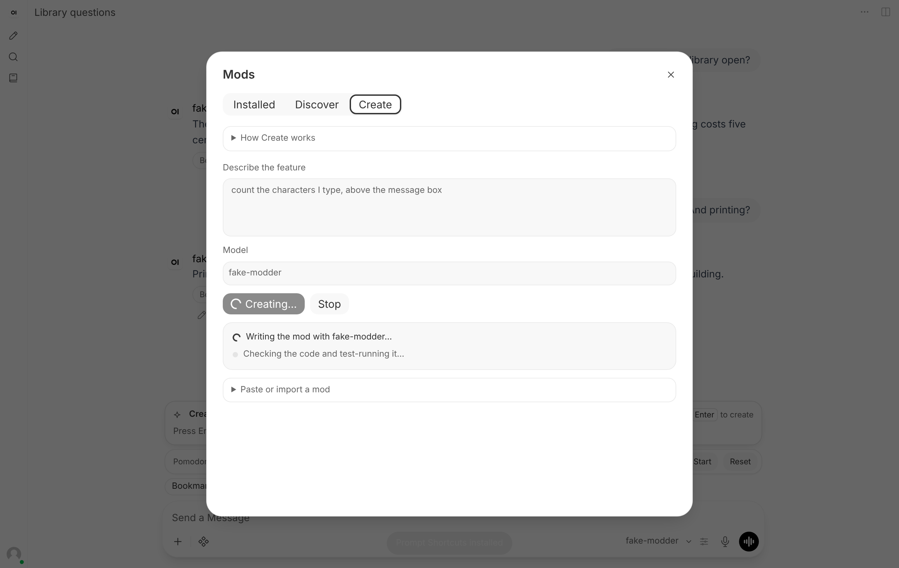
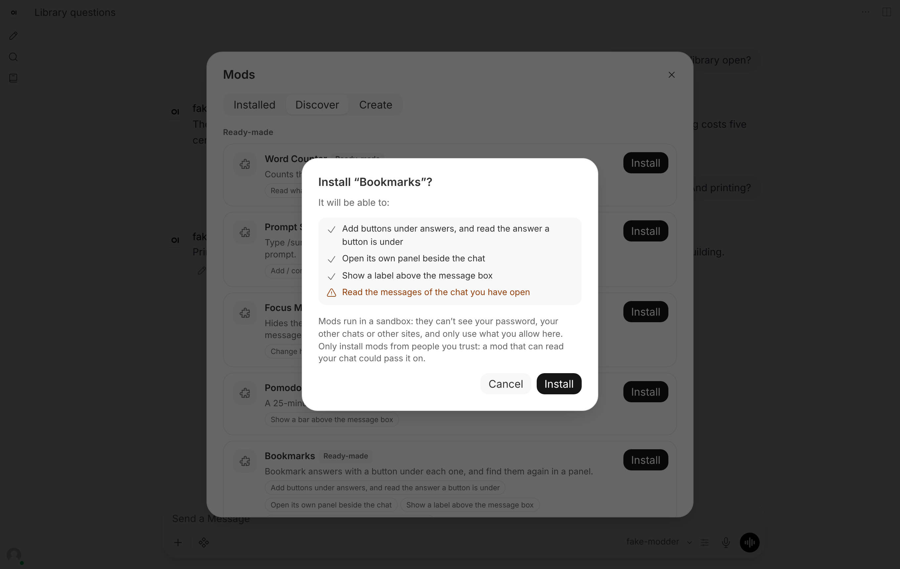
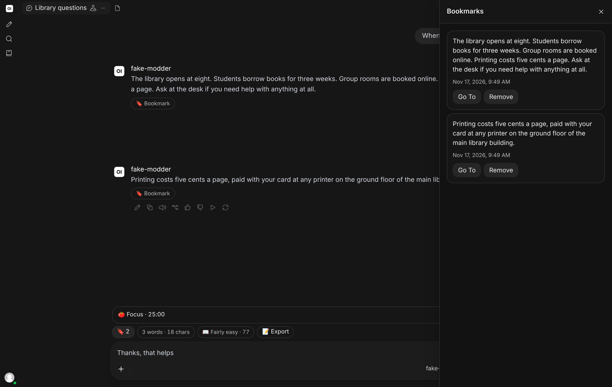
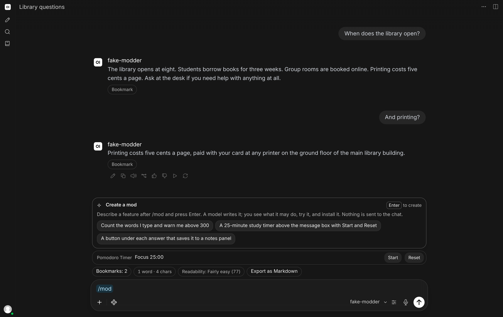
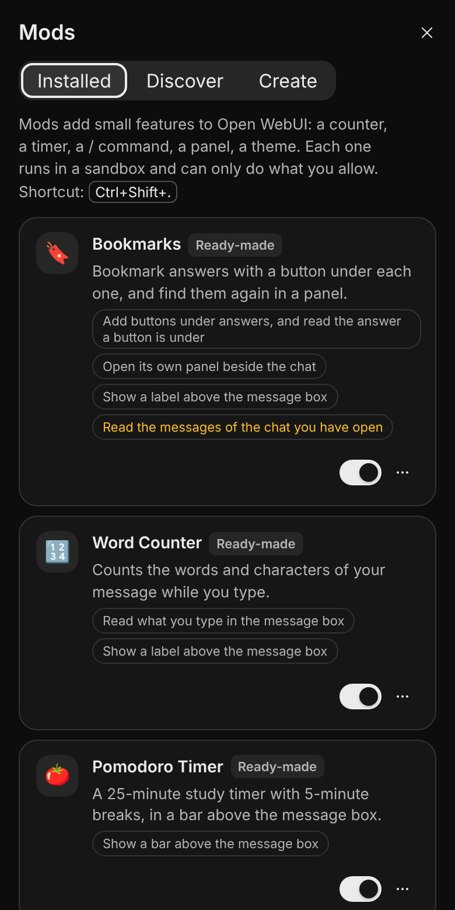

# Mods for Open WebUI

Mods let people add small features to Open WebUI without asking an administrator for a new plugin: a word counter, a study timer, `/` commands, bookmarks, a reading theme. Type `/mod` and what you want in the message box, press Enter, and a model writes it. Mods checks the code, test-runs it and has the model fix what fails; you see what it will be allowed to do, try it, and install it. Each mod runs in its own sandbox and can only do what you allowed.

Version v1.0.0. Event Function. Requires Open WebUI v0.13.0 or later; tested in a browser on v0.13.0 and v0.13.3.

| Type `/mod` | Press Enter: it is written and checked | Review, try, install |
| --- | --- | --- |
|  |  |  |

| Before it installs | In a chat | A mod's panel, dark mode |
| --- | --- | --- |
|  |  |  |

| Installed, dark mode | The /mod card, dark mode | Phone |
| --- | --- | --- |
|  |  |  |

## What you can do

- **Install a ready-made mod** from *Discover*. Eight come with it:

  | Mod | What it does | Permissions |
  | --- | --- | --- |
  | Word Counter | Words and characters of your message, as you type | read the message box, label |
  | Prompt Shortcuts | `/summarize`, `/translate`, `/simplify`, `/quiz`, `/proofread` fill in a ready-written prompt | `/` commands, write the message box |
  | Focus Mode | Hides the sidebar and widens the chat; a label turns it on and off | change the look, label |
  | Pomodoro Timer | 25 minutes of work, 5 of rest, in a bar above the message box | bar |
  | Bookmarks | A button under each answer, and a panel listing what you saved | buttons, panel, label, read the chat |
  | Readability | How easy the last answer is to read (Flesch score, French formula in French) | read the chat, label |
  | Export to Markdown | Saves the chat as a `.md` file, from a label or `/export` | read the chat, save files, label, `/` commands |
  | Warm Reading Theme | Warmer greys in light and dark mode | change the look |

- **Create one in plain words**, from the message box with `/mod` or in the *Create* tab. See [Creating a mod](#creating-a-mod).
- **Paste or import** a mod someone shared, as text or a `.mod` file. *Export* in a mod's ⋯ menu saves one.
- **Turn mods on and off** one by one, edit them in Create, or remove them (after a confirmation). A mod that fails shows its last errors on its card.
- **Pause all your mods** with *Run my mods* at the top of *Installed*. Nothing runs and `/mod` is off, on every device, until you turn it back on. Your mods and their settings are kept.
- **Administrators publish** a mod to everyone from its ⋯ menu, and can turn a published mod on for everyone. It is installed once for each person; someone who removes it doesn't get it back.

Your mods are kept on the server, so they follow you to another browser. What a mod saves for itself (bookmarks, a setting) stays in the browser you used.

## Creating a mod

### From the message box

1. Type `/mod`. A card appears above the message box: it explains what will happen and offers three examples you can click. Open WebUI's own `/model` suggestion steps aside while the card is there; type `/model` and it comes back.
2. Write what you want after `/mod`, in your own words, for example `/mod a 25-minute study timer above the message box with Start and Reset`. The card shows *Press Enter to create a mod that: …*.
3. Press Enter. Nothing is sent to the chat; the message box is emptied and the Mods window opens on *Create*, already writing.

`/mod` alone opens *Create* with the cursor in the description. While a mod is being written, the card says so and offers to open Mods.

### In the Create tab

Describe the feature, choose a model and select **Create Mod**. *How Create works* at the top explains the steps and has examples to start from. Mods remembers the model you chose.

### What happens next

| Step | What you see |
| --- | --- |
| The model writes the mod | *Writing the mod with {model}…*, with a **Stop** button that cancels and changes nothing |
| Mods reads the answer | Models format answers loosely; Mods reads fences, extra prose, reasoning blocks, bold or bulleted settings, permissions in brackets or by common names (`status`, `panel`) |
| Mods checks the code | It refuses code that would fail in the sandbox (network, browser storage, `alert`, the Open WebUI page, functions the mod API doesn't have, events that don't exist, calls used without `await`) |
| Mods test-runs it | For a second, in a throwaway sandbox with a stand-in API: sample typing (empty, short and 360 words), a sample chat and answer, its panel opened and closed, its commands, buttons and actions pressed. Errors are caught, and so are styles whose selectors match nothing in Open WebUI |
| A problem goes back to the model | *Fixing it, try 2 of 3…*, with the problem shown. The model sees its answer and what was wrong; on the last try it is told to start again simply. A mod that asks for a panel, buttons or commands but never makes them goes back too |
| The preview | The mod, what it asks for, any permission Mods added because the code uses it, and a warning for anything it asked for but never used in the test run. The window scrolls to it |

Then **Try It** runs it for real without saving anything, **Describe a change** has the model rewrite it (checked the same way), and **Install** keeps it, after the permission dialog. If you close the window while a mod is being written, a message tells you when it is ready.

If the model can't produce a working mod in 3 tries, Mods says what the last problem was and suggests describing it more simply or choosing a stronger model. A model that takes more than 5 minutes is stopped with a message saying so.

### Writing good descriptions

- Say **where** it goes: *above the message box* (a label or a bar), *under each answer* (buttons), *in a panel*, *as a /command*, *the look of the chat*.
- Say **when** it acts: *while I type*, *when an answer finishes*, *when I click*.
- One feature per mod. Add more with *Describe a change*.
- Stronger models write better mods. See [Tested with real models](#tested-with-real-models) for what small models managed.

## Opening it

- The chat's **⋯ menu** has *Mods*.
- The **+ menu** of the tab row above the chat has *Mods*, where Open WebUI shows that menu.
- **`/mod`** in the message box, with or without a description (where people may create mods and `slash_command` is on).
- **Ctrl+Shift+.** (**⌘⇧.** on a Mac) from anywhere. Open WebUI already uses Ctrl+Shift+M for its model selector, so Mods doesn't.

If a mod makes the page unusable, open Open WebUI with `?mods=off` at the end of the address (for example `https://chat.example.edu/?mods=off`). Nothing runs in that tab, and the Mods window offers to turn them back on.

## What a mod can do

A mod is plain JavaScript that runs in a hidden frame of its own. It sees nothing of the page: it talks to Open WebUI through a `mod` object, and every call is checked against what it was granted.

| Permission | What it unlocks | Risk |
| --- | --- | --- |
| `composer.read` | Hear what you type, read the message box | low |
| `composer.write` | Set or add to the message box | low |
| `chat.read` | Read the open chat; hear when an answer finishes; scroll to a message | high |
| `chat.send` | Send a message in your name (3 a minute at most, never while an answer is being written) | high |
| `ui.status` | A small label above the message box, optionally clickable | low |
| `ui.band` | A bar above the message box with up to 3 buttons | low |
| `ui.pane` | Its own panel beside the chat | low |
| `ui.style` | Change Open WebUI's look with CSS | medium |
| `commands` | Up to 8 `/` commands | low |
| `message.buttons` | Up to 3 buttons under each answer; a button gets the answer it is under | medium |
| `ai` | Ask a model a question (6 a minute by default) | medium |
| `download` | Save text, Markdown, CSV, JSON or HTML files, up to 5 MB | low |

Without any permission a mod can still show a short message, keep up to 64 KB of its own data, and read whether Open WebUI is in dark mode and which language it is in.

Example:

```text
name: Shout
description: Adds /shout, which writes your message in capitals.
version: 1
permissions: commands, composer.write
---
mod.commands.add('shout', 'Write it in capitals', text => text.toUpperCase());
```

The full API is the guide the model is given in Create; it is in `GUIDE` in [`chat_mods.py`](chat_mods.py).

## Light, dark and languages

Mods takes its colours from Open WebUI's own grey palette, so the window, bars, labels and buttons follow light mode, dark mode and their changes while the page is open. A mod's panel gets the same colours as CSS variables (`--mod-bg`, `--mod-text`, `--mod-accent` and others), sent again when the theme changes, so mods written for one mode work in the other. High-contrast (forced colours) mode gets outlined controls; reduced motion turns animations off.

The interface is in English and French and follows Open WebUI's language. The ready-made mods speak French too.

## How it works


The Event function serves the Mods script and checks every mod that is saved. In the page, each mod runs in its own sandboxed frame, and the Mods host answers its requests only after checking the frame, its key and its permissions. Create sends the description to a model, then reads, checks and test-runs the answer, and sends any problem back to the model. For the details, see [ARCHITECTURE.md](ARCHITECTURE.md).

## Install

1. Open **Admin Panel > Functions** as an administrator.
2. Create a function and paste [`chat_mods.py`](chat_mods.py). Review the code first, as with any function: it runs on your server.
3. Enable the function, then hard-refresh any open Open WebUI tab (`Ctrl+Shift+R`, or `Cmd+Shift+R` on a Mac).
4. Press Ctrl+Shift+. or choose *Mods* in a chat's ⋯ menu.

## Settings

| Valve | Default | What it does |
| --- | --- | --- |
| `enabled` | on | Switches every mod off for everyone at once, without uninstalling anything. |
| `allow_user_mods` | on | Lets people create and import their own mods. Off, they can only install ready-made and published mods (administrators still can). |
| `allowed_permissions` | all 12 | The permissions mods may use on this server, comma separated. Remove `chat.send` or `ai`, for example, and no mod asking for it can be installed or run. |
| `max_mods_per_user` | 12 | How many mods one person can have (up to 24). Each mod that is on runs in its own frame. |
| `ai_calls_per_minute` | 6 | How often one mod may ask a model, per minute. 0 stops it. |
| `studio_model` | empty | The model that writes mods in Create and answers mods' questions. Empty uses the model each person last chose in Create, or else the first they can use. Choose a capable coding model. |
| `slash_command` | on | Lets people type `/mod` and a description in the message box to create a mod, with the card that explains it. Off, they use the Mods window. |
| `show_starters` | on | Offers the 8 ready-made mods. |
| `show_in_chat_menu` | on | Adds *Mods* to a chat's ⋯ menu. |
| `show_in_tab_menu` | on | Adds *Mods* to the tab row's + menu. |
| `language` | `auto` | `auto` follows Open WebUI's language; `en` or `fr` forces one. |
| `catalog` | `[]` | Mods published to everyone, as JSON. Managed from the Mods window. |

A valve change reaches a browser tab the next time it is reloaded.

### Turning things off

| To stop | Who | How |
| --- | --- | --- |
| Every mod, for everyone | Administrator | `enabled` off |
| People writing or importing their own mods | Administrator | `allow_user_mods` off (only ready-made and published mods remain) |
| `/mod` in the message box | Administrator | `slash_command` off |
| A capability, such as sending messages or asking the model | Administrator | remove it from `allowed_permissions` |
| All of one person's mods | That person | *Run my mods* off in *Installed* |
| One mod | That person | its switch in *Installed*, or remove it |
| Everything, in one tab, after a mod broke the page | Anyone | open the address with `?mods=off` |

## Permissions and security

- **The sandbox.** Each mod runs in an `<iframe sandbox="allow-scripts">` written by Mods, without the site's origin. It can't read the page, Open WebUI's storage or cookies, or the sign-in token. It can't open windows, submit forms or navigate the page. Its content policy (`default-src 'none'`, `connect-src 'none'`) blocks every network request: `fetch`, images, fonts, styles and frames from anywhere.
- **The bridge.** Mods accepts a message only from a frame it made, from that frame's own window, carrying a random key given to that frame alone, and only for a request its permissions cover. Text, sizes and rates are capped on the way in.
- **Navigation.** A browser lets a sandboxed frame load another address in itself, and nothing can stop that from outside. Mods stops and switches off a mod the moment its frame loads anything else. Because the address it loaded can carry what the mod was given, **a mod that can read your chat could pass it on**; the permission dialog says so for those mods. Install mods only from people you trust, and read what they ask for.
- **Styles** (`ui.style`) can't load anything: `@import`, `image-set()`, `src()` and every `url()` that isn't a `data:` image are refused or removed, after comments are stripped and with CSS escapes refused, so `u\72l(` can't spell its way through. A style can't select Mods' own interface, so it can't hide itself or the off switch. A style can still make the page hard to use; safe mode (`?mods=off`) undoes that.
- **Test runs are sandboxed like real mods.** The test run before you see a mod uses the same sandbox and content policy, with a stand-in API that does nothing outside the frame, and a 5-second limit.
- **Mods that misbehave are stopped.** A mod that throws five errors in ten seconds is switched off and marked *Stopped*, with its errors shown.
- **When `allow_user_mods` is off**, the Create tab is gone and the browser runs only code identical to a ready-made or published mod, whatever a person stores through the API (administrators excepted).
- **The server checks what it stores.** Each person's mods are kept in the function's user settings, and the server refuses anything malformed: unknown permissions, grants a mod didn't ask for, ids that aren't simple names, code over 60,000 characters, more than 24 mods. Only administrators can change the catalog, which is checked the same way.
- **Published mods are public to signed-in people.** The catalog is part of the script every page loads, so anyone who can open Open WebUI can read the code of published mods. Don't publish anything secret.
- **The page itself** writes everything as text, never as HTML. The sign-in token is attached only to requests that resolve to Open WebUI's own address.

## Limits

- What a mod keeps for itself is per browser. Mods themselves follow the account.
- Mods places its bar, labels and buttons by markers that have stayed stable from Open WebUI 0.13.0 to 0.13.3 (`chat-input`, `message-input-container`, `messages-container`, `response-content-container`, `chat-context-menu-button`, `panel-tab-strip`). A later release that changes them may hide some of Mods until it is updated.
- Open WebUI's own `/` menu also opens when you type `/`. Mods' commands are listed as chips above the message box and run when you press Enter on one.
- A mod's panel covers the right side of the chat while it is open.
- A mod in its sandbox can't use the microphone, camera, clipboard, notifications or other sites; that is the point.
- Writing mods is as good as the model you choose. The checks catch code that fails or never shows anything, not code that does something other than what you meant; *Try It* before installing.
- The test run presses every button and command once with sample data. A mod that only misbehaves after many minutes, or with your real data, can still fail later; it is stopped after five errors in ten seconds.
- Several tabs: a tab that comes back into view reloads your mods. Two tabs changing mods at the same moment can still overwrite each other.

## Tests

Server half, without Open WebUI:

```bash
python -m pip install "pydantic>=2,<3" starlette httpx pytest
python -m pytest -q tests/test_chat_mods.py
```

It checks the served script and settings, the lenient reading of model answers, the code checks (including missing `await`), the test-run rules, that a valve change or disabling the function reaches the next request, that published code can't end the script early, every validation rule for settings and stored mods, that the ready-made mods are valid and parse, the French translation, the sandbox and content policy, that nothing is written as HTML, the mod format and the CSS cleaner (run in Node), the state machine, that the Create guide covers every permission, the shortcut, and that the two protocol blocks are unchanged.

In a browser, against a **throwaway** Open WebUI with no users yet:

```bash
python tests/fake_model.py 9996 &
OPENAI_API_BASE_URL=http://127.0.0.1:9996/v1 OPENAI_API_KEY=test open-webui serve &
python tests/seed.py http://127.0.0.1:8080 chat_mods.py > seed.json
node tests/e2e.mjs seed.json
```

`e2e.mjs` needs Playwright with Chromium. It installs the ready-made mods and uses each one; types `/mod` and checks the card, its examples and that Open WebUI's `/model` suggestion steps aside; creates mods from `/mod` and from Create with the fake model, including a loosely formatted answer, a broken first answer that is sent back and repaired, a model that never writes a mod, Stop, and a mod finished while the window is closed; tries, changes, installs and exports one; pauses all mods and turns them back on; keeps two tabs in step; checks `slash_command` off; opens Mods from the ⋯ and + menus, runs a mod that tries every way out of its sandbox, tries styles that would load from elsewhere or hide Mods, a mod that navigates away and one that keeps failing, checks the server's validation, safe mode, dark mode, French, a phone screen, an administrator publishing a mod for everyone, a person removing it, and the off switch.

Results on 2026-11-17:

| Open WebUI | With Chat Files and Artifacts | Checks |
| --- | --- | --- |
| 0.13.3 | yes | 96 of 96 |
| 0.13.0 | no | 95 of 95 (its + menu button only appears on hover, so that check is skipped) |

Server tests: 43 of 43.

### Tested with real models

The fake model answers perfectly, so Create was also tested end to end with real models: Qwen2.5-Coder 3B and 1.5B (Q4 quantised, served by llama.cpp on a 4-core CPU, about 1 to 2 minutes per answer), connected to a real Open WebUI 0.13.3. A script typed `/mod …` in the message box as a person would, pressed Enter, waited for the result, then tried, installed and used the mod.

What this testing changed: the lenient reader, the code checks, the test run, sending problems back to the model, the worked examples in the guide, and argument checks in the runtime. Each was added because a real answer slipped through without it.

Results from the last rounds with Qwen2.5-Coder 3B. Each request was run once on a recent version of the checks; a small model's answers vary from run to run:

| Request | Result |
| --- | --- |
| Count the words I type and warn me above 300 | Works, first try |
| A 25-minute study timer above the message box with Start and Reset buttons | Works, first try |
| Show a warning label if my message contains an email address | Works, first try |
| A dark blue theme for the chat | Works, first try |
| Make the chat text bigger and easier to read | Works, first try |
| Show how many messages are in this chat | Works, first try |
| Add a /email command that turns my text into a polite email | Works; its first answer called a function that doesn't exist and was repaired |
| A button under each answer that puts it in the message box as a quote | Installs after one repair, but sends the quote through the model instead of quoting it; the dialog flags *Send messages in your name* |
| A button under each answer that saves it to a notes panel | Installs after two repairs with a warning: its buttons work, its panel never opens |
| Add a /fr command that asks the model to translate my text into French | Failed in 3 tries (kept forgetting `await`); the person is told why |

With the 1.5B model, 2 of 6 requests produced a working mod; the others failed with the reason shown. In every run, no mod that failed its checks reached *Install*. The checks find code that fails or never shows anything; they can't tell whether a mod does exactly what was meant, which is why the preview, *Try It* and the permission dialog come before installing. Use the strongest coding model you have for `studio_model`.

## Licence

MIT. By Muhammad Sohail.
