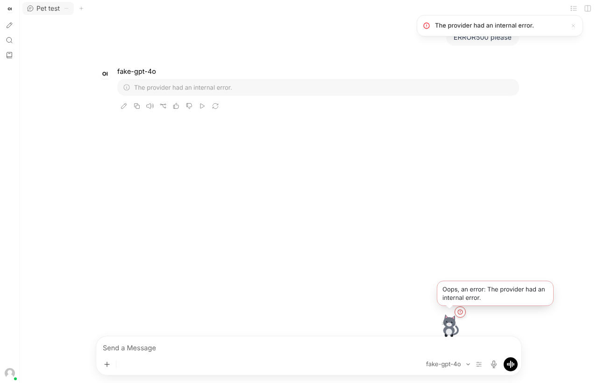
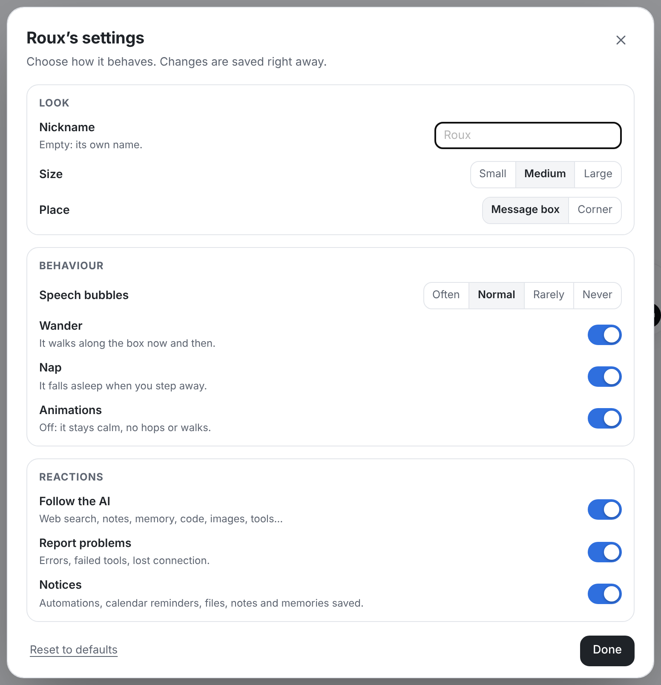

# Chat Pets for Open WebUI

A small companion that lives on Open WebUI's message box, the way ChatGPT's pets do. Each person picks one of six animals or makes their own. The pet watches while you type, follows what the AI is doing (searching the web, reading documents, writing a note, running code, drawing an image, calling a skill or a tool), says in plain words what went wrong when something fails, and tells you when an automation ran, a meeting is near or an answer is ready in another chat. Administrators choose who gets a pet, by role, group or person.

Version v2.0.0. Event Function. Requires Open WebUI v0.13.0 or later; tested in a browser on v0.13.5.

| Choose your pet | On the message box | Its menu |
| --- | --- | --- |
|  |  |  |
| **Make your own** | **When something goes wrong** | **Its settings** |
|  |  |  |


## The pets

| Pet | Job | Shortcuts it offers |
| --- | --- | --- |
| **Plume**, the owl | Mail | Summarise my unread emails · Which important emails are waiting for a reply? · Help me reply to the last email · Analyse my mailbox for the last 7 days |
| **Noisette**, the squirrel | Notes & memory | Take a note: … · Find my notes about … · Summarise this conversation in a note · What do you remember about me? |
| **Filou**, the sheepdog | Tasks | Which tasks are overdue? · Add a task: … · Make me a plan for this week · Remind me in an hour to … |
| **Roux**, the fox | Research | Research … · Compare these two options: … · Explain simply … · Find reliable sources about … |
| **Minuit**, the cat | Calendar | What do I have tomorrow? · Find a one-hour slot this week with … · Prepare my next meeting · Am I free on Thursday afternoon? |
| **Sage**, the turtle | Study | Help me revise … · Ask me 5 questions about … · Explain step by step … · Make a revision plan for my exam on … |
| **Your own** | Whatever you write | The shortcuts of the animal you base it on |

The mail, task and calendar shortcuts are written for the [Partage (Zimbra) tool](../../../tools/partage-zimbra/), and the notes ones for Open WebUI's built-in notes and memory. They work with any model and tools that can answer them. Administrators can replace them (see `quick_actions_json`).

**A shortcut only fills the message box.** Nothing is sent until the person presses Enter.

## What the pet does

- **Watches while you type.** It tilts its head toward the message box.
- **Thinks while the model answers,** and hops when the answer is ready, now and then with a word in character.
- **Follows the AI.** While an answer streams, the pet acts out each step and wears a small badge for it:

| What the AI does | The pet | Badge |
| --- | --- | --- |
| Web search, fetching a page | sniffs | globe |
| Knowledge, documents, attached files, chat history | reads | book |
| Notes (search, read, write) | writes | note |
| Memory (recall, save, forget) | ponders | brain |
| Tasks | writes | list |
| Calendar | reads | calendar |
| Automations | types | clock |
| Code interpreter, terminal | types | code |
| Image generation and editing | paints | brush |
| Sub-agents, channels | thinks | people |
| Skills | ponders | wand |
| Other tools (tool servers, MCP, Function tools) | types | plug |
| Reasoning | ponders | bulb |
| A tool asks you something | waits | question |
| Voice input on | listens | microphone |
| A file is dropped, pasted or attached | sniffs | paper clip |

  It notices these from Open WebUI's own live events, so it works in every language and with any tool. When an answer cites sources or produces an image, it is pleased about it.
- **Reports problems in plain words.** A failed tool makes it puzzled ("The web search didn't work"). An error makes it worried and it says what happened in plain words: too many requests, the chat is too long for the model, access was refused, the model wasn't found, a timeout, the model isn't answering, or otherwise Open WebUI's own message. Warnings and errors shown by Open WebUI as toasts, an answer you stopped, and a lost connection (the pet greys out until it is back) each have their own reaction.
- **Tells you things.** When an automation starts, finishes or fails, when a calendar reminder fires, when an uploaded file couldn't be read, when a note or a memory is saved, when an image is ready, and when an answer is ready in another chat. A notice about a chat can be clicked to open that chat.
- **Wanders** along the box now and then, **naps** when you step away, and **says hello** once a day.
- **Can be moved.** Drag it along the box, or focus it and use the arrow keys.

Pages without a message box, such as Channels, show the pet in the bottom-right corner.

## Each person's choices

The pet's menu has its shortcuts, then **Pet settings…**, **Change pet…**, **Hide for an hour** and **Remove**. Without a pet, a small paw button brings the picker back, and **Alt+Shift+P** opens it anywhere.

**Pet settings** (saved at once):

- **Look:** a nickname, the size (small, medium, large), on the message box or in the corner.
- **Behaviour:** speech bubbles often, normally, rarely or never; wander; nap; animations (off keeps it still, also when the system asks for reduced motion).
- **Reactions:** follow the AI, report problems, notices. Each can be off. An administrator's "off" wins.

**Make your own:** a name (up to 24 characters), one of the six animals, one of twelve colours, a job (up to 40 characters) and, optionally, a photo. The photo is cropped to a square and shrunk to 128 px in the browser before it is kept, usually to 5–30 KB. PNG, JPEG, WebP and GIF up to 5 MB are accepted.

The choice is saved in the person's Open WebUI account, under its own `owui_pets` key, so it follows them to other browsers and devices. A copy in the browser keeps the pet working if the server can't be reached, and a save that failed is retried when the connection comes back. Open tabs follow a change made in another tab.

## Admin Valves

| Valve | Default | Purpose |
| --- | --- | --- |
| `available_pets` | all six | Which pets can be chosen: `hibou`, `ecureuil`, `berger`, `renard`, `chat`, `tortue` |
| `allow_custom_pets` | on | "Add your own" |
| `allow_photo_pets` | on | Photos for people's own pets |
| `default_pet` | empty | A pet shown to people who haven't chosen, for example `hibou` |
| `invite_new_users` | on | A wiggling paw that invites people without a pet |
| `show_paw_when_off` | on | Keep the paw on screen when someone has no pet or hid it |
| `speech_bubbles` | on | Greetings and remarks (each person can also turn them off) |
| `bubble_interval_minutes` | 20 | Least time between two spontaneous remarks |
| `sleep_after_minutes` | 3 | Inactivity before the pet falls asleep |
| `quick_actions` | on | Shortcuts in the pet's menu |
| `quick_actions_json` | empty | Shortcuts that replace the built-in ones, per pet: `{"hibou": [{"fr": "Résume mes emails", "en": "Summarise my emails"}]}`. Up to 8 per pet; anything invalid is ignored. |
| `default_position` | `composer` | `composer` (on the message box) or `corner` |
| `hide_on_mobile` | off | No pet below 640 px |
| `language` | `auto` | `auto` follows each person's Open WebUI language; `fr` or `en` forces one |
| `react_to_activity` | on | Show what the AI is doing |
| `react_to_errors` | on | React to errors, failed tools, warnings and lost connections |
| `notices` | all | Which notices pets give: `automations`, `calendar`, `files`, `notes`, `memories`, `images`, `chats`. Empty: none. |

### Who gets a pet

| Valve | Default | Purpose |
| --- | --- | --- |
| `access_mode` | `everyone` | `everyone`, or `selected`: only the roles, groups and people below |
| `allowed_roles` | `user,admin` | With `selected`: roles that get pets (`user`, `admin`, `pending`) |
| `allowed_groups` | empty | With `selected`: groups, by name or ID. Members of sub-groups count. |
| `allowed_users` | empty | With `selected`: people, by email or user ID |
| `blocked_users` | empty | People or groups who never get a pet, by email, user ID, group name or group ID. Wins over everything. |
| `custom_pets_for` | empty | Who may make their own pet, by email, user ID, group name or group ID. Empty: everyone who has a pet. |

With `selected`, a person gets a pet if their role is listed, **or** they are in a listed group, **or** they are listed themselves, and they are not blocked. For example, to give pets only to the "Students" group and one teacher: `access_mode = selected`, `allowed_roles` empty, `allowed_groups = Students`, `allowed_users = teacher@exemple.fr`.

The lists are sent to the browser as salted SHA-256 hashes, never as names or emails. The browser hides the pet from people who aren't allowed, but that is a convenience, not a lock: everything the server sends (the notices) is checked on the server, against the person's real role and groups, before it leaves.

## Safety and privacy

- **No HTML from users.** Names and jobs are written as text. The only markup the script builds is its own drawings and icons, which take nothing but checked colours and numbers. A photo must be a `data:image/png|webp|jpeg` URL under 70 KB, and goes in through `setAttribute`.
- **Checked on every load.** A saved pet is checked again each time it is read, from the server or from the browser: unknown animals, bad colours, bad photos and out-of-range places are dropped. A pet that an administrator no longer allows disappears, and the paw is offered instead.
- **Same site only.** It calls four Open WebUI endpoints of the signed-in person (`/api/v1/auths/`, `/api/v1/users/user/settings`, `/api/v1/users/user/settings/update`, and `/api/v1/users/groups` when groups decide access) with their own token, and nothing else.
- **Listens, never speaks.** It reads Open WebUI's live socket and the page without sending anything, clicking anything or changing a message. Notices from the server go only to the person they concern (`user:<id>` room), carry only a type, a short title, a chat ID and a number of minutes, and are skipped for anyone not allowed a pet. A failure in the pet never stops Open WebUI's own event handling.
- **Stays out of the way.** The pet sits below Open WebUI's menus and dialogs, never covers the message box's buttons, pauses when the tab is hidden, and shows nothing when nobody is signed in or on shared-chat pages.
- **Accessible.** The pet is a button with a label, its menu works with the keyboard (Enter, arrows, Escape), the picker keeps focus inside and returns it on close, speech is announced politely to screen readers, and reduced motion (the system setting or the menu) stops walking and hopping.

## Install

1. **Admin Panel → Functions → +**, paste `chat_pets.py`, save, and turn it on.
2. Reload the page. People without a pet see the paw; clicking it opens **Choose your pet**.

Like Chat Inspector, Gallery and Files, it publishes its script through [Classic298's Shared Assets Protocol](https://github.com/Classic298/open-webui-plugins/tree/main/shared-assets-protocol), so it sits side by side with the other browser features of this repository.

## Tests

```bash
python -m pip install "pydantic>=2,<3" starlette httpx pytest
python -m pytest -q tests/test_chat_pets.py
```

The 52 unit tests cover the protocol blocks (byte for byte), valves and their limits, shortcut overrides, escaping, the served script parsing, the HTML-safety rules, the translations, the same hashes in Python and in the browser, the access rules, tool classification, error explanations, and the server notices (who gets them, what they carry, the cache, and that a failure is harmless).

`tests/e2e.mjs` runs 129 checks in Chromium against a real Open WebUI, seeded by `tests/seed.py`, with `tests/fake_model.py` as the model (it can stream slowly, reason, call built-in tools, fail with 500 or 429, or stop short):

- first visit and the picker; choosing and perching; the same pet on another device;
- shortcuts filling the box without sending, and states while typing, answering and done;
- following the AI: web search, notes, memory, reasoning, a failing tool;
- errors, rate limits, cut-off answers, Stop, uploads, voice, going offline;
- the settings dialog; an answer ready in another chat;
- automation and calendar notices from the server;
- who gets a pet: roles, groups, blocked people, own pets for some only;
- dragging, keyboard, a hostile name with a photo, two tabs, hiding, removing, Alt+Shift+P;
- Open WebUI dialogs on top, corner mode, signed out, phone, dark mode, French, reduced motion;
- broken saved data, the server going away, every admin valve, falling asleep.

[How it works](ARCHITECTURE.md) · [Changelog](CHANGELOG.md)
