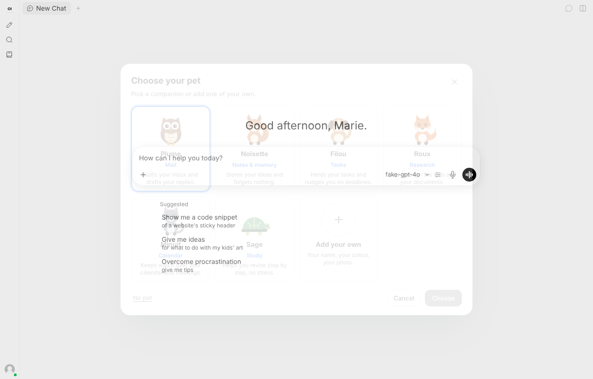
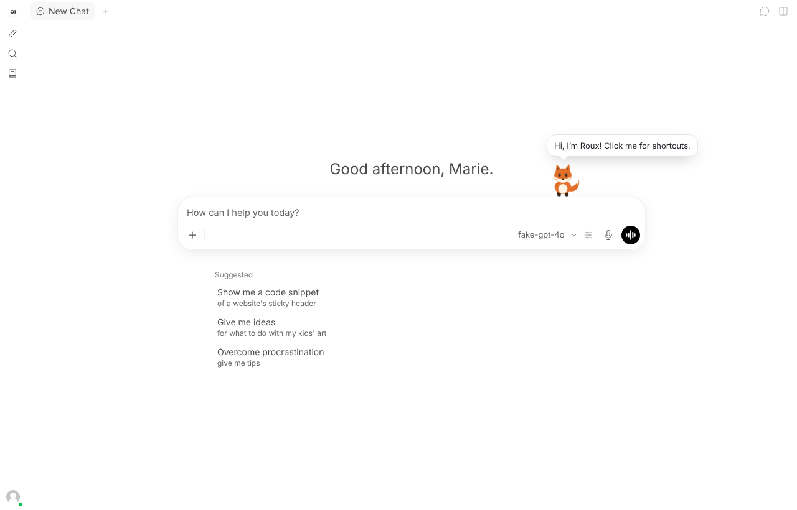
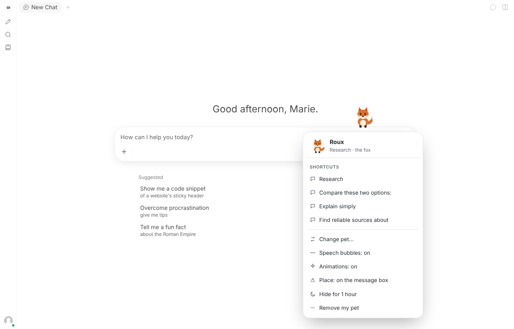
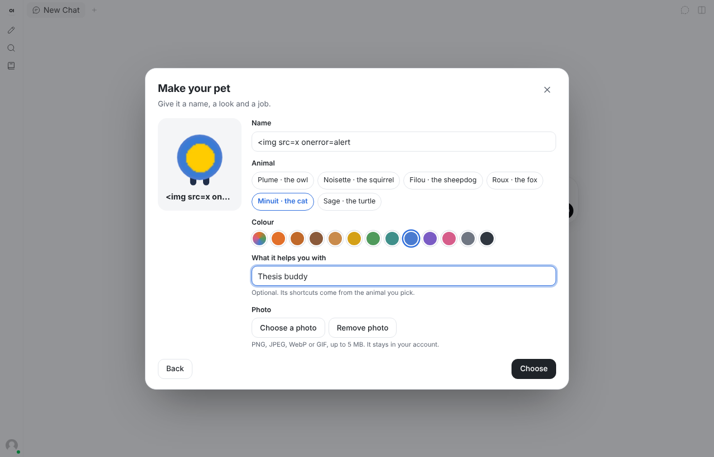
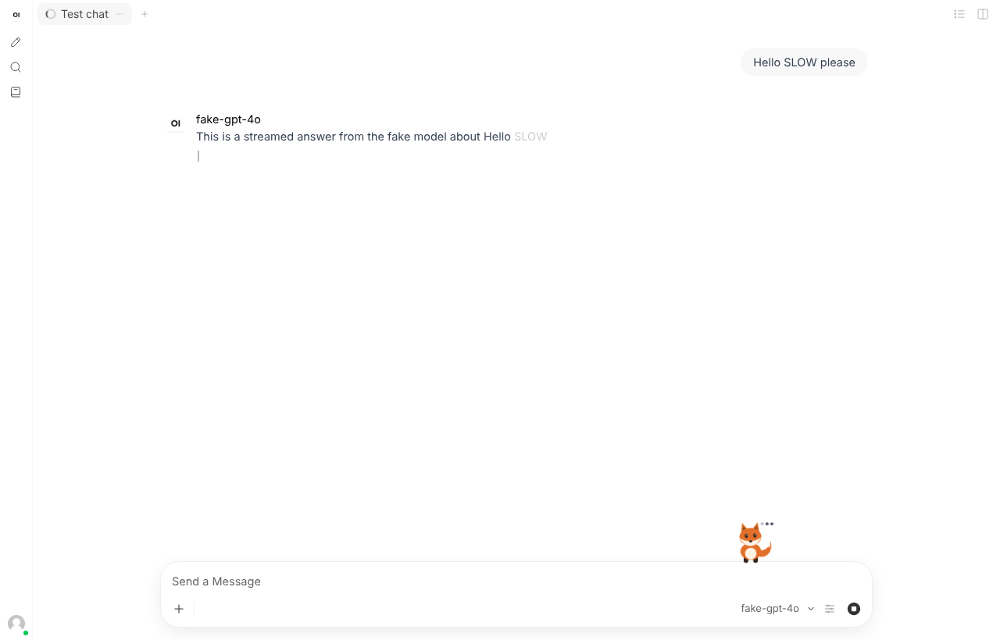
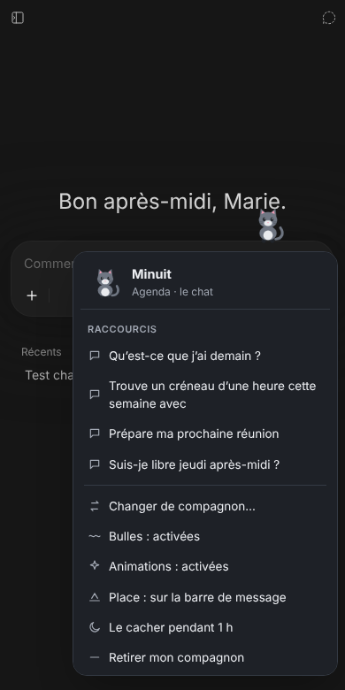
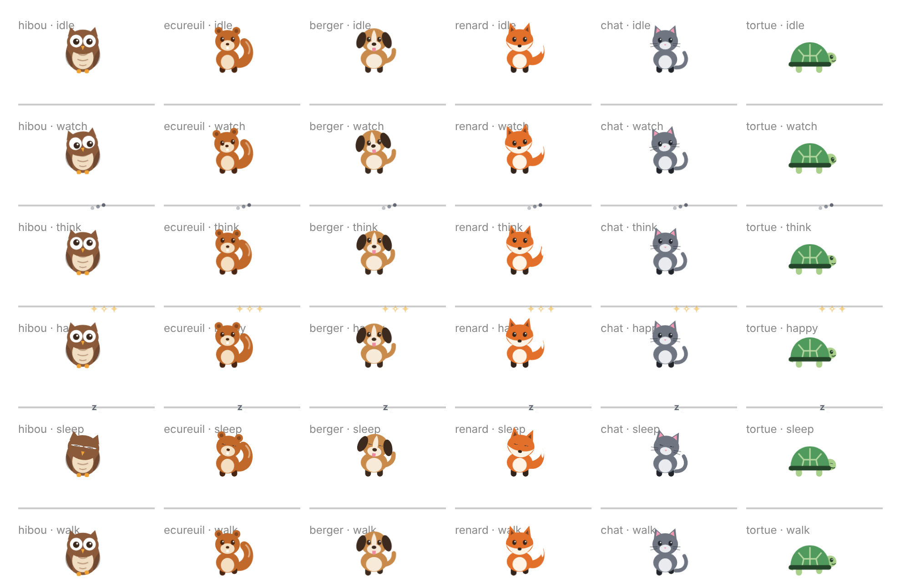

# Chat Pets for Open WebUI

A small companion that lives on Open WebUI's message box, the way ChatGPT's pets do. Each person picks one of six animals or makes their own. The pet sits on the edge of the message box, watches while you type, thinks while the model answers, cheers when the answer is ready, wanders along the box now and then, and naps when you step away. Click it for shortcuts that match its job.

Version v1.0.0. Event Function. Requires Open WebUI v0.13.0 or later; tested in a browser on v0.13.5.

| Choose your pet | On the message box | Its menu |
| --- | --- | --- |
|  |  |  |
| **Make your own** | **Thinking while the model answers** | **Phone, dark mode, French** |
|  |  |  |



## The pets

| Pet | Job | Shortcuts it offers |
| --- | --- | --- |
| **Plume**, the owl | Mail | Summarise my unread emails · Which important emails are waiting for a reply? · Help me reply to the last email · Analyse my mailbox for the last 7 days |
| **Noisette**, the squirrel | Notes & memory | Take a note: … · Find my notes about … · Summarise this conversation in a note · What do you remember about me? |
| **Filou**, the sheepdog | Tasks | Which tasks are overdue? · Add a task: … · Make me a plan for this week · Remind me in an hour to … |
| **Roux**, the fox | Research | Research … · Compare these two options: … · Explain simply … · Find reliable sources about … |
| **Minuit**, the cat | Calendar | What do I have tomorrow? · Find a one-hour slot this week with … · Prepare my next meeting · Am I free on Thursday afternoon? |
| **Sage**, the turtle | Study | Help me revise … · Ask me 5 questions about … · Explain step by step … · Make a revision plan for my exam on … |
| **Your own** | Whatever you write | The shortcuts of the animal you base it on |

The mail, task and calendar shortcuts are written for the [Partage (Zimbra) tool](../../../tools/partage-zimbra/), and the notes ones for Open WebUI's built-in notes and memory. They work with any model and tools that can answer them. Administrators can replace them (see `quick_actions_json`).

**A shortcut only fills the message box.** Nothing is sent until the person presses Enter.

## What the pet does

- **Watches while you type.** It tilts its head toward the message box.
- **Thinks while the model answers.** Its head nods and three dots appear. It notices an answer whatever the interface language, from the Stop button's icon and from the answer's text growing.
- **Cheers when the answer is ready.** It hops, sparkles and, now and then, says something in character.
- **Wanders.** When idle it walks along the box from time to time, never in the middle, where Open WebUI shows its "scroll to bottom" button.
- **Naps.** After a few minutes without mouse or keyboard activity it falls asleep, and it wakes up when you come back.
- **Says hello once a day,** with the person's first name and the time of day.
- **Can be moved.** Drag it along the box, or focus it and use the arrow keys. It remembers the place.

Pages without a message box, such as Channels, show the pet in the bottom-right corner.

## Each person's choices

Everything is in the pet's menu: change pet, speech bubbles on or off, animations on or reduced, on the message box or in the corner, hide for an hour, or remove the pet. Without a pet, a small paw button brings the picker back, and **Alt+Shift+P** opens it anywhere.

**Make your own:** a name (up to 24 characters), one of the six animals, one of twelve colours, a job (up to 40 characters) and, optionally, a photo. The photo is cropped to a square and shrunk to 128 px in the browser before it is kept, usually to 5–30 KB. PNG, JPEG, WebP and GIF up to 5 MB are accepted.

The choice is saved in the person's Open WebUI account, under its own `owui_pets` key, so it follows them to other browsers and devices. A copy in the browser keeps the pet working if the server can't be reached, and a save that failed is retried when the connection comes back. Open tabs follow a change made in another tab.

## Admin Valves

| Valve | Default | Purpose |
| --- | --- | --- |
| `available_pets` | all six | Which pets can be chosen: `hibou`, `ecureuil`, `berger`, `renard`, `chat`, `tortue` |
| `allow_custom_pets` | on | "Add your own" |
| `allow_photo_pets` | on | Photos for people's own pets |
| `default_pet` | empty | A pet shown to people who haven't chosen, for example `hibou` |
| `invite_new_users` | on | A wiggling paw that invites people without a pet |
| `show_paw_when_off` | on | Keep the paw on screen when someone has no pet or hid it |
| `speech_bubbles` | on | Greetings and remarks (each person can also turn them off) |
| `bubble_interval_minutes` | 20 | Least time between two spontaneous remarks |
| `sleep_after_minutes` | 3 | Inactivity before the pet falls asleep |
| `quick_actions` | on | Shortcuts in the pet's menu |
| `quick_actions_json` | empty | Shortcuts that replace the built-in ones, per pet: `{"hibou": [{"fr": "Résume mes emails", "en": "Summarise my emails"}]}`. Up to 8 per pet; anything invalid is ignored. |
| `default_position` | `composer` | `composer` (on the message box) or `corner` |
| `hide_on_mobile` | off | No pet below 640 px |
| `language` | `auto` | `auto` follows each person's Open WebUI language; `fr` or `en` forces one |

## Safety and privacy

- **No HTML from users.** Names and jobs are written as text. The only markup the script builds is its own drawings and icons, which take nothing but checked colours and numbers. A photo must be a `data:image/png|webp|jpeg` URL under 70 KB, and goes in through `setAttribute`.
- **Checked on every load.** A saved pet is checked again each time it is read, from the server or from the browser: unknown animals, bad colours, bad photos and out-of-range places are dropped. A pet that an administrator no longer allows disappears, and the paw is offered instead.
- **Same site only.** It calls three Open WebUI endpoints of the signed-in person (`/api/v1/auths/`, `/api/v1/users/user/settings`, `/api/v1/users/user/settings/update`) with their own token, and nothing else.
- **Stays out of the way.** The pet sits below Open WebUI's menus and dialogs, never covers the message box's buttons, pauses when the tab is hidden, and shows nothing when nobody is signed in or on shared-chat pages.
- **Accessible.** The pet is a button with a label, its menu works with the keyboard (Enter, arrows, Escape), the picker keeps focus inside and returns it on close, speech is announced politely to screen readers, and reduced motion (the system setting or the menu) stops walking and hopping.

## Install

1. **Admin Panel → Functions → +**, paste `chat_pets.py`, save, and turn it on.
2. Reload the page. People without a pet see the paw; clicking it opens **Choose your pet**.

Like Chat Inspector, Gallery and Files, it publishes its script through [Classic298's Shared Assets Protocol](https://github.com/Classic298/open-webui-plugins/tree/main/shared-assets-protocol), so it sits side by side with the other browser features of this repository.

## Tests

```bash
python -m pip install "pydantic>=2,<3" starlette httpx pytest
python -m pytest -q tests/test_chat_pets.py
```

The 33 unit tests cover the protocol blocks (byte for byte), valves and their limits, shortcut overrides, escaping, the served script parsing, the HTML-safety rules and the translations.

`tests/e2e.mjs` runs 85 checks in Chromium against a real Open WebUI, seeded by `tests/seed.py` with the fake model from Chat Inspector's tests:

- first visit and the picker (focus trap, Escape);
- choosing and perching, then the same pet on another device;
- shortcuts filling the box without sending, and states while typing, answering and done;
- dragging, keyboard moves, and a hostile name with a photo;
- two tabs, hiding, removing, Alt+Shift+P;
- Open WebUI dialogs on top, corner mode, signed out;
- phone, dark mode, French, reduced motion;
- broken saved data, Open WebUI's own settings saves, the server going away;
- every admin valve, and falling asleep with a fake clock.

[How it works](ARCHITECTURE.md) · [Changelog](CHANGELOG.md)
