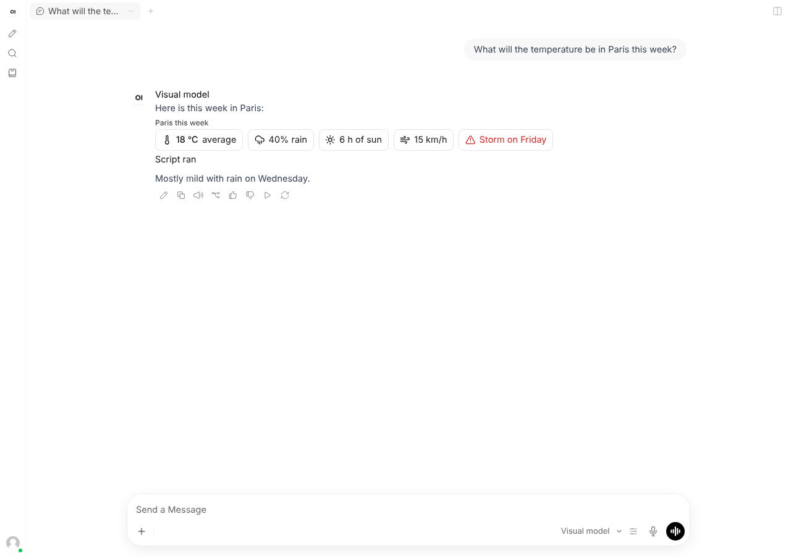
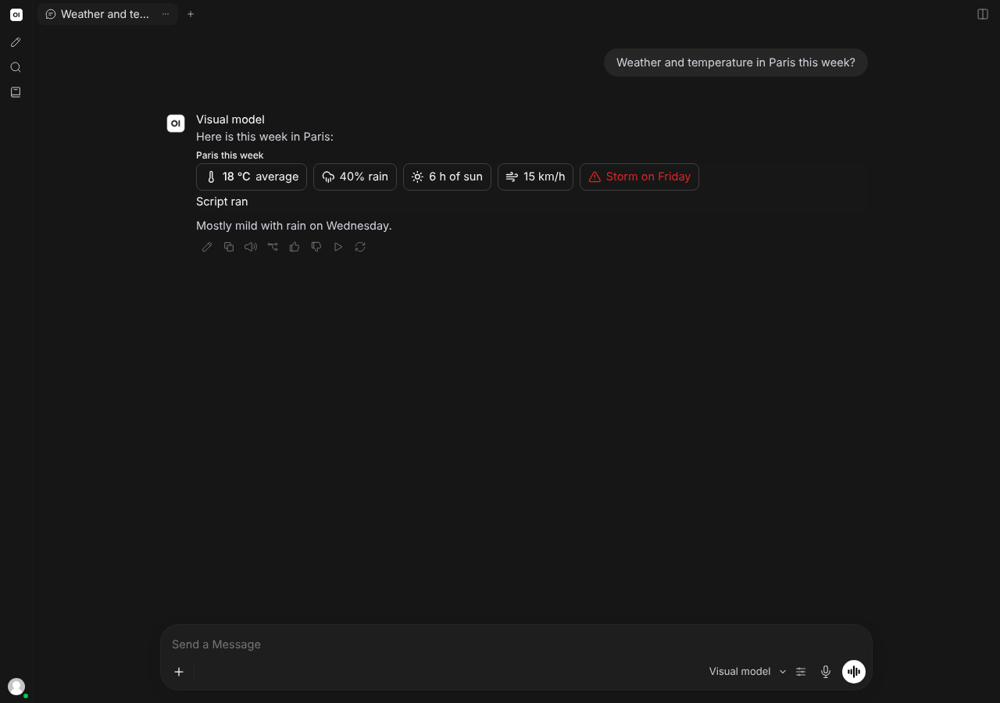
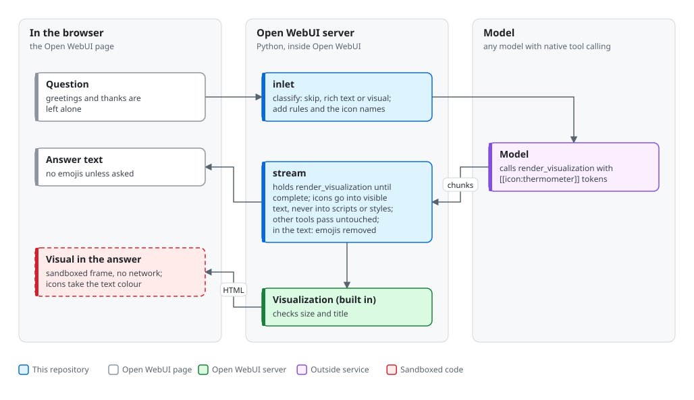

# Rich Visuals for Open WebUI

Open WebUI 0.13.4 can draw visuals inside an answer: the built-in Visualization tool lets a model put a chart, a set of key figures or a small calculator in a sandboxed frame. What it can't do is icons. The frame has no icon library and no fonts, so models reach for emojis, or draw shaky SVG by hand, or link to icon files the sandbox will never load.

Rich Visuals fixes that. Ask about the temperature in Paris this week and the answer comes back with a real thermometer, a rain cloud and a sun, in the colour of the text around them. A storm warning can come back in red, because the model uses colour only when it means something. Say "bonjour" and nothing changes.

Version v1.1.0. Filter Function. Requires Open WebUI v0.13.4 or later, the release that added Visualization; tested in a browser on v0.13.4.

| Light | Dark |
| --- | --- |
|  |  |

## What it does

- **Decides when to act.** Greetings, thanks, "ok", "how are you", goodbyes and short small talk are left alone, in English, French, Spanish, German, Italian, Portuguese and Arabic written in Latin letters. So are messages that ask for plain text ("text only", "sans visuel", "no charts"), and Open WebUI's background tasks such as titles and tags.
- **Asks for a visual when one helps.** Weather and temperature, comparisons, numbers and trends, money and budgets, plans and timelines, how-to steps, health, travel and science questions get a request for a compact visual. Other substantive questions get clean Markdown, with a visual only if it clearly helps.
- **Gives the model icons it can use.** The model writes a short token such as `[[icon:thermometer]]`, or `[[icon:rain|Chance of rain]]` with an accessible label. As the answer streams, the filter swaps each token for a real SVG icon from [Lucide](https://lucide.dev). The model is offered the icons that fit the topic (18 of the 225 bundled), so the request stays small.
- **Repairs what models get wrong.** Testing with a small real model showed it writing icons in every way but the right one. The filter turns all of these into real icons:
  - emojis inside a visual (🌡️ becomes a thermometer, 📈 a rising chart, ✅ a check);
  - loose tokens (`[icon:sun]`, `{{icon:sun}}`, `<[icon:sun]]`);
  - icon names inside elements (`<span class="icon">wallet</span>`);
  - icon-library classes (`<i class="lucide lucide-sun">`, `<i class="fa fa-sun">`);
  - images pointing at made-up icon files (``), which the sandbox could never have loaded.
- **Never breaks a visual.** Icons only go into the visual's visible text. Inside scripts, styles and attributes a token or emoji is simply removed, so a chart's JavaScript stays valid. Other tools (web search, code and so on) pass through untouched.
- **Looks natural.** Icons take the colour and size of the text next to them. The model is told to add colour only where it means something (danger in red, a warning in amber, a good result in green) and icons only where they help.
- **Costs few tokens.** About 180 tokens are added when a visual is wanted, a few words otherwise, and nothing for small talk.
- **Keeps emojis out of the text,** unless the person asks for emojis. Text can't show SVG icons, so there the emojis simply go, with the spacing tidied. Code blocks are never touched.
- **Stays silent.** It emits no events: no status line, no "thinking", nothing extra in the chat. Its hooks aren't even given Open WebUI's event emitter.

## How it works



Visualization is a built-in tool. The model calls `render_visualization(title, html)`, Open WebUI checks the size, and the browser shows the HTML in a sandboxed frame (`allow-scripts`, no network, no fonts, cleaned with DOMPurify, `<use>` removed). That is why icons must be inline SVG inside the HTML itself.

A Filter's `stream` hook sees every chunk from the model before Open WebUI processes it, including the tool call's arguments as they arrive. Rich Visuals rewrites those arguments on the way through:

1. **`inlet`** classifies the last message: skip, rich text or visual. It then adds short rules and the icon names to the system prompt, once (a marker stops it repeating on regenerate). It only mentions Visualization when the model has it switched on and uses native tool calling.
2. **`stream`** holds back the `render_visualization` arguments until they are complete (valid JSON, or the end of the call). It then parses them and changes the HTML once:
   - in visible text, tokens, emojis and the loose icon forms become SVG icons;
   - in `<script>` and `<style>` blocks and inside tags, they are removed, so code and attributes stay valid;
   - comments are left alone.

   The arguments go out in one piece as valid JSON. If they are not valid JSON, or are far larger than Visualization accepts, they go out exactly as they came. Tool calls for any other tool are never touched. In the answer text, emojis are removed and a token cut between chunks is held back until it is complete.
3. **`outlet`** tidies the saved text (leftover tokens, emojis outside code) and leaves tool-call blocks exactly as they are.

## Install

1. Open **Admin Panel > Functions**, create a function and paste [`rich_visuals.py`](rich_visuals.py). Save and enable it.
2. Make it global (the globe switch), or add it to the models that should use it.
3. For each of those models, open **Workspace > Models**, edit the model, and under **Builtin Tools** turn on **Visualizations**. It is off by default.
4. Keep the model's function calling on **Native** (the default). In *Legacy* mode Open WebUI offers no built-in tools, and Rich Visuals only tidies the text.

Without step 3 the filter still keeps answers clean and emoji-free, but there are no visuals to put icons in.

## Settings

| Valve | Default | What it does |
| --- | --- | --- |
| `enabled` | on | Turns Rich Visuals off for everyone without uninstalling it. |
| `visuals` | `auto` | `auto` asks for a visual when the question benefits from one. `prefer` offers a visual on every substantive question. `rich_text_only` never asks for visuals and only tidies the text. |
| `emojis` | `icons` | `icons`: emojis inside visuals become real icons, and emojis are left out of text unless the person asks for them. `keep`: leave emojis alone. |
| `icons_per_answer` | 18 | How many icon names the model is offered for one answer, most relevant first (6 to 120). Each name costs about two tokens. |
| `skip_phrases` | empty | Extra messages to leave alone, comma separated, compared without case or accents (for example a team's own greeting). |
| `priority` | 0 | Order among filters. |

Each person can also switch it off for themselves, or choose `auto`, `prefer` or `rich_text_only`, in their own settings for the function.

## Works with

- **Rich Responses** adds emoji icons to headings. With both installed, Rich Visuals removes those emojis from the text. Pick one: Rich Responses for emoji headings, Rich Visuals for real icons in visuals.
- **Generative UI** draws its own cards with its own renderer. Both can be installed; Generative UI's cards aren't affected.

## Tested with real models

The browser test uses a fake model that answers perfectly, so the filter was also run against a real one: Qwen2.5-Coder 3B (Q4, served by llama.cpp on a CPU).

- **Through Open WebUI:** with Open WebUI's full request (33 built-in tools), the 3B model usually answered in text instead of calling Visualization. With only Visualization on, it still often chose text. Rich Visuals did its part either way: greetings were untouched, no emojis appeared, and no status lines were added. A larger model makes this choice far more reliably.
- **When it does call Visualization:** six real answers were run through the filter. The tool call stayed valid JSON every time and no emoji survived.
  - When the model attempted an icon (a token, an emoji, a made-up image or class), the filter turned about 15 of 17 attempts into real icons.
  - In some answers the model used no icons at all. That is the model's choice; a filter can't add icons the model didn't ask for.

The lesson: use a strong model with native tool calling. The filter makes whatever icons it writes come out right.

## Limits

- Icons can only appear inside visuals. Markdown text can't show inline SVG in Open WebUI, which is why emojis are removed from text rather than replaced there.
- The model decides whether to call Visualization. The filter asks; it can't force a tool call.
- Classification uses keywords, so an unusual phrasing can be treated as small talk or as a substantive question. `skip_phrases` and the per-person setting cover the cases that matter to you.
- Icons can't appear inside a chart drawn on a canvas (Chart.js labels, for example). A token there is removed, and the label shows as plain text.
- The visual appears when the tool call is complete rather than filling in as it streams. Visualization only draws a complete visual anyway, so in practice nothing is lost.
- Removing emojis from text is final: copy and export get the text without them.

## Tests

```bash
python -m pip install "pydantic>=2,<3" pytest
python -m pytest -q test_rich_visuals.py
```

145 tests:
- **When it acts:** classification in several languages.
- **What the model is told:** injection, without repeats, and the model and tool-calling checks.
- **Icons in the visual:** tokens and elements cut at every chunk size, including one character at a time, with the tool call's JSON still valid; escaped and unescaped emojis; every loose form seen from the real model.
- **Never breaking a visual:** tokens and emojis in single-quoted JavaScript strings, styles, attributes and comments; other tools untouched; two tool calls in one answer; invalid JSON and oversized arguments passed through; no finish reason.
- **Token cost:** the added instructions stay under a fixed size.
- **Text:** emoji removal and spacing; code blocks kept; joiners in scripts such as Malayalam kept.
- **Other formats:** the Responses API.
- **Outlet:** cleanup.
- **Silence:** proof that no hook can emit an event.
- **The icon set itself.**

In a browser, against a throwaway Open WebUI 0.13.4:

```bash
python tests/fake_model.py 9994 &
OPENAI_API_BASE_URL=http://127.0.0.1:9994/v1 OPENAI_API_KEY=x open-webui serve --port 8084 &
python tests/seed.py http://127.0.0.1:8084 rich_visuals.py > seed.json
node tests/e2e.mjs seed.json http://127.0.0.1:9994
```

20 checks, all passing on 0.13.4:
- **Request:** the request carries the rules; Open WebUI offers the tool.
- **The visual:** it appears, its tokens and its emoji become icons with labels at a sensible size, and no token or emoji is left inside it.
- **Its script:** a script with a token inside a single-quoted string runs with no error; a token in an attribute is removed.
- **Colour:** icons take their text's colour, and a warning the model coloured red stays red.
- **Text and status:** the text has no emojis, nothing stray is saved, and there are no status lines.
- **Dark mode:** icons follow the light text.
- **Greetings:** a greeting passes untouched.
- **Without Visualization:** a model without it only gets the tidy-text rules.

## Licence

MIT. By Muhammad Sohail. Icons from [Lucide](https://lucide.dev), ISC licence; the notice is at the top of `rich_visuals.py`.
