# Generative UI

ChatGPT-style visual answers for Open WebUI: interactive cards that stream inside normal answers, with any model.

The model writes one small JSON spec. The Tool validates it, repairs common mistakes, fetches live data when asked, and renders a native-looking interactive view inline in the conversation: dashboards, metric cards, charts, sortable tables, calculators with sliders, checklists, product comparisons, option explorers, timelines, itineraries with maps, architecture diagrams, step-by-step workflows and live weather. Every control works locally in the browser, so moving a slider or switching a tab never calls the model again.

| | |
| --- | --- |
| Type | One file, two installs: a **Tool** (`render_ui`) and a **Filter** (streaming mode) |
| Version | 1.2.0 |
| Open WebUI | 0.12.0 or newer (embed API checked against the 0.12.5 source) |
| Python packages | none beyond Open WebUI (`aiohttp`, `pydantic`, `fastapi` ship with it) |
| Front-end dependencies | none: the renderer is self-contained, no CDN |
| License | MIT; icons are a subset of [Lucide](https://lucide.dev) (ISC) |

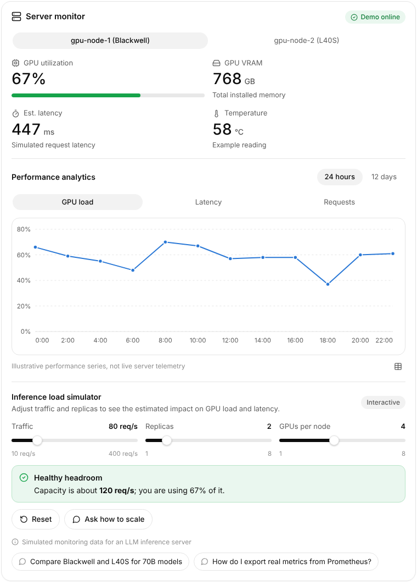

| | | |
| --- | --- | --- |
| 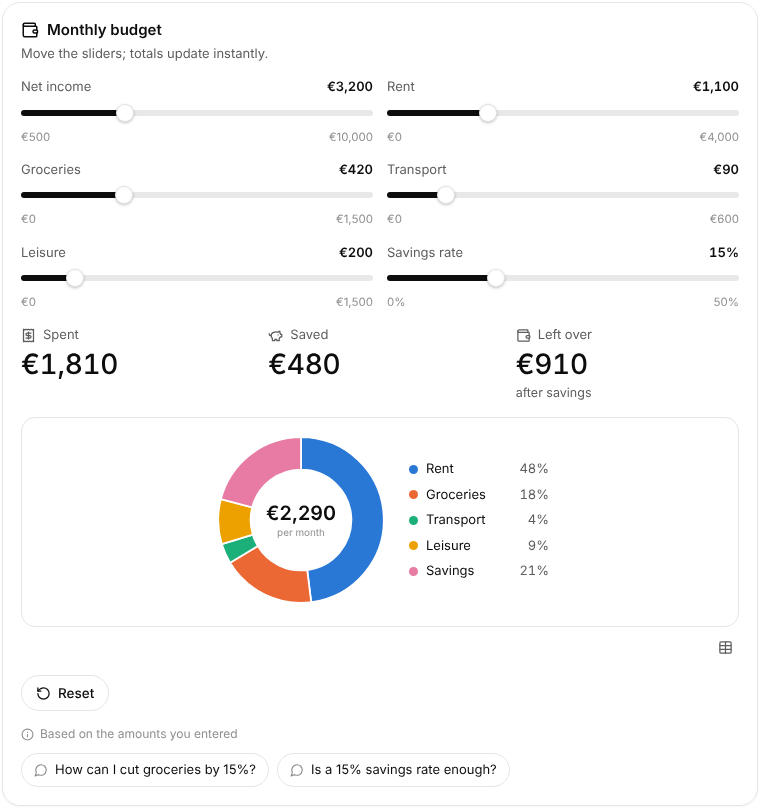 | 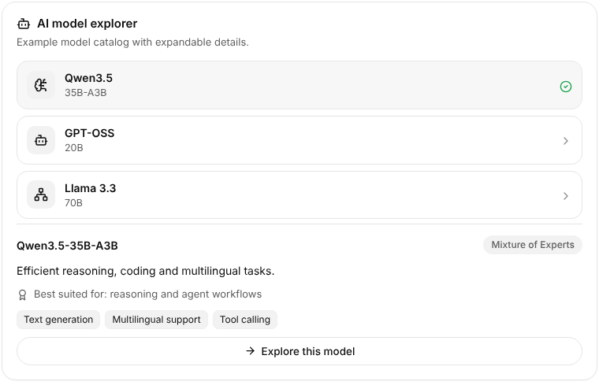 | 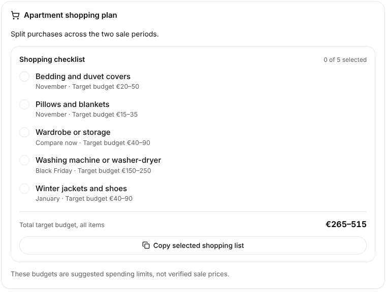 |
| 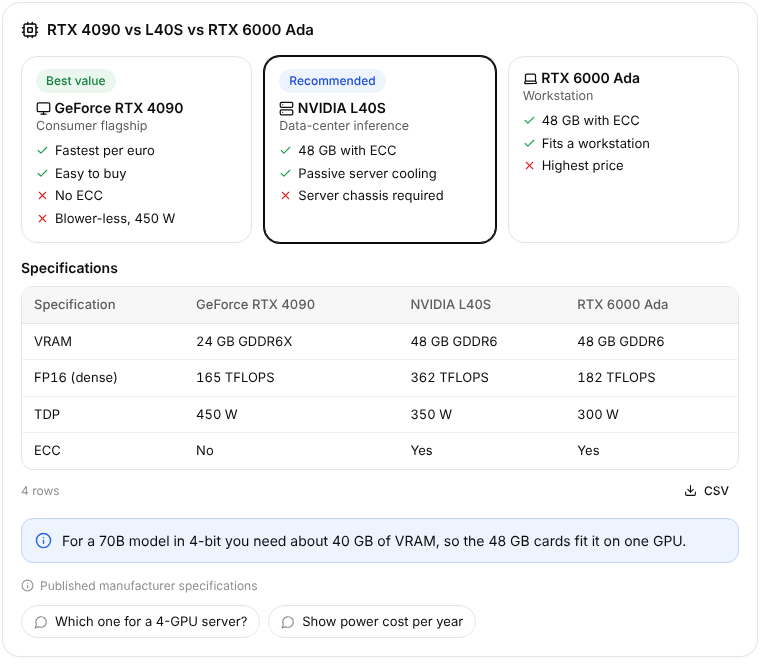 | 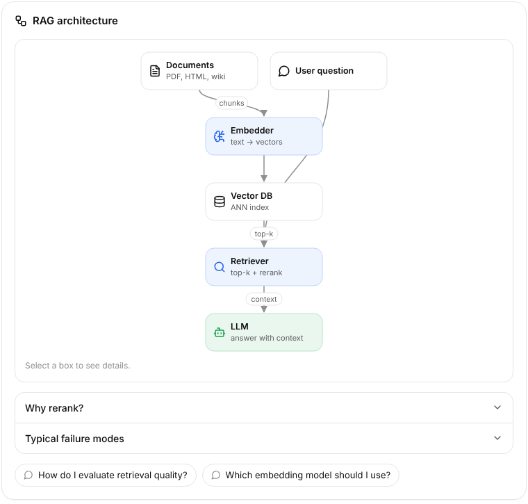 | 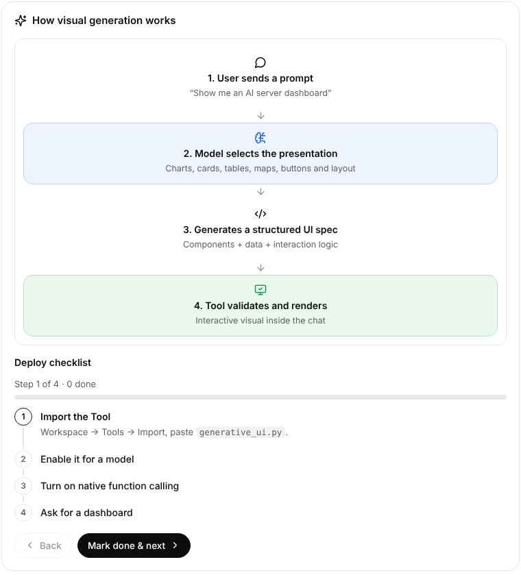 |
| 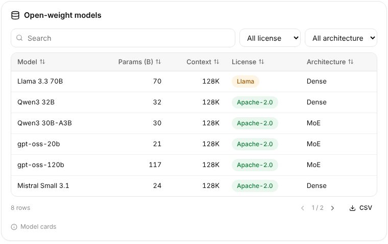 | 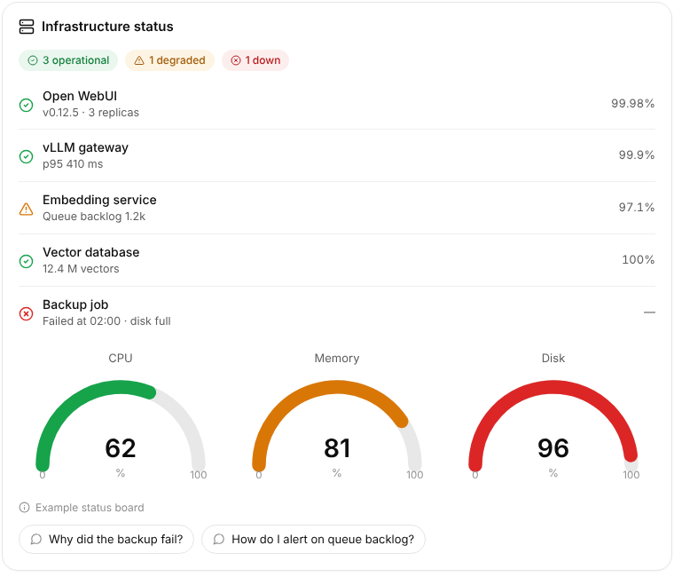 | 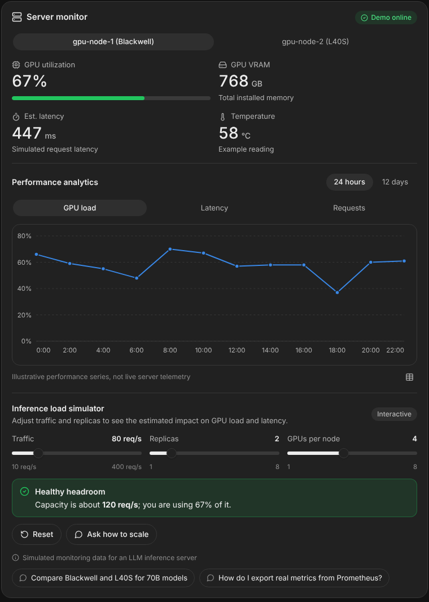 |

All screenshots in [`screenshots/`](screenshots/) were captured by the automated browser tests from the real renderer, inside a page that reproduces Open WebUI's embed iframe. The weather sample is labeled "Sample data" because the test environment had no network access to Open-Meteo.

## Two ways to get cards

| | Streaming mode (Filter) | Tool mode (`render_ui`) |
| --- | --- | --- |
| How the model asks | Writes a ```` ```genui ```` JSON block anywhere in its normal answer | Calls the `render_ui` function |
| Needs tool calling | No: works with any model | Yes (native tool calling recommended) |
| When the card appears | Immediately when the block starts, then fills in section by section while it streams | After the tool call finishes |
| Text around it | Streams before and after the card in one answer | Model writes text after the tool returns |

Install both for the best result; the model is told to prefer the streaming block when both are active.

Inspired by the open-source [Inline Visualizer](https://github.com/Classic298) for Open WebUI, which streams model-written HTML into an iframe by reading the chat page. Generative UI keeps the declarative, validated spec instead (no model-written scripts in the default path, no same-origin requirement) and gets the live effect from server-side progressive rendering.

### Streaming mode, step by step

```text
User: "Compare my monthly expenses visually"
  inlet   -> request looks visual, so the filter teaches the model the ```genui block format (prompt_mode auto)
  stream  -> "Here is your spending at a glance."                       streams normally
          -> ```genui  opens                                            card shell appears at once: title + "Rendering..." skeleton
          -> {...JSON streams...}                                       each completed component is added to the card (only new ones fade in)
          -> block closes: repair, validate, live data, render          final card replaces the live one (embeds event, persisted)
          -> "*📊 Expenses - interactive view shown above*"              placeholder left in the text
          -> "Rent is 67% of the total..."                              keeps streaming
  outlet  -> non-streaming responses get the same treatment; nothing to do when streaming already handled it
```

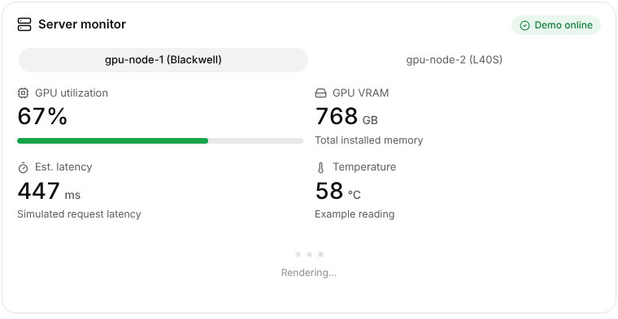

Live filling works without "Allow iframe same origin": the filter re-renders the card on the server each time a component completes (at most every `live_preview_interval` seconds) and replaces the embed, so no code inside the card needs access to the Open WebUI page. If the user stops the answer mid-card, `outlet` finishes the card from what arrived or removes the shell.

When "Allow iframe same origin" *is* enabled, cards also remember their slider, tab and input values across page reloads (stored per message in the browser). Every final card has a **Download as HTML** button that saves a standalone, still-interactive copy.

Edge cases handled: a block split across any number of chunks, other code fences (including ```` ```json ```` and ```` ```genui ```` shown inside a longer fence) left untouched, a broken block replaced by a short warning instead of raw JSON, a block cut off by the end of the stream repaired and rendered when possible, a configurable card limit per answer, cards from the `render_ui` tool in the same message preserved, per-message state isolation, OpenAI-style and Responses-API streams.

## How the Tool works

```text
User message
  -> model decides a visual helps (guided by the Tool description)
  -> model calls render_ui(spec)        (or show_weather / ui_examples)
  -> lenient JSON repair -> schema validation -> migrations -> limits
  -> server-side live data (weather, photo lookup, geocoding), bounded and cached
  -> self-contained HTML embed (CSS + renderer + validated spec as JSON)
  -> Open WebUI shows it inline in a sandboxed iframe
  -> sliders, tabs, filters, charts and calculators run locally in the browser
  -> follow-up chips and prompt buttons send text back to the chat (Open WebUI asks the user to confirm)
```

The Tool returns `(HTMLResponse, context)`. Open WebUI renders the HTML as an embed and gives the model the context string, which says the UI is already visible, lists any repairs the validator made, and includes a short text summary so the model can talk about what the user sees without repeating it.

Rendering modes, chosen automatically:

1. **Native structured UI** (default). An allow-listed component registry renders the validated spec. The model never writes HTML or JavaScript for this path.
2. **Sandboxed custom app** (`app` component). For a mini application the components cannot express, model-written HTML/JS runs in a nested iframe with `sandbox="allow-scripts"` and a `default-src 'none'` Content Security Policy, so it has no network, no storage and no access to the chat. Administrators can turn this off.
3. **Fallback.** Invalid specs return a precise error to the model so it can retry. A component that fails at runtime shows a contained error box while the rest of the card keeps working. If the renderer itself cannot run, the embed shows a plain-text summary.

See [ARCHITECTURE.md](ARCHITECTURE.md) for the protocol, security model, research comparison and the audit of the previous `frontier_ui.py`.

## Installation

**Streaming mode (recommended):**

1. **Admin Panel > Functions > + (Create)**, paste the whole `generative_ui.py`, save. Open WebUI uses the file's `Filter` class.
2. Turn the function on and enable **Global** in its menu (or attach it to specific models under **Workspace > Models > Filters**).
3. Nothing else: no tool calling needed. Optional Valves: `prompt_mode` (`auto` teaches the format only for visual requests, `always`, `off`), `placeholder`, `max_cards_per_message`, theme, live data switches.

**Tool mode:**

1. **Workspace > Tools > + (Import)**, paste or upload the same `generative_ui.py`, review it, save.
2. **Workspace > Models > edit your model > Tools**: tick **Generative UI**. (Or enable it per chat from the **+** menu.)
3. Recommended: **Model > Advanced Params > Function Calling: Native** for models that support tool calling (vLLM with a tool parser, Ollama tool models, OpenAI-compatible APIs). Models without native tool calling still work through Open WebUI's default prompt-based tool mode, with lower reliability.
4. Optional: open the Tool's **Valves** (gear icon) to adjust behavior.

Try:

- "Show me a GPU monitoring dashboard for an inference server"
- "Make a monthly budget calculator for 3,200 euros income"
- "Compare RTX 4090, L40S and RTX 6000 Ada"
- "Plan two days in Paris with a map"
- "Explain RAG architecture visually"
- "What's the weather in Lyon this week?"
- "What is 25% of 480?" (should get a plain answer, no widget)

### Optional system prompt

The Tool description already tells the model when to use it. If a smaller model over- or under-uses it, add this to the model's system prompt:

```text
When an answer is clearer as a visual (comparisons, numbers, trends, dashboards, calculators, schedules,
step-by-step processes, architectures, option lists), call render_ui with a compact spec and then write
one to three sentences. For simple facts or chit-chat, answer in text only. Never invent live numbers;
mark illustrative values with data_source.kind = "demo". If unsure of the format, call ui_examples first.
```

## Tool methods

| Method | Purpose |
| --- | --- |
| `render_ui(spec)` | Render any spec. The main entry point. |
| `show_weather(location, days)` | Live forecast card from Open-Meteo. A shortcut for small models. |
| `ui_examples(topic)` | Returns a complete valid example (`dashboard`, `calculator`, `comparison`, `table`, `itinerary`, `diagram`, `workflow`, `checklist`, `explorer`, `chart`, `status`) for the model to adapt. |

## Configuration

Administrator Valves:

| Valve | Default | Meaning |
| --- | --- | --- |
| `theme` | `auto` | `auto` follows the user's Open WebUI theme at render time (and live theme switches when "iframe same-origin" is enabled in the user's settings); `light` / `dark` force one. |
| `followup_action` | `submit` | `submit`: chips and prompt buttons send the text; Open WebUI shows a confirmation because it comes from an embed. `fill`: put the text in the message box instead. |
| `live_weather` | on | Fetch forecasts from Open-Meteo for `weather` components. |
| `resolve_images` | on | Turn image `query` fields into photos from Wikipedia. Without this, only explicit `https` image URLs are shown. |
| `geocode_places` | on | Look up coordinates (city level) for map places that have none. |
| `map_embeds` | on | Show an OpenStreetMap embed in `map` components. |
| `allow_custom_apps` | on | Allow sandboxed `app` components. |
| `network_timeout` | 6 s | Per external request. |
| `max_spec_kb` | 256 | Largest accepted spec. |
| `status_updates` | on | "Building..." status lines while rendering. |

User Valves: `theme` (`default`, `auto`, `light`, `dark`) and `units` for weather (`auto` from the browser locale, `metric`, `imperial`).

## Spec reference (short)

```json
{
  "title": "Server monitor", "icon": "server",
  "badge": {"label": "Demo online", "tone": "success"},
  "data_source": {"kind": "demo", "label": "Simulated data"},
  "state": {"rps": 80, "replicas": 2},
  "computed": {"util": "clamp(rps / (replicas * 60) * 100, 0, 100)"},
  "components": [
    {"type": "slider", "bind": "rps", "label": "Traffic", "min": 10, "max": 400, "unit": "req/s"},
    {"type": "metric", "label": "GPU utilization", "value": "=util", "format": "percent", "icon": "cpu",
     "progress": {"value": "=util", "max": 100}},
    {"type": "callout", "tone": "warning", "md": "Over capacity at {{round(util)}}%", "visible_if": "util >= 85"}
  ],
  "sources": [{"title": "Docs", "url": "https://example.org"}],
  "followups": ["How many replicas do I need?"]
}
```

- Any value may be an **expression**: a string starting with `=` over `state` and `computed` variables. Text fields can embed `{{expr}}` or `{{expr|money}}`. Expressions are parsed by a small safe evaluator (no `eval`): numbers, strings, `+ - * / % ^`, comparisons, `&& || !`, `? :`, and the functions `min max round abs sqrt pow exp ln log floor ceil clamp if sum avg pmt fv pv pct mod lerp sin cos tan noise`.
- **Inputs** (`slider`, `number`, `select`, `segmented`, `toggle`, `text_input`, `date`) write their `bind` variable. Everything that reads it updates immediately.
- **`visible_if`** on any component shows it only when its expression is true (tabs-like switching, warnings).
- **Actions** on buttons: `prompt` (send text to chat), `set` (variable = value), `reset`, `copy`, `link` (http/https), `download` (a table as CSV, or text).
- **`data_source.kind`**: `live`, `cached`, `user`, `demo`, `static`, `estimate`. Shown under the card so simulated values are never presented as real.

Components:

| Group | Types |
| --- | --- |
| Layout | `grid`, `card`, `section` (with header `controls`), `tabs`, `accordion`, `divider` |
| Text | `heading`, `text` (safe Markdown subset), `callout`, `quote`, `code` (with copy), `kv`, `tags`, `notice` |
| Data | `metric`, `metrics`, `progress`, `gauge`, `chart` (`line`, `area`, `bar`, `stacked_bar`, `hbar`, `pie`, `donut`, `scatter`), `heatmap`, `table` (search, sort, filters, pagination, CSV), `status` |
| Sequences | `timeline`, `steps` (optionally an interactive wizard), `flow`, `diagram` (auto-layout nodes and edges) |
| Choices | `list` (selectable explorer with detail panel), `checklist` (totals, ranges, copy), `compare` (product cards with pros, cons, specs table) |
| Media and places | `image`, `gallery` (grid or carousel), `map`, `weather` |
| Inputs and actions | `slider`, `number`, `select`, `segmented`, `toggle`, `text_input`, `date`, `button`, `actions` |
| Escape hatch | `app` (sandboxed HTML/JS) |

The validator also accepts common synonyms (`kpi`, `bar_chart`, `dropdown`, `itinerary`, `flowchart`, `{"type": ..., "props": {...}}`, `blocks` instead of `components`, ...) and Frontier UI 1.x specs, and reports every repair to the model.

## Permissions, data flow and security

- **Runs as trusted server code**, like every Open WebUI Tool. Review it before installing.
- **Data leaving the server**, only when the matching Valve is on: the location name to Open-Meteo (geocoding and forecast), image query text to Wikipedia, place names to Open-Meteo geocoding. No API keys, no user identifiers.
- **Data loaded by the user's browser**: images from the `https` URLs in the spec, the OpenStreetMap embed for maps.
- **Embed isolation**: Open WebUI renders the HTML in an iframe without `allow-same-origin` by default, so the embed has an opaque origin and cannot read Open WebUI cookies, tokens or the DOM. The renderer adds its own CSP (`connect-src 'none'`, `form-action 'none'`, images over `https:` only, frames only for openstreetmap.org).
- **No code from the model runs in the native path**: components are allow-listed, user text is inserted with `textContent` (never `innerHTML`), URLs are restricted to `https`/`http` (`https` only for images), icons come from a fixed table, colors come from a fixed tone list, and the expression evaluator only knows whitelisted functions and declared variables.
- **Limits**: 256 KB spec, depth 8, 300 components, 2,000 table rows, 1,000 points per series, 8 series, 400-character expressions, 6 follow-ups.
- **Messages to the chat**: follow-ups use Open WebUI's documented `input:prompt:submit` message, which Open WebUI confirms with the user because it comes from an embed.

## Testing

```bash
cd tools/generative-ui
python -m pytest -q tests/test_generative_ui.py
```

```bash
python tests/build_demos.py tests/out --offline
```

```bash
python -m http.server 8765 --directory tests/out
```

```bash
node tests/browser_test.js http://localhost:8765 screenshots
```

Results for 1.0.0, run in this repository's environment:

- **90 Python tests passed** (44 for the protocol and Tool, 46 for streaming mode: random chunkings, fences, broken and truncated blocks, card limits, live card growth and fade order, the partial-JSON component counter, stop-mid-card finalization, preservation of other embeds, outlet, Responses API, isolation): JSON repair, aliases, migrations, limits, duplicate ids, non-finite numbers, URL and expression filtering, prototype keys, HTML escaping and single-pass templating, theme detection, status events, live-data success and failure (mocked), image pruning, every demo rendering.
- **73 browser checks passed** (including the live skeleton card, download as HTML, and state restored after reload with same-origin enabled; the original 66 are listed next) in Chromium (Playwright 1.63) inside a parent page that reproduces Open WebUI 0.12.5's `FullHeightIframe` sandbox and message handling: slider recalculation, computed values, `visible_if`, segmented and tab switching, chart tooltips by mouse and keyboard, chart table view, reset, prompt and follow-up messages, iframe height messages, table search/sort/filter/pagination/CSV download, checklist totals and copy, explorer selection and keyboard navigation, map and directions links, interactive steps, mortgage `pmt()` and number validation, diagram details and accordion, contained component errors, sandboxed app isolation (network blocked), XSS payloads inert, 2,000-row table plus 8 charts rendering in under 3 seconds, and no horizontal overflow at 390 px for 12 demos.
- CI runs the same suites: [`.github/workflows/validate-generative-ui.yml`](../../.github/workflows/validate-generative-ui.yml).

## Compatibility

| Area | Status |
| --- | --- |
| Open WebUI 0.12.x embeds (`HTMLResponse` + `Content-Disposition: inline`, `(response, context)` tuples, `iframe:height`, `input:prompt:submit`) | Checked against the 0.12.5 source; reproduced in the browser harness. Not yet run inside a live Open WebUI instance. |
| Open WebUI 0.11.x and older | Not tested. The `(response, context)` tuple and embed confirmation flow may differ. |
| Chromium | Tested (Playwright 1.63). |
| Firefox, Safari | Not tested. The renderer uses standard ES2019, CSS container queries and `color-mix()` (Firefox 113+, Safari 16.4+). |
| Model providers (vLLM, Ollama, OpenAI-compatible) | Not tested with live models in this environment. The validator was written for the malformed output local models produce, and every repair is reported back. |
| Open-Meteo and Wikipedia | Code paths tested with mocks; the live services were unreachable from the test environment. |

## Known limitations

- Streaming-mode cards appear at the top of the message (Open WebUI's embed area), not exactly where the block was written; a short placeholder line marks the spot. Open WebUI also scrolls to the card when it appears.
- Open WebUI never shows raw HTML inside streamed Markdown, so cards always use the embed area.

- Interactive state lives in the browser and resets when the chat is reloaded; the embed itself is stored with the message and re-renders.
- Open WebUI shows embeds after the tool call completes, so components appear in one piece rather than streaming in progressively. Status lines show progress meanwhile.
- Maps use the OpenStreetMap embed (one marker, bounding box of all stops) plus a numbered stop list and a directions link; routes are not drawn on the map.
- Prompt buttons trigger Open WebUI's "Confirm Prompt from Embed" dialog. Set `followup_action` to `fill` to fill the input instead.
- Live data is limited to weather. Other real-time data (prices, server metrics, search results) must come from other tools, and the model then passes it into `render_ui`.
- An administrator `IFRAME_CSP` stricter than the renderer's own policy can block images or the map embed.
- Each embed carries the renderer (about 130 KB), stored with the chat message.

## Production checklist

- [ ] Review the source and import it as an administrator; restrict the Tool to the models and groups that need it.
- [ ] Decide which network Valves stay on (`live_weather`, `resolve_images`, `geocode_places`, `map_embeds`) for your data policy.
- [ ] Keep "Allow iframe same-origin" off for users unless you trust every Tool that produces embeds.
- [ ] Turn on native function calling for capable models; test once with each model you deploy.
- [ ] Watch the Open WebUI logs for the `generative_ui` logger; repairs and failures are returned to the model and logged at debug level.
- [ ] Back up before upgrading. To roll back, re-import the previous `generative_ui.py`; specs are versioned (`"version": "1"`).

## Upgrading from Frontier UI

`frontier_ui.py` specs with `blocks` keep working: text, table, stats, chart, callout, compare, steps, timeline, status, places, images, map, weather, hero and links are mapped to the new components, and `budget` and `calculator` blocks become sliders with computed totals. Stock quotes, Craft/Office file apps, Gmail drafts and notes were removed (see [ARCHITECTURE.md](ARCHITECTURE.md#audit-of-frontier_uipy)); the validator tells the model when it meets one.

## Pair with Rich Responses

Generative UI handles interactive cards. For ordinary answers (explanations, document summaries, how-tos), install the [Rich Responses](../../functions/filters/rich-responses/) filter: it streams ChatGPT-style Markdown with icons in real time and tells the model when to call `render_ui`.

## Changelog

See [CHANGELOG.md](CHANGELOG.md).
