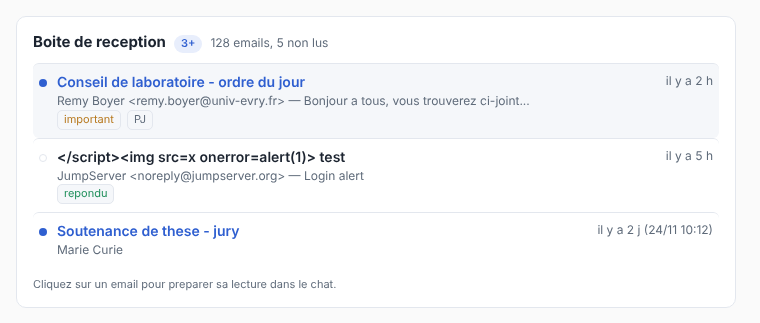
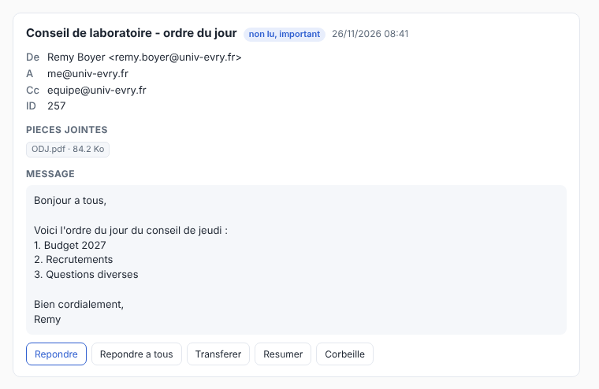
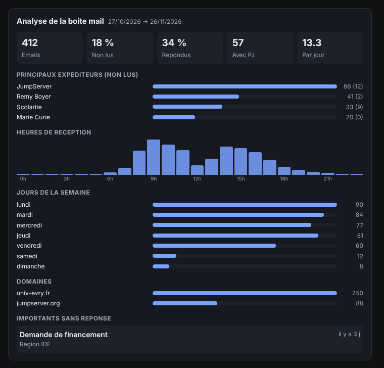
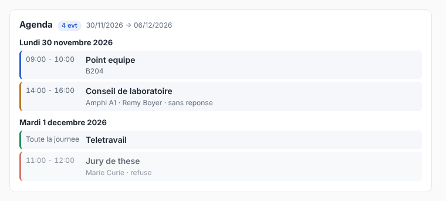
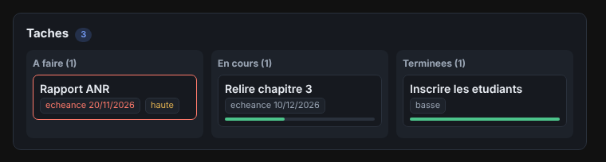
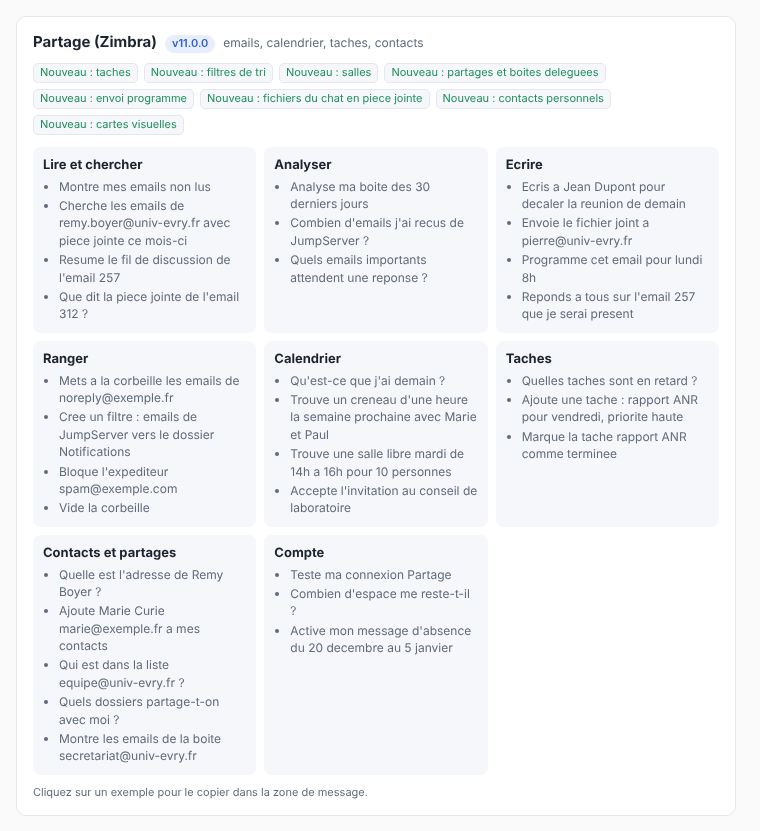

# Partage (Zimbra) for Open WebUI

An Open WebUI Tool that lets the model work in a person's Zimbra mailbox, calendar, task list and address book: Partage (Renater) at Université d'Évry Paris-Saclay, or any Zimbra 8.8+ server with the SOAP API on. Each person connects with their own Partage address and password. The tool asks the person in the browser before it sends anything, deletes anything, or changes their calendar, filters or settings. Results can also appear as visual cards in the chat.

Tested against Open WebUI 0.13.5. It needs Open WebUI 0.13.0 or later, and only `requests`, `pydantic` and `fastapi`, which Open WebUI already ships.

| Inbox | Email | Analytics |
| --- | --- | --- |
|  |  |  |
| **Agenda** | **Tasks** | **Help and what's new** |
|  |  |  |

## Install

1. **Workspace → Tools → +**, paste `partage.py`, save.
2. Open the tool's **Valves** (admin). Check `zimbra_server` and set the rest to match your policy (see below).
3. Turn the tool on for the models that should have it. **Native** function calling works best: it lets the model chain calls, for example `search_contacts` then `compose_email`.
4. Each user opens the tool's **User Valves** (the tool icon under the message box, or **Settings → Tools**), enters their Partage address and password, and saves. The password field is masked.
5. Ask: "Teste ma connexion Partage."

## Features (48 tools)

| Area | Tools | Confirmation |
| --- | --- | --- |
| Read mail | `list_emails`, `search_emails`, `get_email`, `get_conversation`, `read_attachment` | — |
| Analyse | `count_emails`, `mailbox_analytics` | — |
| Send | `compose_email` (now, scheduled, or as a draft; with chat files as attachments, priority, read receipt), `reply_to_email`, `forward_email`, `send_draft` | always (drafts excepted) |
| Organise mail | `delete_emails`, `move_emails`, `mark_emails`, `tag_emails`, `manage_folder`, `empty_folder` | deletes always; others above `bulk_confirmation_threshold` |
| Mail rules | `list_mail_filters`, `create_mail_filter`, `manage_mail_filter`, `manage_sender_lists` | creating, deleting, blocking |
| Calendar | `list_calendars`, `get_calendar_events`, `get_event_details`, `check_availability`, `find_meeting_slots`, `find_rooms` | — |
| Calendar changes | `create_calendar_event` (with room booking), `update_calendar_event`, `cancel_calendar_event`, `respond_to_invitation` | always |
| Tasks | `list_tasks`, `create_task`, `update_task`, `delete_task` | deleting |
| People | `search_contacts` (contacts and university directory), `list_contacts`, `manage_contact`, `get_list_members` | deleting |
| Sharing | `list_shares`, `mount_shared_folder`, and a `mailbox` parameter for reading a delegated mailbox | — |
| Account | `list_folders`, `get_mailbox_info`, `list_identities`, `get_out_of_office`, `set_out_of_office`, `test_connection`, `help` | out-of-office changes |

### New in 11.0

- **Tasks:** list (open, overdue, done), create with a due date, priority, notes and reminder, update or complete, delete.
- **Mail filters:** create sorting rules ("emails from JumpServer go to Notifications"), list them, enable, disable or delete them, and optionally apply a new rule to the inbox.
- **Blocked and allowed senders:** the anti-spam lists, by address or domain.
- **Rooms:** `find_rooms` lists bookable rooms with capacity and shows which are free. `create_calendar_event(room=...)` books one.
- **Shared and delegated access:** see what others share with you, add it to your folders, and read a delegated mailbox (`mailbox="secretariat@univ-evry.fr"`) in mail, calendar, tasks and analytics.
- **Better sending:** files attached in the chat as email attachments, send-later, high or low priority, read receipts, and the user's Partage signature when they haven't typed one.
- **Personal contacts and lists:** create, update and delete contacts, with duplicate detection, and see the members of a distribution list.
- **Visual cards:** inbox, search results, a single email, analytics, agenda, free slots, tasks, quota, and a help card listing what's new. Clicking an item fills in the next question in the message box.

## Visual cards

When a card is shown, the model still gets the full text result. It is told the user can see the card, so it summarises instead of repeating the list.

- **Switching off:** admins turn cards off for everyone with `enable_visual_cards`. Each user can turn them off with the `visual_cards` User Valve. If either is off, the tool returns plain text only.
- **Safety:** each card is a self-contained page. Data goes in as escaped JSON and is written with `textContent` only, never `innerHTML`. A Content-Security-Policy (`default-src 'none'`) blocks every network request, so a hostile email cannot load a tracking pixel or send data out. The cards run in Open WebUI's sandboxed iframe, and they were checked in Chromium with an `` subject (no script ran).
- **Clicks:** clicking an item only pre-fills the message box (`input:prompt`). Nothing is sent until the person presses Enter.
- **Theme:** cards follow Open WebUI's light or dark theme, and the browser's preference when the iframe cannot see the page.

## Security model

| Risk | What the tool does |
| --- | --- |
| Credentials leak | The password lives only in the user's own User Valves, in a masked field. It goes only into `AuthRequest`, and is never logged or shown in errors. Tokens stay in memory, keyed by an HMAC with a per-process secret. |
| Cross-user leakage | Every call has its own context. Pooled HTTP sessions refuse to store cookies, so no Zimbra cookie can pass from one user's request to another's. Caches are keyed per account, and chat files are read only if the caller owns them. |
| Account lockout | After `account.AUTH_FAILED` the tool makes no new login attempt for `auth_failure_cooldown_seconds` (default 90 s). |
| Request bursts | Parallel tool calls from one person share one login, and are capped at `max_parallel_requests_per_user` requests at a time, so they cannot trip Zimbra's DoS filter or slow other users. |
| Model acts without consent | Destructive or outward-facing actions use Open WebUI's classic confirmation modal, and only a literal `true` proceeds. The modal is sent without `tool_call`, so tool auto-approval cannot skip it. Permanent deletion and emptying the trash ask the person to type `SUPPRIMER`. |
| Duplicate sends | An identical email already being sent is refused, which covers the model calling the tool twice in parallel. An identical email sent within `duplicate_send_window_minutes` gets a warning in the confirmation. `SendMsg` and calendar writes are never retried once they may have reached the server. |
| Prompt injection | Bodies, attachments and event descriptions come back between untrusted-content markers. Confirmations show the real recipients, with the body quoted. |
| Data exfiltration | Filters that forward mail elsewhere are off unless `enable_filter_forwarding` is set, and then respect `allowed_recipient_domains`. Delegated mailboxes are read-only in this version. |
| Header injection | Subjects, names and filenames are stripped of control characters. Addresses are parsed and validated. |
| Transport | HTTPS only, TLS verified, optional `ca_bundle_path`, no redirects, no credentials in URLs. Downloads and uploads are size-capped. |

## Edge cases covered

- **The same person in several tabs or parallel tool calls:** one login is shared, requests are capped per user, and an identical email in flight is refused.
- **Many users at once:** caches and limits are per account, and per-account entries are bounded and pruned.
- **Expired or revoked session:** the tool logs in again once and retries. A changed password invalidates the cached token.
- **Slow server:** read requests retry with backoff and honour `Retry-After`. Writes report "unknown outcome" instead of risking duplicates.
- **Huge mailboxes:** results are paged, scans are capped by `max_scan_for_stats` and `max_bulk_operations`, and truncation is always reported.
- **Ambiguous input:** a folder name, an email subject or a contact name that matches several items returns the candidates instead of a guess. An unknown date explains the formats it accepts.
- **Recurring events:** the agenda expands each occurrence. A single occurrence can be cancelled, and edits apply to the whole series.
- **Shared calendars without free/busy rights:** they show as "agenda non consultable" instead of "free".
- **Two filter changes at once:** filter rules are read, changed and written under a per-account lock, so concurrent edits cannot overwrite each other.

## Admin Valves

| Valve | Default | Purpose |
| --- | --- | --- |
| `zimbra_server` | `https://partage.univ-evry.fr` | Server base URL |
| `default_login_domain`, `allowed_login_domains` | empty | Bare-username domain, and who may connect |
| `verify_tls`, `ca_bundle_path`, `allow_insecure_http` | on, empty, off | Transport |
| `connect_timeout`, `request_timeout`, `max_retries`, `retry_backoff_seconds` | 10, 60, 3, 0.75 | Network |
| `token_cache_hours`, `auth_failure_cooldown_seconds` | 8, 90 | Sessions |
| `enable_send`, `enable_delete`, `enable_calendar_write`, `enable_settings_write`, `enable_attachment_reading` | on | Capability switches |
| `enable_visual_cards` | on | Visual cards for everyone |
| `enable_delegated_mailboxes` | on | `mailbox` parameter for shared or delegated mailboxes |
| `enable_filter_forwarding` | off | Filters that redirect mail to another address |
| `use_zimbra_signature` | on | Use the Partage default signature when the user has none |
| `require_confirmation_for_send` / `_delete` / `_events`, `typed_confirmation_for_permanent` | on | Confirmations |
| `bulk_confirmation_threshold` | 20 | Bulk move, mark or tag above this asks first |
| `max_parallel_requests_per_user` | 4 | Concurrency cap per account |
| `duplicate_send_window_minutes` | 10 | Duplicate-send warning window |
| `max_bulk_operations`, `max_scan_for_stats` | 1000, 3000 | Bulk and statistics limits |
| `max_recipients_per_message`, `allowed_recipient_domains` | 100, empty | Sending policy |
| `max_body_chars`, `max_attachment_mb`, `max_upload_mb` | 12000, 10, 25 | Size limits |
| `include_shared_calendars`, `work_day_start`, `work_day_end` | on, 08:30, 18:00 | Calendar |
| `mark_as_read_on_open` | off | Whether `get_email` marks the message read |

User Valves: `zimbra_email`, `zimbra_password`, `zimbra_username` (only if the login differs from the address), `timezone` (IANA, default `Europe/Paris`), `email_signature`, `visual_cards`.

## How it talks to Zimbra

Everything goes through the JSON form of the SOAP API at `/service/soap`, with `nosession`. Request shapes were checked against Zimbra's own client, `@zimbra/api-client` 104. Delegated mailboxes use the SOAP header `account` element, as the official client does. Attachments are downloaded from `/service/home/<mailbox>/` and uploaded to `/service/upload?fmt=raw`, with the auth token as a cookie on that single request.

| Feature | Zimbra requests |
| --- | --- |
| Mail | `SearchRequest`, `GetMsgRequest`, `GetConvRequest`, `SendMsgRequest`, `SaveDraftRequest` (incl. `autoSendTime`), `MsgActionRequest` |
| Folders, tags, shares | `GetFolderRequest`, `CreateFolderRequest`, `FolderActionRequest`, `GetTagRequest`, `CreateTagRequest`, `GetShareInfoRequest`, `CreateMountpointRequest` |
| Calendar | `GetAppointmentRequest`, `CreateAppointmentRequest`, `ModifyAppointmentRequest`, `CancelAppointmentRequest`, `SendInviteReplyRequest`, `GetFreeBusyRequest`, `SearchCalendarResourcesRequest` |
| Tasks | `SearchRequest` (`types=task`), `GetTaskRequest`, `CreateTaskRequest`, `ModifyTaskRequest`, `CancelTaskRequest` |
| Contacts | `AutoCompleteRequest`, `SearchGalRequest`, `CreateContactRequest`, `ModifyContactRequest`, `ContactActionRequest`, `GetDistributionListMembersRequest` |
| Rules | `GetFilterRulesRequest`, `ModifyFilterRulesRequest`, `ApplyFilterRulesRequest`, `GetWhiteBlackListRequest`, `ModifyWhiteBlackListRequest` |
| Account | `AuthRequest`, `GetInfoRequest`, `GetIdentitiesRequest`, `GetSignaturesRequest`, `GetPrefsRequest`, `ModifyPrefsRequest` |

## Known limits

- Accounts that only allow SSO or two-factor login cannot use password authentication.
- Delegated mailboxes (`mailbox=`) are read-only here. Sending as someone else goes through identities you have been granted.
- Send-later needs the Zimbra "send later" feature on the server. If it is off, Zimbra rejects the request and the tool says so.
- `find_rooms` needs rooms to exist as Zimbra location resources.
- Emails are sent as plain text. `update_calendar_event` changes the whole series of a recurring event.

## Tests

```bash
pip install requests pydantic fastapi pytest
pytest -q tools/partage-zimbra/test_partage.py
```

91 tests run against an in-memory fake Zimbra that records every request. They cover request contents, confirmations, retry and no-retry rules, the auth cooldown, concurrency (shared login, per-user cap, parallel identical sends), delegated mailboxes, chat-file ownership, every new feature, cards on and off, escaping of hostile content in cards, and the parsing of dates and search queries. The screenshots come from rendering each card in Chromium inside a sandboxed iframe like Open WebUI's.
